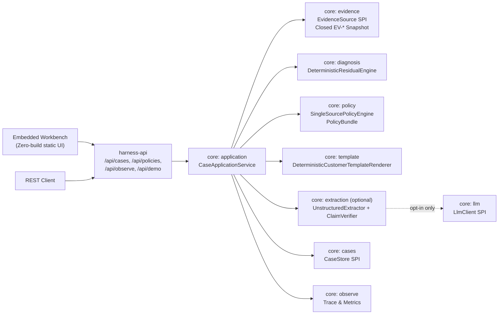

# Delivery Harness Engineering Platform

[简体中文](README.zh-CN.md) | English


[](LICENSE)

An open-source **AI Harness Engineering reference benchmark** for on-demand delivery abnormal-order review and compensation adjudication. It runs out of the box with **zero LLM required** on a deterministic core (three-valued evidence ledger, single-source `PolicyBundle`, residual attribution, deterministic customer templates, and a structured human-decision state machine) and isolates optional LLM usage to the **minimum probabilistic surface**: unstructured conversation signal extraction under strict unidirectional risk routing.

> [!IMPORTANT]
> This repository is an open-source reference implementation and benchmark, not a production delivery or payout system. Built-in fixtures use synthetic data, state is stored in memory, there is no authentication (`operator_id` is explicitly recorded as `unauthenticated_operator_id`), and nothing here executes real payments. Do not expose the application to the public internet or feed real personal/order data into it without authentication, durable storage, and external payment controls.

## Core Design Principles

- **Zero-LLM deterministic core**: Immutable closed `EV-*` evidence snapshots with Java 17 three-valued `sealed interface EvidenceValue<T>` (`Known` / `Unknown` / `Invalid`) and canonical SHA-256 hashing ([ADR-0006](docs/adr/0006-three-valued-evidence-ledger-and-deterministic-snapshots.md)).
- **Single-source `PolicyBundle`**: One versioned, startup-validated JSON bundle (`policy-v1.0.0.json`) owns all compensation rules, intervals, approval threshold, escalation cap, staleness limits, attribution thresholds, and routing matrix ([ADR-0007](docs/adr/0007-single-source-policy-bundle.md)).
- **Deterministic residual diagnosis**: Computes five candidate delay factors (`DISPATCH_WAIT_EXCESS`, `TO_SHOP_EXCESS`, `MERCHANT_PREP_EXCESS`, `WEATHER_EXPLAINED`, and neutral `UNEXPLAINED_ROAD_EXCESS`), preserves negative raw deltas, exposes `MULTI_FACTOR` / `UNDETERMINED` outcomes and evidence gaps honestly, and never assigns automatic liability.
- **Minimum probabilistic surface & unidirectional routing**: Optional LLM extraction (`harness.llm.extraction.enabled=false` by default) extracts only unconfirmed signals (`ClaimedFact`) from IM text, verified deterministically via `ClaimVerifier` (Unicode NFKC, single-message offset binding, metadata `SpeakerRole` self-serving guard, negation window, injection pre-scan). By method signature and bytecode architecture tests, `SingleSourcePolicyEngine` never accepts `ClaimedFact` ([ADR-0005](docs/adr/0005-minimum-probabilistic-surface-and-unidirectional-routing.md)).
- **Human-in-the-loop Case workflow**: Unified `/api/cases` aggregate with optimistic concurrency (`expected_case_version`), `Idempotency-Key` replay, single open case per `(orderId, complaintType)`, human evidence attestation (`EV-HUMAN-*`), over-cap supervisor escalation requiring `exception_reason`, and external execution receipt recording before customer drafts switch to completed wording.
- **Zero-build Single-Case Workbench**: Embedded HTML/CSS/Vanilla JS UI served from `harness-api` with strict `Content-Security-Policy` (`default-src 'self'`), zero `innerHTML` sinks, and zero Node/npm build steps.

The following are intentionally **not** claimed as implemented: autonomous agent planning, production ERP/delivery integrations, durable database persistence, vector/RAG search ([ADR-0003](docs/adr/0003-no-vector-retrieval-at-this-corpus-size.md) retired), authentication/RBAC, rate limiting, distributed tracing, or automatic payment execution. See [Known limitations](#known-limitations).

## Architecture



### Three Core SPIs

To adapt this reference harness to a real delivery backend, replace three interfaces:

1. `com.delivery.harness.evidence.EvidenceSource` — replaces `SyntheticEvidenceSource` to assemble immutable point-in-time (`asOf`) `EvidenceSnapshot` records from real order, ETA, station, and IM systems.
2. `com.delivery.harness.cases.CaseStore` — replaces `InMemoryCaseStore` with durable database storage and transactional optimistic locking.
3. `com.delivery.harness.llm.gateway.LlmClient` — optional OpenAI-compatible transport used only when `harness.llm.extraction.enabled=true`.

## Modules

| Module | Responsibility |
| --- | --- |
| `harness-common` | Three-valued `EvidenceValue<T>`, `EvidenceType`, `OrderTimeline`, `HarnessTimeConfig`, DTOs, exceptions (`BizException`, `ConflictException`, `ResourceNotFoundException`), and trace context. No internal dependencies. |
| `harness-core` | Deterministic core and SPIs: `policy` (`PolicyBundle`, `PolicyBundleValidator`, `SingleSourcePolicyEngine`), `evidence` (`EvidenceSnapshot`, `EvidenceSource`, 13 synthetic contract fixtures), `diagnosis` (`DeterministicResidualEngine`), `template` (`DeterministicCustomerTemplateRenderer`), `cases` (`DeliveryCase`, `AssessmentRun`, `HumanDecision`, `CaseStore`), `application` (`CaseApplicationService`), `extraction` (`ClaimVerifier`, `RegexSignalBaseline`, `UnstructuredExtractor`), `llm`, `observe`, plus offline & live-LLM ablation evaluation utilities. |
| `harness-api` | Executable Spring Boot application: unified REST controllers, validation, `AuditLogFilter` (trace ID + CSP headers), zero-build Single-Case Workbench (`src/main/resources/static/`). |
| `llm-inference` | Optional pinned Ollama container definition and smoke-test script. |

See [ADR-0004](docs/adr/0004-three-maven-modules-instead-of-nine.md) for why the repository keeps three Maven modules.

## Prerequisites

- JDK 17 or newer
- Maven 3.6.3 or newer, or the included Maven Wrapper (`./mvnw`)
- Docker with Compose support — **only** if you opt into running a local Ollama model for live extraction ablation

## Quick start (Zero LLM required)

### 1. Build and verify offline

```bash
./mvnw clean verify
```

### 2. Start the API and Single-Case Workbench in `demo` profile

```bash
./mvnw -pl harness-api -am package
java -jar harness-api/target/harness-api.jar --spring.profiles.active=demo
```

Open `http://127.0.0.1:8080` in your browser to use the embedded Single-Case Workbench with the 13 synthetic contract fixtures.

Without `--spring.profiles.active=demo`, `/api/demo/fixtures` is not mounted (`404`), while `/api/cases` still runs cleanly against known orders and returns `404` for unknown order IDs instead of fabricating fake orders.

### 3. Call the unified Case API

Create and evaluate a case (idempotent via `Idempotency-Key`):

```bash
curl --fail-with-body \
  --request POST \
  --header 'Content-Type: application/json' \
  --header 'Idempotency-Key: demo-req-001' \
  --data '{"order_id":"ORD-MERCHANT-01","complaint_type":"OVERTIME"}' \
  http://127.0.0.1:8080/api/cases
```

Submit human evidence attestation (e.g. for a `DAMAGED` case waiting on `DAMAGE_LEVEL`):

```bash
curl --fail-with-body \
  --request POST \
  --header 'Content-Type: application/json' \
  --data '{"evidence_type":"DAMAGE_LEVEL","value":"PARTIAL","operator_id":"reviewer-01","expected_case_version":1}' \
  http://127.0.0.1:8080/api/cases/{caseId}/attestations
```

Submit a structured human decision bound to the latest `run_id` and `expected_case_version`:

```bash
curl --fail-with-body \
  --request POST \
  --header 'Content-Type: application/json' \
  --data '{"run_id":"RUN-1","expected_case_version":1,"action":"ACCEPT","operator_id":"reviewer-01"}' \
  http://127.0.0.1:8080/api/cases/{caseId}/decisions
```

Record an external execution receipt (required before customer communication wording switches to "completed"):

```bash
curl --fail-with-body \
  --request POST \
  --header 'Content-Type: application/json' \
  --data '{"run_id":"RUN-1","expected_case_version":2,"action":"RECORD_EXECUTION_RECEIPT","operator_id":"ops-01","external_receipt_id":"PAY-20260901-0001"}' \
  http://127.0.0.1:8080/api/cases/{caseId}/decisions
```

Every response uses the `HarnessResponse` envelope (`{ code, message, data, traceId }`) and mirrors `traceId` in the `X-Trace-Id` header.

### Release artifacts

Tagged releases publish the runnable `harness-api` fat JAR and a SHA-256 checksum as GitHub Release assets. This is a 0.x release: the HTTP surface and response fields may change without a major-version bump. Pin a tag if you depend on the response shape.

## API surface

| Method | Path | Purpose |
| --- | --- | --- |
| `GET` | `/` (`/index.html`) | Embedded zero-build Single-Case Workbench |
| `POST` | `/api/cases` | Create and evaluate a case (`Idempotency-Key` supported; unknown `order_id` returns `404`; duplicate open case returns `409`) |
| `GET` | `/api/cases` | List recent cases (`limit` 1..200) |
| `GET` | `/api/cases/{caseId}` | Fetch a case with its immutable snapshot, runs, and decisions |
| `POST` | `/api/cases/{caseId}/attestations` | Append a human-attested `EV-HUMAN-*` evidence record and trigger a fresh `AssessmentRun` |
| `POST` | `/api/cases/{caseId}/decisions` | Submit a structured `HumanDecision` (`ACCEPT`, `OVERRIDE`, `REQUEST_EVIDENCE`, `ESCALATE`, `RETURN_TO_REVIEW`, `APPROVE`, `REJECT_CLOSE`, `RECORD_EXECUTION_RECEIPT`, `CLOSE`, `REOPEN`) |
| `GET` | `/api/policies/active` | Inspect the active validated `PolicyBundle`, SHA-256 hash, and rendered rule descriptions |
| `GET` | `/api/observe/traces/{traceId}` | Read a recorded trace |
| `GET` | `/api/observe/traces` | List recent traces (`limit` 1..100) |
| `GET` | `/api/observe/metrics` | Read in-memory operational counters and timings |
| `GET` | `/api/demo/fixtures` | List the 13 synthetic contract fixtures (mounted **only** when `--spring.profiles.active=demo`) |

## Configuration

Copy `.env.example` for a local reference. Spring reads the following environment variables directly:

| Variable | Default | Description |
| --- | --- | --- |
| `SERVER_ADDRESS` | `127.0.0.1` | Bind address; set `0.0.0.0` only in an intentionally isolated deployment |
| `SERVER_PORT` | `8080` | API and Workbench port |
| `HARNESS_LLM_EXTRACTION_ENABLED` | `false` | Opt-in toggle for optional LLM IM signal extraction (disabled by default) |
| `HARNESS_LLM_ENDPOINT` | `http://localhost:11434` | OpenAI-compatible base URL (used only when extraction is enabled) |
| `HARNESS_LLM_MODEL` | `qwen2.5:7b` | Model name for optional extraction / live ablation |
| `HARNESS_LLM_API_KEY` | empty | Optional bearer token; never commit a real value |
| `HARNESS_LLM_TIMEOUT_SECONDS` | `15` | Model read timeout (aligned with `application.yml`) |
| `HARNESS_MAX_CASES` | `500` | Capacity bound of the in-memory `CaseStore` |
| `HARNESS_MAX_TRACES` | `500` | Size of the in-memory trace ring |

Policy limits (`approvalThreshold`, `escalationCap`, intervals, staleness limits, and attribution thresholds) live exclusively in [`policy-v1.0.0.json`](harness-core/src/main/resources/policy/policy-v1.0.0.json) — there are no duplicate environment-variable caps.

## Testing & Live-LLM Ablation

Run the full offline test suite, architecture boundary guards, XSS/CSP checks, format check, and JaCoCo coverage gate:

```bash
./tools/check-format.sh
./mvnw clean verify
```

The offline suite contains **76 tests** (`harness-common`: 9, `harness-core`: 55, `harness-api`: 12) and requires no Ollama or Docker daemon. Key guarantees enforced in tests:

- Bytecode architecture guards (`ArchitectureGuardTest`, `ApiArchitectureGuardTest`) verify `com.delivery.harness.policy` never references `extraction` or `llm`, `evidence` never leaks test labels, and controllers stay clean.
- `OfflineAblationSmokeTest` evaluates the deterministic ~20-line `RegexSignalBaseline` against the frozen hand-crafted `dev`/`holdout` IM corpus via an independent scorer (`IndependentEvalScorer`) and generates a pipeline-smoke report explicitly tagged `PIPELINE_SMOKE_ONLY`.
- `WorkbenchStaticTest` verifies strict CSP headers and zero `innerHTML`/inline-script sinks in the static UI.

### Optional: Run Live-LLM Ablation (CLI)

To benchmark a real OpenAI-compatible model (e.g. local Ollama `qwen2.5:7b`) head-to-head against the deterministic regex baseline on the frozen holdout set (`@Tag("live-llm")`, excluded from offline CI):

```bash
docker compose up -d ollama
docker compose exec ollama ollama pull qwen2.5:7b
HARNESS_LLM_MODEL=qwen2.5:7b ./llm-inference/smoke-test.sh

HARNESS_LLM_ENDPOINT=http://localhost:11434 \
HARNESS_LLM_MODEL=qwen2.5:7b \
./mvnw -pl harness-core test -Dgroups=live-llm -Dtest=LiveLlmAblationReportTest
```

The Markdown report is written to `harness-core/target/ablation-report-live.md` and includes the [ADR-0005](docs/adr/0005-minimum-probabilistic-surface-and-unidirectional-routing.md) exit criterion: if an LLM does not beat the regex baseline on holdout F1 with zero false-positive exemption signals, leave `harness.llm.extraction.enabled=false`.

## Architecture Decision Records

See [`docs/adr/README.md`](docs/adr/README.md) for the complete index:

- [ADR-0001](docs/adr/0001-delete-unreachable-code-before-adding-features.md) — Delete unreachable code before adding features
- [ADR-0002](docs/adr/0002-rule-engine-owns-the-compensation-amount.md) — Rule engine owns the compensation amount (amended by ADR-0005)
- [ADR-0003](docs/adr/0003-no-vector-retrieval-at-this-corpus-size.md) — No vector retrieval at this corpus size *(Retired)*
- [ADR-0004](docs/adr/0004-three-maven-modules-instead-of-nine.md) — Three Maven modules instead of nine
- [ADR-0005](docs/adr/0005-minimum-probabilistic-surface-and-unidirectional-routing.md) — Minimum probabilistic surface and unidirectional LLM routing
- [ADR-0006](docs/adr/0006-three-valued-evidence-ledger-and-deterministic-snapshots.md) — Three-valued evidence ledger and deterministic snapshots
- [ADR-0007](docs/adr/0007-single-source-policy-bundle.md) — Single-source `PolicyBundle` owns all policy parameters

## Security and data handling

- **No authentication or RBAC**: `operator_id` on attestation and decision endpoints is caller-supplied and explicitly tagged as `unauthenticated_operator_id`. Put an authenticating gateway/IdP in front of the service before any shared deployment.
- **No automatic payout execution**: `APPROVED_PENDING_EXECUTION` only records approval intent; an external execution receipt must be posted via `RECORD_EXECUTION_RECEIPT` before customer drafts use completed wording.
- **Prompt-injection trust boundary**: IM messages are untrusted text. `UnstructuredExtractor` runs a deterministic pre-scan, `ClaimVerifier` verifies offsets/quotes/metadata speaker roles, and `SingleSourcePolicyEngine` is architecturally isolated from extracted claims.
- **Strict frontend CSP & zero `innerHTML`**: Static UI assets enforce `default-src 'self'; script-src 'self'; style-src 'self'; object-src 'none'; base-uri 'self'` and render exclusively via `textContent` / DOM text nodes.
- Review [SECURITY.md](SECURITY.md) before reporting a vulnerability or deploying a derivative.

## Known limitations

- `SyntheticEvidenceSource` returns deterministic synthetic contract fixtures rather than calling live delivery systems.
- `InMemoryCaseStore`, traces, and metrics are bounded in-memory stores cleared on restart; no database persistence layer is bundled.
- `operator_id` is unauthenticated (`unauthenticated_operator_id`); supervisor approval (`APPROVE`) enforces workflow state and `exception_reason` rules but does not verify caller roles.
- The offline IM evaluation corpus is a small frozen hand-crafted benchmark (`dev` + `holdout`) meant for honest regression and ablation comparison — real production accuracy claims require a labelled sample from production traffic.
- No live-LLM accuracy or latency numbers are claimed in this README; run `LiveLlmAblationReportTest` against your target model to measure them directly.

## Contributing

Contributions are welcome. Read [CONTRIBUTING.md](CONTRIBUTING.md), follow the [Code of Conduct](CODE_OF_CONDUCT.md), and use [SECURITY.md](SECURITY.md) for security-sensitive reports.

## License

The source code is licensed under the [MIT License](LICENSE). Downloaded model weights and third-party services retain their own licenses; see [THIRD_PARTY_NOTICES.md](THIRD_PARTY_NOTICES.md).
