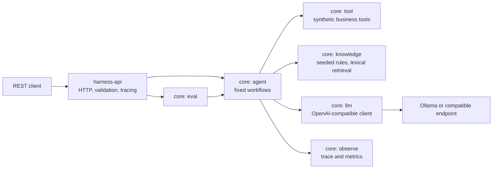

# Delivery Harness Engineering Platform

[简体中文](README.zh-CN.md) | English


[](LICENSE)

An AI harness reference implementation for on-demand delivery operations. It combines deterministic workflows, mock business tools, lightweight knowledge retrieval, an OpenAI-compatible model endpoint, evaluation scaffolding, and human-review guardrails.

> [!IMPORTANT]
> This repository is an educational MVP, not a production-ready delivery or compensation system. Business tools use synthetic data, most state is held in memory, and model output is advisory. Do not expose the application to the public internet, submit real personal/order data, or execute compensation decisions without authentication, policy enforcement, and human approval.

## What is implemented

- Two synchronous workflows: abnormal-order analysis and compensation suggestion.
- Four locally registered tools for orders, ETA, station capacity, and compensation rules. Every tool derives its result from its arguments.
- Synthetic orders that vary by order ID across six named scenarios, including one delivered on time.
- A deterministic timeline that splits an order into dispatch wait, to-shop, merchant prep, and on-road legs, reported alongside the model's answer as the baseline it has to beat.
- Compensation amounts decided by the rule engine, never by the model ([ADR-0002](docs/adr/0002-rule-engine-owns-the-compensation-amount.md)).
- OpenAI-compatible chat-completions client behind an interface, so workflows are testable without a model.
- In-memory document ingestion, text chunking, lexical retrieval scored by query-term overlap, and a rule and case base seeded at startup.
- In-memory evaluation runs whose scorers report "not measured" rather than a perfect score when a case declares no expectation.
- Request trace IDs, per-step durations, a bounded trace store, per-scenario metrics, feedback storage, and advisory output checks.
- Completed workflows with an unavailable optional dependency are reported as `DEGRADED`; the deterministic result remains available and the affected step is recorded as failed.
- A local Ollama profile, regression tests, Maven Wrapper, and GitHub Actions CI.

The following are intentionally **not** claimed as implemented: autonomous agent planning, production tool integrations, production-validated persistence, vector embeddings/Milvus RAG, organization-validated identity integration, production quotas, distributed tracing, or automatic compensation execution. See [Known limitations](#known-limitations).

### Trusted decision semantics (breaking changes)

Timeline calculations retain seconds. Missing endpoints and reversed timestamps
remain unknown in the trusted output; they cannot establish a zero-duration leg
or compensation eligibility. Positive subminute delays count as late; legacy
minute counters remain integers. Model citations are checked against the exact
evidence and policy snapshot. Customer messages are generated by the server
from the authoritative decision and review state.

When only the model is unavailable, a usable deterministic result returns HTTP
200 with `DEGRADED` instead of HTTP 502. Clients must inspect status and evidence
validation; missing policy or facts never become an approved compensation.
Compensation methods use canonical enum IDs, and refund amounts cannot exceed
the verified refundable balance. Legacy `suggested_amount` may remain a candidate;
`authoritative_amount` stays null until the required facts establish a decision.
Configure the single approval threshold with
`HARNESS_REVIEW_APPROVAL_THRESHOLD` / `harness.review.approval-threshold` (default
`10.00`); the old `harness.compensation.approval-threshold` property is replaced.
See [ADR-0005](docs/adr/0005-trusted-workflow-output-contract.md).

### Model call boundary

A model call has one deadline covering upload, headers, response body and retries.
Response bytes stop at 1 MiB; cancellation interrupts pending calls. Versioned
runtime bindings permit at most two retries for connection/timeout failures and
HTTP 429/502/503/504, within the original deadline; legacy calls do not retry.
Pilot requires an explicit `HARNESS_LLM_ALLOWED_HOSTS` allowlist and HTTPS
(explicit loopback HTTP is allowed for tests). Redirects are rejected. Code-owned
constraints remain system messages; configurable task prompts have lower priority.

### Indexed storage foundation

Platform records and audit events use JDBC and core-owned Flyway migrations.
Material bodies are separated from indexed metadata. Read helpers do not commit;
writes and audit events share one transaction with optimistic version checks.
Audit ordering uses timestamps and event IDs, with scoped SQL pagination.
The default H2 database is an in-memory demonstration; configure
`HARNESS_DATABASE_URL`, username and password for a durable deployment.
PostgreSQL drivers are included, but H2 migration tests do not certify a real
PostgreSQL deployment. See [ADR-0006](docs/adr/0006-indexed-metadata-and-separated-material-content.md).

### Trusted decision semantics (breaking changes)

Timeline calculations retain seconds. Missing endpoints and reversed timestamps
remain unknown in the trusted output; they cannot establish a zero-duration leg
or compensation eligibility. Positive subminute delays count as late; legacy
minute counters remain integers. Model citations are checked against the exact
evidence and policy snapshot. Customer messages are generated by the server
from the authoritative decision and review state.

When only the model is unavailable, a usable deterministic result returns HTTP
200 with `DEGRADED` instead of HTTP 502. Clients must inspect status and evidence
validation; missing policy or facts never become an approved compensation.
Compensation methods use canonical enum IDs, and refund amounts cannot exceed
the verified refundable balance. Legacy `suggested_amount` may remain a candidate;
`authoritative_amount` stays null until the required facts establish a decision.
Configure the single approval threshold with
`HARNESS_REVIEW_APPROVAL_THRESHOLD` / `harness.review.approval-threshold` (default
`10.00`); the old `harness.compensation.approval-threshold` property is replaced.
See [ADR-0005](docs/adr/0005-trusted-workflow-output-contract.md).

### Model call boundary

A model call has one deadline covering upload, headers, response body and retries.
Response bytes stop at 1 MiB; cancellation interrupts pending calls. Versioned
runtime bindings permit at most two retries for connection/timeout failures and
HTTP 429/502/503/504, within the original deadline; legacy calls do not retry.
Pilot requires an explicit `HARNESS_LLM_ALLOWED_HOSTS` allowlist and HTTPS
(explicit loopback HTTP is allowed for tests). Redirects are rejected. Code-owned
constraints remain system messages; configurable task prompts have lower priority.

### Explicit API identity (breaking change)

Every `/api/**` request needs an explicit bearer. Local demo offers
`demo-agent-token`, `demo-reviewer-token`, `demo-supervisor-token`,
`demo-admin-token` and `demo-publisher-token` with separate roles. Blank
`HARNESS_DEMO_IDENTITIES` selects these public synthetic identities; `[]`
disables them. Demo also checks literal Host/Origin allowlists.

Pilot uses signed OIDC JWTs with issuer, audience, tenant, role and scope
validation; it rejects demo credentials and returns 410 for authenticated v1
requests. Configure `HARNESS_OIDC_ISSUER`, `HARNESS_OIDC_AUDIENCE`,
`HARNESS_OIDC_JWK_SET_URI` and the browser allowlists for your deployment.
Local JWT tests do not certify your IdP integration or permission grants.
See [ADR-0009](docs/adr/0009-oidc-identities-and-local-demo-access.md).

### Read-only order source

V2 can use a read-only pilot adapter with explicit endpoint/host configuration.
Its ten-second deadline covers response headers and body, with a 1 MB streaming
limit and no redirects or synthetic fallback. Refundable balance is explicit:
missing is unknown, zero is a known zero, and invalid precision or excess over
order amount is rejected. Local demo continues to use synthetic fixtures.
`GET /api/v2/adapters/status` returns metadata without probing orders or secrets.

### Cases, evidence and independent review

V2 case queues apply status, exact order/assignee, risk, complaint, city and
station filters in SQL before pagination. Material bodies remain separate from
metadata. Typed bounded requests reject invalid input before writes.
Case creators and decision authors cannot claim, approve or receive their own
review; missing legacy authorship requires a fresh analysis. Export uses
`POST /api/v2/cases/{id}/export`, records an audit receipt and executes no payment;
GET returns 405. See [ADR-0007](docs/adr/0007-independent-case-and-decision-reviewers.md).

### Durable execution queue

V2 analysis freezes order evidence and runtime inputs before enqueueing.
Idempotency, bounded capacity, fencing and absolute deadlines guard durable
execution state. Heartbeat, deadline and recovery schedulers are independent;
completion locks the execution row to avoid normal heartbeat conflicts.
Recovery advances a bounded global cursor across tenants and active tasks.
Decisions record the submitting identity and remain advisory, NOT_EXECUTED.
See [ADR-0008](docs/adr/0008-durable-queue-with-independent-schedulers.md).

### Lightweight record lists

Record list queries read explicit metadata projections rather than frozen
runtime bundles. Updates persist the full record and its summary atomically;
V8/V9 migrate and backfill existing rows. Summary projections preserve the
policy, knowledge and evidence scopes needed for authorization, and exclude
prompt/document bodies. Details require separate authorized reads. See
[ADR-0010](docs/adr/0010-explicit-record-list-projections.md).

### Versioned policy publication

V2 policy candidates validate canonical compensation methods, formulas,
amount bounds, currency and effective windows. Publication requires another
identity; the creator cannot publish their own version. Published rules are
immutable, and demo defaults are seeded at startup rather than GET requests.
Pilot starts without synthetic policy seeds. Policy lists use summaries;
fetch an authorized version detail to read its rules. This workflow authorizes
advisory policy use and executes no funds.

### Reviewed knowledge versions

Knowledge ingestion creates scoped candidates with content hashes and versioned
chunks. Another identity validates publication; published content cannot be
edited in place. Search/citation reads preserve tenant and scope boundaries and
return exact version/hash references. Knowledge is prompt-injection-sensitive
reference data, never authority to change system instructions or payment rules.
Lists contain metadata; authorized version details contain the source text.

### Frozen runtime configurations

Runtime versions freeze policy/knowledge/model/task settings and their hashes.
Publication requires an independent identity and matching passing evaluation
evidence. Pilot execution fails closed without a published version. One bundle
is limited to 512 KiB. Configuration visibility includes every embedded knowledge
scope as well as policy scope; a broad policy cannot expose a restricted document.
Lists return scope-preserving metadata, and authorized detail reads return the
full immutable bundle. Deterministic mode requires no provider request.

### Reproducible structured evaluation (breaking score contract)

V2 evaluations freeze datasets, runtime bundles and scorer hashes, compare
exact expected fields against a deterministic baseline, and mark missing labels
NOT_MEASURED. These scores must not be compared with legacy lexical scores.
Blind datasets require reviewed labels; execution completion alone cannot pass
the publication gate. Scope checks cover runtime knowledge and every sample.
Restarted runs fail explicitly with frozen-snapshot retry guidance. GET does not
seed defaults; synthetic evaluation datasets are initialized only in demo startup.

### Verified feedback lifecycle

Structured feedback binds the exact case, decision version, evidence and
runtime. Case scope authorization is unconditional, including detail reads.
Another identity verifies a correction before it can become an evaluation
label. Confirmed feedback can link a fix and a passing frozen regression run;
raw votes never become blind-set ground truth. List summaries omit corrections;
`GET /api/v2/feedback/{id}` requires authorization to view the full correction.

### Scoped operations and audit

Operations metrics count scoped rows in SQL and sample at most 1,000 explicit
execution summaries for latency/cost. Costs remain unknown unless amount,
currency and price version are all known; different groups are never combined.
Audit uses an opaque timestamp/event-ID cursor with SQL scope filtering.
These are execution observations, not decision-accuracy or business-effect claims.

### Advisory exceptions

A supervisor may propose a bounded, evidenced exception; another authorized
supervisor must review it. REFUND still needs verified refundable balance,
nonmonetary RESEND uses zero and all amounts respect the configured ceiling.
The typed amount is a JSON number. Approval remains advisory/NOT_EXECUTED.
The five public demo identities include one supervisor; a complete exception
review needs a second separately configured supervisor identity, as in pilot.
No payment channel, ledger, callback or irreversible deletion is included.

### Generated API contract

Authenticated `GET /api/v2/openapi` generates the contract from real routes and
DTO constraints; tests export `harness-api/target/generated-api/openapi.v2.json`
and check route/schema consistency. See [v2 migration notes](docs/api/v2.md).
No handwritten OpenAPI snapshot is maintained.

## Architecture



All workflow steps run synchronously in the gateway process. Apart from the configured model endpoint, the default application has no required external services.

## Modules

| Module | Responsibility |
| --- | --- |
| `harness-common` | DTOs, exceptions, JSON/text helpers, and trace context. No internal dependencies. |
| `harness-core` | Everything that decides something: `agent` (workflows, timeline, guardrails, formatting), `tool` (synthetic business tools), `llm` (model routing and transport), `knowledge` (seeded rules and cases, lexical retrieval), `eval` (cases, runs, scorers), `observe` (traces, metrics, feedback). |
| `harness-api` | Executable Spring Boot application: controllers, validation, exception mapping, request tracing. |
| `llm-inference` | Pinned Ollama container definition and smoke-test script. |

Java packages are unchanged — `com.delivery.harness.{agent,tool,llm,knowledge,eval,observe}` still exist and still mean the same thing. Only the Maven build boundary moved; see [ADR-0004](docs/adr/0004-three-maven-modules-instead-of-nine.md).

## Prerequisites

- JDK 17 or newer
- Maven 3.6.3 or newer, or the included Maven Wrapper
- Docker with Compose support, only when running Ollama in a container
- Enough memory for the model you choose; `qwen2.5:7b` is the default example

## Quick start

### 1. Start a local model

If Ollama already runs on your machine, skip the first command.

```bash
docker compose up -d ollama
docker compose exec ollama ollama pull qwen2.5:7b
```

The Compose port binds to `127.0.0.1` only. Model weights are downloaded separately and are not part of this repository or its MIT license.

### 2. Build and test

```bash
./mvnw clean verify
```

### 3. Run the API

```bash
./mvnw -pl harness-api -am package
java -jar harness-api/target/harness-api.jar
```

The API listens on `http://localhost:8080` by default.

### Release artifacts

Tagged releases publish the runnable `harness-api` fat JAR and a SHA-256
checksum as GitHub Release assets. This is a 0.x release: the HTTP surface
and response fields may change without a major-version bump. Pin a tag if you
depend on the response shape.

### 4. Call a workflow

```bash
curl --fail-with-body \
  -H 'Authorization: Bearer demo-agent-token' \
  --request POST \
  --header 'Content-Type: application/json' \
  --data '{"order_id":"DEMO-001"}' \
  http://localhost:8080/api/v1/analyze/abnormal-order
```

Compensation suggestion:

```bash
curl --fail-with-body \
  -H 'Authorization: Bearer demo-agent-token' \
  --request POST \
  --header 'Content-Type: application/json' \
  --data '{"order_id":"DEMO-002","complaint_type":"OVERTIME"}' \
  http://localhost:8080/api/v1/analyze/compensation
```

For `DAMAGED` complaints, pass `"damage_level":"FULL"` or
`"damage_level":"PARTIAL"`. Without evidence, the policy returns zero and
requires manual review; the rule engine, not the model, remains authoritative.

Every response uses an envelope similar to:

```json
{
  "code": 0,
  "message": "success",
  "data": {
    "executionId": "...",
    "traceId": "...",
    "status": "SUCCESS",
    "steps": []
  },
  "traceId": "..."
}
```

The same trace ID is returned in the `X-Trace-Id` response header.

## API surface

| Method | Path | Purpose |
| --- | --- | --- |
| `POST` | `/api/v1/analyze/abnormal-order` | Run abnormal-order analysis |
| `POST` | `/api/v1/analyze/compensation` | Generate a compensation suggestion |
| `POST` | `/api/v1/knowledge/ingest` | Ingest and chunk an in-memory document |
| `POST` | `/api/v1/knowledge/search` | Search in-memory rules, documents, and cases |
| `POST` | `/api/v1/eval/cases` | Add an in-memory evaluation case |
| `GET` | `/api/v1/eval/cases` | List evaluation cases |
| `POST` | `/api/v1/eval/run` | Run selected cases synchronously |
| `GET` | `/api/v1/eval/run/{runId}` | Read an evaluation run |
| `GET` | `/api/v1/eval/run/{runId}/results` | Read evaluation results |
| `GET` | `/api/v1/observe/trace/{traceId}` | Read a recorded trace, when populated |
| `GET` | `/api/v1/observe/traces` | List recorded traces, when populated |
| `GET` | `/api/v1/observe/metrics` | Read in-memory metrics, when populated |
| `POST` | `/api/v1/observe/feedback` | Store feedback in memory |
| `GET` | `/api/v1/observe/feedback` | List in-memory feedback |

## Configuration

Copy `.env.example` if you want a local reference. Spring reads the following environment variables directly:

| Variable | Default | Description |
| --- | --- | --- |
| `SERVER_ADDRESS` | `127.0.0.1` | Bind address; set `0.0.0.0` only for an intentionally isolated remote/container deployment |
| `SERVER_PORT` | `8080` | API port |
| `HARNESS_LLM_ENDPOINT` | `http://localhost:11434` | OpenAI-compatible base URL |
| `HARNESS_LLM_MODEL` | `qwen2.5:7b` | Default model name |
| `HARNESS_LLM_API_KEY` | empty | Optional bearer token; never commit a real value |
| `HARNESS_LLM_TIMEOUT_SECONDS` | `120` | Model read timeout |
| `HARNESS_MAX_COMPENSATION_AMOUNT` | `50.0` | Advisory maximum amount check |

Additional Spring properties, settable in `application.yml` or as `--property=value`:

| Property | Default | Description |
| --- | --- | --- |
| `harness.review.approval-threshold` | `10.0` | Payouts at or above this value require a human approver |
| `harness.knowledge.seed.enabled` | `true` | Load the synthetic rule and case base at startup |
| `harness.eval.seed.enabled` | `true` | Load the starter evaluation cases at startup |
| `harness.observe.max-traces` | `500` | Size of the in-memory trace ring |
| `harness.observe.max-feedback` | `1000` | Maximum in-memory feedback records |
| `harness.observe.max-tool-invocations` | `2000` | Maximum recent tool invocation records |
| `harness.eval.max-cases` | `1000` | Maximum in-memory evaluation cases |
| `harness.eval.max-runs` | `200` | Maximum retained in-memory evaluation runs |
| `harness.knowledge.max-documents` | `1000` | Maximum in-memory knowledge documents |
| `harness.knowledge.max-chunks` | `5000` | Maximum in-memory knowledge chunks |

Run the model smoke test after installing the configured model:

```bash
HARNESS_LLM_MODEL=qwen2.5:7b ./llm-inference/smoke-test.sh
```

## Testing

```bash
./mvnw clean verify
```

Unit and API regression tests cover both workflows. Both workflows are covered end to end against a stub model transport, so no test requires Ollama or a Docker daemon. The load-bearing test is `buildsDifferentEvidenceForDifferentOrders`: it asserts that two different orders produce two different prompts, which is the property every other measurement depends on. CI runs the same Maven verification on every push and pull request.

## Security and data handling

- APIs require explicit bearer identities and enforce tenant/role/scope. Anonymous failures use bounded throttling. Organizational permission grants and production quota policy require deployment review.
- Tool data and addresses are synthetic examples; do not replace them with real personal data in a public deployment.
- Ingested documents can influence prompts. Treat knowledge ingestion as a prompt-injection trust boundary.
- The advisory checker detects a small set of phrases and amount conditions; it is not a policy engine.
- Most in-memory stores are demonstration components and are cleared on restart; traces and feedback have explicit capacity limits, while evaluation and knowledge stores still need lifecycle governance.
- Review [SECURITY.md](SECURITY.md) before reporting a vulnerability or deploying a derivative.

## Known limitations

- Tool implementations return synthetic data rather than calling delivery systems. The data varies with its arguments, which makes the pipeline testable — it does not make it accurate.
- Retrieval is lexical term overlap, not semantic search. CJK text is split on whitespace and punctuation rather than segmented, so recall depends on the query and the rule sharing a phrase ([ADR-0003](docs/adr/0003-no-vector-retrieval-at-this-corpus-size.md)).
- Rules, documents, cases, evaluations, feedback, metrics, and traces are not durable and are lost on restart.
- The evaluation scorers are lexical and are calibrated to catch regressions, not to certify quality. Six synthetic cases cannot establish accuracy; a real claim needs a labelled set drawn from production traffic.
- `modelVersion` and `promptVersion` on an evaluation run are recorded metadata labels; they do not yet select a model or mutate the workflow prompt. Pin those inputs through deployment configuration when comparing runs.
- `needs_human_review` and `approval_required` are derived from guardrail outcome, parse success, model confidence and baseline agreement. This is reporting, not authority: nothing here executes a payment.
- Guardrails report pass/fail in workflow steps and the final output, but do not replace human review.
- JDBC/Flyway provides the platform storage foundation. Legacy workflow knowledge, evaluation and trace stores still use memory; a configured PostgreSQL deployment requires its own migration and restore validation.

## Roadmap

- Validate organization IdP onboarding, revocation, key rotation and production quotas.
- Replace mock tools with versioned adapters and contract tests.
- Add durable repositories and migrations behind explicit profiles.
- Persist traces, metrics, feedback, and audit events with retention limits.
- Introduce typed workflow outputs, stronger policy enforcement, and redaction.
- Build a labelled evaluation set from real abnormal orders and measure top-1 attribution accuracy against the deterministic baseline. If the model does not beat that baseline, the model is not earning its place in the attribution path.
- Bind evaluation model/prompt versions to immutable runtime configuration so a run can be reproduced from its recorded metadata.
- Measure reviewer handling time before and after. Without it, the system cannot demonstrate that it saves anything.
- Embedding generation and vector retrieval are deliberately **not** on this roadmap at the current corpus size; see [ADR-0003](docs/adr/0003-no-vector-retrieval-at-this-corpus-size.md) for the conditions that would reopen it.

## Contributing

Contributions are welcome. Read [CONTRIBUTING.md](CONTRIBUTING.md), follow the [Code of Conduct](CODE_OF_CONDUCT.md), and use [SECURITY.md](SECURITY.md) for security-sensitive reports.

## License

The source code is licensed under the [MIT License](LICENSE). Downloaded model weights and third-party services retain their own licenses; see [THIRD_PARTY_NOTICES.md](THIRD_PARTY_NOTICES.md).
