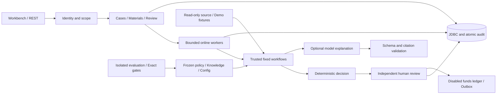

# Delivery Harness

[简体中文](README.zh-CN.md) | English

A decision workbench for delivery incidents and customer complaints. It freezes order evidence, independently verified materials, policy and actual runtime configuration; deterministic rules decide money, optional models explain facts, and people approve changes.

[Product PRD](docs/prd/delivery-harness-product-prd.md) · [Implementation and acceptance map](docs/implementation/delivery-harness-prd-implementation.md) · [v2 API](docs/api/v2.md) · [Operations runbook](docs/operations/pilot-runbook.md)

## Implemented

- Browser workbench for cases, timelines, evidence, independent verification, asynchronous analysis, review/reassignment/exceptions/closure, policy/knowledge versions, evaluation, configuration and audit.
- Explicit demo/pilot modes, trusted server identities, tenant/city/station authorization, fail-closed pilot startup and no legacy synthetic bypass.
- Second-precision nullable timelines, versioned policy validation, exact monetary rules and immutable evidence; missing policy or unverified damage cannot become a determined zero-payment decision.
- Nested output and citation ID/type/value/unit/version validation; model confidence cannot authorize facts, amounts or payment. Verified customer messages come from deterministic server templates.
- JDBC/Flyway records and atomic business audit, optimistic concurrency, immutable snapshots, retention holds and independently approved reference-aware deletion plans.
- Bounded fair online workers, tenant quotas, idempotency, cancellation, deadlines, leases and fenced recovery; evaluation uses separate workers.
- Independent policy and knowledge publication, atomic chunks, exact rule-ID and Chinese lexical search, scope/withdrawal filtering and historical citations.
- Actual prompt/model/parameters/policy/knowledge binding; labelled exact evaluation gates, independent runtime publication, scope/scenario rollout and rollback routing.
- Frozen datasets, asynchronous evaluations, stored-output rescoring and comparisons; exact cents, rule precision/recall/exact-match, NOT_MEASURED and structured feedback through verified regression.
- Configured read-only HTTP order contract adapter, explicit upstream errors/schema drift, no fixture fallback; unavailable historical ETA/capacity remains unknown.
- Model endpoint allowlists, bounded retries/budgets, provider usage and versioned pricing; unknown tokens and costs are never reported as zero.
- Separately disabled funds extension with dedicated roles, approved snapshots, fresh channel eligibility, cumulative reservations, durable outbox, provider idempotency, signed callbacks and reconciliation. Demo never moves real money.

These are executable capabilities and local regression evidence. Real identity operations, policy sign-off, production source/payment integration, PostgreSQL recovery drills, capacity and business-effectiveness experiments require an actual pilot environment. Synthetic tests do not certify a production deployment.

## Quick start

Use JDK 17+ and the included Maven Wrapper. The default demo runtime is deterministic and needs neither Ollama nor Docker.

```bash
./mvnw clean verify
cp .env.example .env
set -a
source .env
set +a
export HARNESS_BUILD_GIT_SHA=$(git rev-parse HEAD)
java -jar harness-api/target/harness-api.jar
```

Open [the local workbench](http://127.0.0.1:8080/workbench/). Create a DEMO-002 OVERTIME case, generate the rule decision, inspect its CNY20 amount and evidence, claim and review it. Approval leaves compensation unexecuted. `.env.example` configures a second `demo-reviewer` identity for independent verification/publication; enter it in the workbench credential dialog. Default H2 memory storage resets on shutdown; file storage and PostgreSQL instructions are in the runbook.

For optional model explanations, run `docker compose up -d ollama`, then `docker compose exec ollama ollama pull qwen2.5:7b`. Create a model-enabled candidate runtime, evaluate it and publish independently. Model weights are downloaded separately and are outside this repository's MIT license.

## Architecture



| Module | Responsibility |
| --- | --- |
| harness-common | DTOs, exceptions, JSON and trace helpers |
| harness-core | Workflows, rules, models, retrieval and the persistent platform, authorization, queues, quality and payment contracts |
| harness-api | Controllers, identity filter, migrations, workbench, runtime configuration and acceptance tests |
| llm-inference | Local Ollama container and smoke scripts |

Versioned JSON is stored with indexed tenant, kind, scope, risk, due-date and version projections. The existing three-module boundary is retained; see [ADR-0005](docs/adr/0005-versioned-persistent-decision-workbench.md).

## API and configuration

The [v2 contract](docs/api/v2.md) and [OpenAPI document](docs/api/openapi.v2.json) describe requests, states and errors. Main resources are `/api/v2/cases`, `/executions`, `/reviews`, `/policies/versions`, `/knowledge/versions`, `/runtime-configs`, `/runtime-routes`, `/eval/runs`, `/feedback`, `/metrics` and `/audit-events`.

`.env` is not read automatically; source it or inject values through your process manager. See [.env.example](.env.example). Pilot requires durable JDBC, configured trusted token scopes and an allowlisted read-only order source. It does not seed synthetic policy. Model endpoints are server-managed. Defaults: 2 online workers, 50 queued tasks, a 15-second total deadline; evaluation has 2 workers and 16 queue slots. Funds and retention execution are disabled by default.

Legacy v1 synchronous analysis and in-memory knowledge/evaluation/observe remain for demo compatibility. Safety fields and unknown-value semantics may tighten legacy results. Pilot v1 returns410; all scoped business handling uses v2. Pin a release if you depend on response shapes.

## Verification and operational boundaries

`tools/check-format.sh` and `./mvnw clean verify` are CI gates. Tests use handwritten model stubs, H2 and loopback HTTP, without real orders, models or funds. They cover scope isolation, atomic audit, exact money/second boundaries, bad citations, blind-set leakage, concurrent idempotency, evidence/review races, recovery, publication, payment replay/order and retention graphs. The final suite passes 243 tests with no failures or skips. Core line coverage is75.15%, cross-module coverage84.32%; the core floor is raised from0.30 to0.70.

The real-order adapter is a generic contract connector. Historical ETA/capacity stays unavailable until supplied. Vector RAG, autonomous planning, an embedded production identity provider and a certified live payment channel are not claimed. Large-volume aggregates/audit queries, multi-node saturation and PostgreSQL backup recovery need dedicated validation. Business gains need real deidentified labels and shadow experiments; see the PRD D0–D5 gates.

## Contributing and license

See [CONTRIBUTING](CONTRIBUTING.md), [SECURITY](SECURITY.md) and [CHANGELOG](CHANGELOG.md). MIT license. Do not commit real credentials, orders, attachments or provider data.
