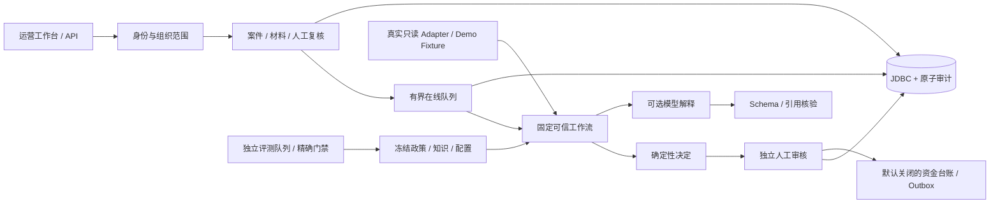

# Delivery Harness

简体中文 | [English](README.md)

面向即时配送异常与客诉的决策辅助工作台。系统冻结订单、材料、政策和实际运行配置，以确定性规则形成金额决定，用可核验的模型解释辅助人工复核，并通过评测和反馈推动版本改进。

[详细产品 PRD](docs/prd/delivery-harness-product-prd.md) · [实施与验收映射](docs/implementation/delivery-harness-prd-implementation.md) · [v2 API](docs/api/v2.md) · [部署与恢复手册](docs/operations/pilot-runbook.md)

## 已实现

- 中文工作台：案件、事实时间轴、补证/独立核验、异步分析、领取审核/转派/例外/结案、版本政策与知识、评测、配置及运营审计。
- `demo` / `pilot` 模式、服务器身份与 tenant/city/station 范围授权；pilot 缺关键配置拒绝启动，旧 v1 不能绕过真实源和审批。
- 秒级时间轴与 null/UNKNOWN/INVALID；动态政策版本、冲突检查、按分精确金额、冻结引用、禁止模型定价；缺件未覆盖或损坏未核验不能呈现确定拒赔。
- 嵌套输出与证据 ID/type/value/unit/version 校验；模型高置信度不代表证据充分；可复制的已核验客户说明由服务端模板产生。
- JDBC/Flyway 持久案件、材料、证据、执行/步骤、决定、审核、知识、配置、评测、反馈与原子业务审计；CAS 防并发覆盖，保留锁与独立批准留存计划。
- 有界、公平在线队列、租户配额、幂等、取消、deadline、租约恢复与迟到结果隔离；独立评测线程池。
- 独立政策/知识发布、原子切片、精确规则 ID 与中文词法检索、范围和撤回过滤、历史引用。
- 真正绑定 Prompt/model/参数/政策/知识的候选配置；精确标注评测门禁、独立发布、场景/组织灰度和回滚路由。
- 冻结数据集、异步评测、原输出重放、比较、规则 precision/recall/exact-match、金额分级精确与 NOT_MEASURED；结构化反馈→独立核验→修复→包含该样本的回归。
- 可配置真实只读订单 HTTP Adapter，源错误/字段漂移明确失败，无合成回退；历史 ETA/运力缺口明确显示。
- 模型端点 allowlist、总预算与有界重试，供应商用量和版本价格记录；未知 token/费用保持 unknown。
- 默认关闭的资金扩展：独立 FUNDS 权限、批准快照、当前余额核验、订单累计预留、持久 outbox、渠道幂等、签名回调和只读对账；demo 不移动真实资金。

这些是可运行代码和本地回归能力。真实组织身份发放、政策签字、服务接入/支付认证、PostgreSQL恢复演练、生产容量以及模型业务增益仍需试点环境验收，不能将合成测试通过解释成已投产。

## 快速开始

JDK 17+，使用仓库 Maven Wrapper。默认 demo 工作台使用确定性配置，无需 Ollama 或 Docker。

```bash
./mvnw clean verify
cp .env.example .env
set -a
source .env
set +a
export HARNESS_BUILD_GIT_SHA=$(git rev-parse HEAD)
java -jar harness-api/target/harness-api.jar
```

访问 [本机工作台](http://127.0.0.1:8080/workbench/)。新建 `DEMO-002` / `OVERTIME` 案件，生成建议，检查 20元权威金额与证据，领取并审核；支付仍显示未执行。`.env.example` 的 `demo-reviewer` 为第二个独立演示身份，可在页面“设置访问凭证”中切换。合成政策不是真实资金规则。默认 H2 内存库结束即清空；文件库或 PostgreSQL 配置见运行手册。

需要模型时可运行现有 `docker compose up -d ollama`，再 `docker compose exec ollama ollama pull qwen2.5:7b`；创建模型模式的候选配置，评测后独立发布。模型权重单独下载，不属于本仓库 MIT 许可。

## 架构



| 模块 | 职责 |
| --- | --- |
| harness-common | DTO、异常、JSON与Trace基础工具 |
| harness-core | 可信工作流/规则/模型/检索，platform 的持久对象、权限、队列、评测和资金契约 |
| harness-api | Controller、身份过滤、Migration、工作台、部署配置及端到端测试 |
| llm-inference | 本地 Ollama 容器及冒烟脚本 |

关系库保存可读的版本 JSON；tenant、kind、scope、risk、due、version 是可索引关系投影。三模块边界保持不变，见 [ADR-0005](docs/adr/0005-versioned-persistent-decision-workbench.md)。

## 接口与配置

[v2契约](docs/api/v2.md)列出请求、状态和错误；[OpenAPI](docs/api/openapi.v2.json)供集成。关键入口为 `/api/v2/cases`、`/executions`、`/reviews`、`/policies/versions`、`/knowledge/versions`、`/runtime-configs`、`/runtime-routes`、`/eval/runs`、`/feedback`、`/metrics`、`/audit-events`。

`.env` 不会被应用自动读取，需要显式 source 或进程管理器注入。所有示例在 [.env.example](.env.example)。`HARNESS_MODE=pilot` 必须配置持久 JDBC、可信 token scopes、allowlisted read-only Adapter；不播种合成政策。模型 endpoints 仅由服务端配置。默认线上并发2/队列50/总预算15秒，评测并发2/队列16。资金与数据删除开关均默认关闭。

v1 同步分析、内存检索/评测/observe 接口在 demo 保留，面向旧演示客户端；新版 unknown/引用安全状态可能收紧原结果。pilot v1 返回410，所有业务处理经v2。请固定版本，不依赖未声明字段。

## 验证与运行边界

`tools/check-format.sh` 和 `./mvnw clean verify` 是 CI 门禁。测试使用手写模型 stub、H2 与 loopback HTTP，无需真实模型/订单/资金。覆盖租户/站点隔离、原子审计、精确金额、秒边界、坏引用、盲测泄漏、20次并发幂等、材料/审批竞态、取消超时/恢复、运行发布、支付重复/乱序和留存图。最终243项测试全部通过，无失败或跳过；core行覆盖率75.15%，跨模块84.32%，核心门槛从0.30提高到0.70。

现有真实源接口是通用契约连接器，历史 ETA/运力未提供时如实降级。没有向量 RAG、自主Agent规划、生产身份供应商内置集成或已认证支付渠道。大规模聚合/审计查询、跨节点负载和 PostgreSQL备份恢复需要单独负载/演练验证。有效性提升需脱敏真实标注样本及影子实验，详情见 PRD 的 D0–D5 门禁。

## 参与贡献与许可

参阅 [CONTRIBUTING](CONTRIBUTING.md)、[SECURITY](SECURITY.md)、[CHANGELOG](CHANGELOG.md)。MIT 许可；真实凭证、订单、材料及提供方数据不得提交仓库。
