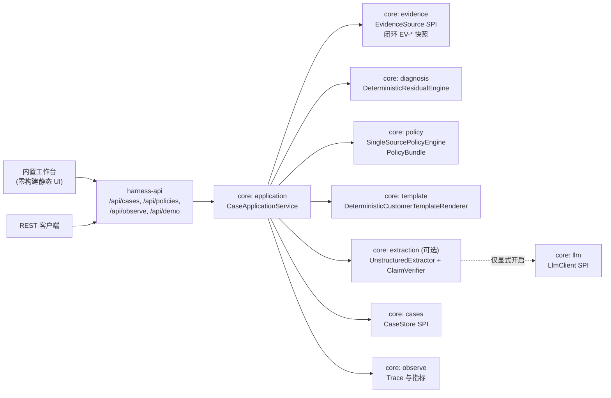

# Delivery Harness Engineering Platform

简体中文 | [English](README.md)


[](LICENSE)

面向即时配送异常订单复核与赔付裁决场景的开源 **AI Harness 工程参考基线（Reference Benchmark）**。项目以**零 LLM 即可开箱运行**的确定性核心为底座（三值证据台账、单一真源 `PolicyBundle`、确定性残差归因、确定性客户沟通模板与人工决策状态机），并将可选 LLM 严格收束到**最小概率面**——仅在开启时抽取非结构化 IM 对话信号，并受单向风险路由约束。

> [!IMPORTANT]
> 本仓库是开源参考实现与工程基线，不是可直接投产的配送或赔付系统。内置样本使用合成数据，状态保存在内存中，当前没有鉴权（`operator_id` 显式标记为 `unauthenticated_operator_id`），且系统不执行任何真实付款。在补齐鉴权、持久化存储与外部支付执行控制之前，请勿暴露到公网或输入真实个人/订单数据。

## 核心设计原则

- **零 LLM 确定性核心**：基于 Java 17 密封接口 `sealed interface EvidenceValue<T>`（`Known` / `Unknown` / `Invalid`）构建不可变闭环 `EV-*` 证据快照，并以规范化 JSON 计算 SHA-256 哈希（见 [ADR-0006](docs/adr/0006-three-valued-evidence-ledger-and-deterministic-snapshots.md)）。
- **单一真源 `PolicyBundle`**：由一份版本化、启动即校验的 JSON 政策包（`policy-v1.0.0.json`）统一拥有全部赔付规则、超时区间、审批线、升级上限、证据时效、归因阈值与路由矩阵（见 [ADR-0007](docs/adr/0007-single-source-policy-bundle.md)）。
- **确定性残差归因**：计算 5 个候选延误因子（`DISPATCH_WAIT_EXCESS`、`TO_SHOP_EXCESS`、`MERCHANT_PREP_EXCESS`、`WEATHER_EXPLAINED` 与中性词 `UNEXPLAINED_ROAD_EXCESS`），诚实保留负原始差值，显式输出 `MULTI_FACTOR` / `UNDETERMINED` 与证据缺口，不自动定责。
- **最小概率面与单向路由**：可选 LLM 抽取默认关闭（`harness.llm.extraction.enabled=false`）；启用后仅从 IM 文本提取待核实信号（`ClaimedFact`），并经 `ClaimVerifier` 做确定性校验（Unicode NFKC、单消息 offset 精确匹配、基于消息元数据 `SpeakerRole` 的自利豁免拦截、否定词窗口、注入预扫描）。通过方法签名与字节码架构守卫双重保证：`SingleSourcePolicyEngine` 永不接收 `ClaimedFact`（见 [ADR-0005](docs/adr/0005-minimum-probabilistic-surface-and-unidirectional-routing.md)）。
- **人工复核闭环状态机**：统一的 `/api/cases` 聚合根支持乐观锁并发控制（`expected_case_version`）、`Idempotency-Key` 幂等重放、同 `(orderId, complaintType)` 单未结案约束、人工举证回填（`EV-HUMAN-*`）、超上限升级主管特批（强制填写 `exception_reason`），以及仅在登记外部执行回执后才切换为“已完成赔付”客户沟通口径。
- **零构建单 Case 工作台**：`harness-api` 内置纯 HTML/CSS/Vanilla JS 静态页面，强制严格 `Content-Security-Policy`（`default-src 'self'`），零 `innerHTML` 注入点，无需 Node/npm 构建。

以下能力**刻意不宣称已实现**：自主 Agent 规划、生产配送/ERP 系统集成、持久化数据库、向量/RAG 检索（[ADR-0003](docs/adr/0003-no-vector-retrieval-at-this-corpus-size.md) 已 Retired）、鉴权/RBAC、限流、分布式追踪、自动执行付款。详见[已知限制](#已知限制)。

## 架构



### 三个核心 SPI

将本参考 Harness 接入真实业务后端时，只需替换三个接口：

1. `com.delivery.harness.evidence.EvidenceSource` — 替换 `SyntheticEvidenceSource`，按订单事件时点（`asOf`）从真实订单、ETA、站点运力与 IM 系统组装不可变 `EvidenceSnapshot`。
2. `com.delivery.harness.cases.CaseStore` — 替换 `InMemoryCaseStore`，接入关系型数据库与事务级乐观锁。
3. `com.delivery.harness.llm.gateway.LlmClient` — 可选 OpenAI 兼容传输层，仅在 `harness.llm.extraction.enabled=true` 时调用。

## 模块说明

| 模块 | 实际职责 |
| --- | --- |
| `harness-common` | 三值 `EvidenceValue<T>`、`EvidenceType`、`OrderTimeline`、`HarnessTimeConfig`、DTO、异常（`BizException`、`ConflictException`、`ResourceNotFoundException`）与 Trace 上下文。无内部依赖。 |
| `harness-core` | 确定性核心与 SPI：`policy`（`PolicyBundle`、`PolicyBundleValidator`、`SingleSourcePolicyEngine`）、`evidence`（`EvidenceSnapshot`、`EvidenceSource`、13 条合成契约样本）、`diagnosis`（`DeterministicResidualEngine`）、`template`（`DeterministicCustomerTemplateRenderer`）、`cases`（`DeliveryCase`、`AssessmentRun`、`HumanDecision`、`CaseStore`）、`application`（`CaseApplicationService`）、`extraction`（`ClaimVerifier`、`RegexSignalBaseline`、`UnstructuredExtractor`）、`llm`、`observe`，以及离线/实模型消融评测工具。 |
| `harness-api` | 可执行 Spring Boot 应用：统一 REST Controller、参数校验、`AuditLogFilter`（Trace ID 与 CSP 响应头）、零构建单 Case 工作台（`src/main/resources/static/`）。 |
| `llm-inference` | 可选的固定版本 Ollama 容器定义与冒烟测试脚本。 |

关于为何保持三个 Maven 模块，见 [ADR-0004](docs/adr/0004-three-maven-modules-instead-of-nine.md)。

## 环境要求

- JDK 17 或更高版本
- Maven 3.6.3 或更高版本，也可使用仓库内置的 Maven Wrapper（`./mvnw`）
- Docker Compose — **仅**在需要本地运行 Ollama 做实模型消融评测时需要

## 快速开始（零 LLM 即可运行）

### 1. 离线构建与测试

```bash
./mvnw clean verify
```

### 2. 以 `demo` Profile 启动 API 与单 Case 工作台

```bash
./mvnw -pl harness-api -am package
java -jar harness-api/target/harness-api.jar --spring.profiles.active=demo
```

浏览器打开 `http://127.0.0.1:8080` 即可使用内置单 Case 工作台，顶部会自动加载 13 条合成契约样本。

若不启用 `--spring.profiles.active=demo`，`/api/demo/fixtures` 不会挂载（返回 `404`）；`/api/cases` 仍可正常工作，并对未知 `order_id` 诚实返回 `404`，不再按哈希伪造订单。

### 3. 调用统一 Case API

创建并评估 Case（支持 `Idempotency-Key` 幂等重放）：

```bash
curl --fail-with-body \
  --request POST \
  --header 'Content-Type: application/json' \
  --header 'Idempotency-Key: demo-req-001' \
  --data '{"order_id":"ORD-MERCHANT-01","complaint_type":"OVERTIME"}' \
  http://127.0.0.1:8080/api/cases
```

提交人工举证回填（例如为等待 `DAMAGE_LEVEL` 的餐损单补录餐损等级）：

```bash
curl --fail-with-body \
  --request POST \
  --header 'Content-Type: application/json' \
  --data '{"evidence_type":"DAMAGE_LEVEL","value":"PARTIAL","operator_id":"reviewer-01","expected_case_version":1}' \
  http://127.0.0.1:8080/api/cases/{caseId}/attestations
```

提交绑定到最新 `run_id` 与 `expected_case_version` 的结构化人工决策：

```bash
curl --fail-with-body \
  --request POST \
  --header 'Content-Type: application/json' \
  --data '{"run_id":"RUN-1","expected_case_version":1,"action":"ACCEPT","operator_id":"reviewer-01"}' \
  http://127.0.0.1:8080/api/cases/{caseId}/decisions
```

登记外部执行回执（登记后，客户沟通草稿才会切换为“已完成赔付处理”口径）：

```bash
curl --fail-with-body \
  --request POST \
  --header 'Content-Type: application/json' \
  --data '{"run_id":"RUN-1","expected_case_version":2,"action":"RECORD_EXECUTION_RECEIPT","operator_id":"ops-01","external_receipt_id":"PAY-20260901-0001"}' \
  http://127.0.0.1:8080/api/cases/{caseId}/decisions
```

所有响应使用统一封装 `HarnessResponse`（`{ code, message, data, traceId }`），并同步返回 `X-Trace-Id` 响应头。

### Release 制品

带 `v*` 标签的版本会发布可运行的 `harness-api` fat JAR，并附带 SHA-256 校验文件作为 GitHub Release 资产。本项目仍处于 0.x 阶段：HTTP 接口和响应字段可能在不提升主版本号的情况下变化；如果依赖响应结构，请固定到具体 Tag。

## API 一览

| 方法 | 路径 | 用途 |
| --- | --- | --- |
| `GET` | `/`（`/index.html`） | 内置零构建单 Case 工作台 |
| `POST` | `/api/cases` | 创建并评估 Case（支持 `Idempotency-Key`；未知订单返回 `404`；重复未结案返回 `409`） |
| `GET` | `/api/cases` | 查询最近 Case 列表（`limit` 1..200） |
| `GET` | `/api/cases/{caseId}` | 查询单个 Case（含不可变快照、全部 Run 与人工决策记录） |
| `POST` | `/api/cases/{caseId}/attestations` | 追加人工举证 `EV-HUMAN-*` 并触发新一轮 `AssessmentRun` |
| `POST` | `/api/cases/{caseId}/decisions` | 提交结构化 `HumanDecision`（`ACCEPT`、`OVERRIDE`、`REQUEST_EVIDENCE`、`ESCALATE`、`RETURN_TO_REVIEW`、`APPROVE`、`REJECT_CLOSE`、`RECORD_EXECUTION_RECEIPT`、`CLOSE`、`REOPEN`） |
| `GET` | `/api/policies/active` | 查看当前生效的 `PolicyBundle`、SHA-256 哈希与渲染后的规则说明 |
| `GET` | `/api/observe/traces/{traceId}` | 查询指定 Trace |
| `GET` | `/api/observe/traces` | 查询最近 Trace 列表（`limit` 1..100） |
| `GET` | `/api/observe/metrics` | 查询内存运行指标 |
| `GET` | `/api/demo/fixtures` | 查询 13 条合成契约样本（**仅**在 `--spring.profiles.active=demo` 时挂载） |

## 配置

如需本地配置参考，可复制 `.env.example`。Spring 会直接读取以下环境变量：

| 变量 | 默认值 | 说明 |
| --- | --- | --- |
| `SERVER_ADDRESS` | `127.0.0.1` | 绑定地址；仅在有意隔离的部署中显式设为 `0.0.0.0` |
| `SERVER_PORT` | `8080` | API 与工作台监听端口 |
| `HARNESS_LLM_EXTRACTION_ENABLED` | `false` | 可选 LLM 非结构化信号抽取开关（默认关闭） |
| `HARNESS_LLM_ENDPOINT` | `http://localhost:11434` | OpenAI 兼容服务地址（仅开启抽取时使用） |
| `HARNESS_LLM_MODEL` | `qwen2.5:7b` | 可选抽取 / 实模型消融使用的模型名 |
| `HARNESS_LLM_API_KEY` | 空 | 可选 Bearer Token，禁止提交真实值 |
| `HARNESS_LLM_TIMEOUT_SECONDS` | `15` | 模型读取超时秒数（与 `application.yml` 对齐） |
| `HARNESS_MAX_CASES` | `500` | 内存 `CaseStore` 容量上限 |
| `HARNESS_MAX_TRACES` | `500` | 内存 Trace 环形缓冲容量 |

所有政策参数（`approvalThreshold`、`escalationCap`、超时区间、证据时效与归因阈值）统一收敛在 [`policy-v1.0.0.json`](harness-core/src/main/resources/policy/policy-v1.0.0.json)，不再存在重复的环境变量上限开关。

## 测试与实模型消融评测

运行完整离线测试集、架构边界守卫、XSS/CSP 检查、格式检查与 JaCoCo 覆盖率门禁：

```bash
./tools/check-format.sh
./mvnw clean verify
```

当前离线测试共 **76 项**（`harness-common`: 9，`harness-core`: 55，`harness-api`: 12），完全不依赖 Ollama 或 Docker。核心防线包括：

- 字节码架构守卫（`ArchitectureGuardTest`、`ApiArchitectureGuardTest`）：验证 `com.delivery.harness.policy` 永不依赖 `extraction` 或 `llm`，`evidence` 不泄漏评测标签，Controller 边界清晰。
- `OfflineAblationSmokeTest`：使用独立评分器（`IndependentEvalScorer`）在冻结的手工 `dev`/`holdout` IM 语料上评测 ~20 行确定性 `RegexSignalBaseline`，并输出带 `PIPELINE_SMOKE_ONLY` 标记的离线冒烟报告。
- `WorkbenchStaticTest`：校验严格 CSP 响应头以及静态前端零 `innerHTML`/内联脚本。

### 可选：运行实模型消融对比（CLI）

若需将真实 OpenAI 兼容模型（例如本地 Ollama `qwen2.5:7b`）与确定性正则基线在冻结 holdout 集上做真机消融对比（`@Tag("live-llm")`，默认离线 CI 排除）：

```bash
docker compose up -d ollama
docker compose exec ollama ollama pull qwen2.5:7b
HARNESS_LLM_MODEL=qwen2.5:7b ./llm-inference/smoke-test.sh

HARNESS_LLM_ENDPOINT=http://localhost:11434 \
HARNESS_LLM_MODEL=qwen2.5:7b \
./mvnw -pl harness-core test -Dgroups=live-llm -Dtest=LiveLlmAblationReportTest
```

评测报告会输出至 `harness-core/target/ablation-report-live.md`，并附带 [ADR-0005](docs/adr/0005-minimum-probabilistic-surface-and-unidirectional-routing.md) 退出条款：如果实测 LLM 无法在 holdout F1 上跑赢正则基线且保持豁免类信号 0 误报，则继续保持 `harness.llm.extraction.enabled=false`。

## 架构决策记录（ADR）

完整目录见 [`docs/adr/README.md`](docs/adr/README.md)：

- [ADR-0001](docs/adr/0001-delete-unreachable-code-before-adding-features.md) — 先删不可达代码再加功能
- [ADR-0002](docs/adr/0002-rule-engine-owns-the-compensation-amount.md) — 规则引擎拥有赔付金额（由 ADR-0005 修订）
- [ADR-0003](docs/adr/0003-no-vector-retrieval-at-this-corpus-size.md) — 当前语料规模不做向量检索 *（已 Retired）*
- [ADR-0004](docs/adr/0004-three-maven-modules-instead-of-nine.md) — 三个 Maven 模块而非九个
- [ADR-0005](docs/adr/0005-minimum-probabilistic-surface-and-unidirectional-routing.md) — 最小概率面与单向风险路由
- [ADR-0006](docs/adr/0006-three-valued-evidence-ledger-and-deterministic-snapshots.md) — 三值证据台账与确定性快照
- [ADR-0007](docs/adr/0007-single-source-policy-bundle.md) — 单一真源 `PolicyBundle` 拥有全部政策参数

## 安全与数据处理

- **无鉴权/无 RBAC**：举证与决策接口上的 `operator_id` 由调用方传入，在数据模型中显式标记为 `unauthenticated_operator_id`。任何共享环境部署前都必须在网关层接入身份认证与授权。
- **不自动执行付款**：`APPROVED_PENDING_EXECUTION` 仅代表人工审批意图；必须通过 `RECORD_EXECUTION_RECEIPT` 登记外部执行回执后，客户草稿才会切换为已完成口径。
- **Prompt Injection 信任边界**：IM 对话一律视为不可信文本。`UnstructuredExtractor` 会先做确定性注入预扫描，`ClaimVerifier` 校验 offset、原句与元数据角色，`SingleSourcePolicyEngine` 在架构上与提取信号完全隔离。
- **严格前端 CSP 与零 `innerHTML`**：静态页面强制返回 `default-src 'self'; script-src 'self'; style-src 'self'; object-src 'none'; base-uri 'self'`，且全部 DOM 渲染均使用 `textContent` / 文本节点。
- 报告漏洞或部署衍生项目前，请先阅读 [SECURITY.md](SECURITY.md)。

## 已知限制

- `SyntheticEvidenceSource` 返回确定性合成契约样本，不调用真实配送系统。
- `InMemoryCaseStore`、Trace 与指标均为有界内存存储，重启即清空，未捆绑数据库持久化实现。
- `operator_id` 未经鉴权（`unauthenticated_operator_id`）；主管审批（`APPROVE`）校验状态机与 `exception_reason`，但不校验调用者权限角色。
- 离线 IM 评测语料为小规模冻结手工样本（`dev` + `holdout`），用于回归校验与消融对比；生产级准确率结论需基于线上真实标注样本。
- 本 README 不宣称任何未实测的 LLM 准确率或延迟数字；请针对目标模型直接运行 `LiveLlmAblationReportTest` 获取实测报告。

## 参与贡献

欢迎贡献。请阅读 [CONTRIBUTING.md](CONTRIBUTING.md)，遵守[行为准则](CODE_OF_CONDUCT.md)，安全问题请按 [SECURITY.md](SECURITY.md) 私下报告。

## 许可证

源代码使用 [MIT License](LICENSE)。单独下载的模型权重和第三方服务遵循各自许可证，详见 [THIRD_PARTY_NOTICES.md](THIRD_PARTY_NOTICES.md)。
