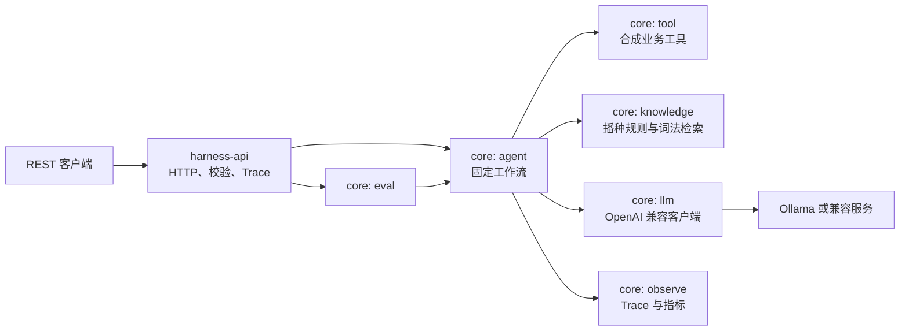

# Delivery Harness Engineering Platform

简体中文 | [English](README.md)


[](LICENSE)

面向即时配送运营场景的 AI Harness 参考实现。项目将确定性工作流、Mock 业务工具、轻量知识检索、OpenAI 兼容模型接口、评测脚手架和人工复核型安全检查组合在一起。

> [!IMPORTANT]
> 本仓库是教学与验证用途的 MVP，不是可直接投产的配送或赔付系统。业务工具使用合成数据，多数状态保存在内存中，模型输出仅供建议。请勿将应用直接暴露到公网、输入真实个人/订单数据，或在缺少鉴权、策略执行和人工审批的情况下执行赔付决策。

## 已实现能力

- 两条同步工作流：异常订单分析、赔付建议。
- 四个本地注册工具：订单、ETA、站点运力、赔付规则。每个工具的返回都由入参决定。
- 合成订单按 order_id 落到六个具名场景，其中包含一个准时送达的对照单。
- 确定性时间轴拆解（调度等待 / 到店 / 出餐等待 / 路途四段），与模型答案并列返回，作为模型必须跑赢的基线。
- 赔付金额由规则引擎决定，模型不参与定价（见 [ADR-0002](docs/adr/0002-rule-engine-owns-the-compensation-amount.md)）。
- 兼容 OpenAI Chat Completions 的客户端抽象为接口，工作流可在无模型环境下测试。
- 内存文档导入、文本切片、按查询词命中率打分的词法检索，以及开机播种的规则库与案例库。
- 内存评测运行；当用例未声明期望时，评分器报告「未度量」而不是满分。
- 请求 Trace ID、真实的分步耗时、有界 Trace 存储、按场景的指标、反馈存储和建议式输出检查。
- 可选依赖不可用但确定性结果仍可返回时，工作流状态为 `DEGRADED`；受影响步骤会记录为失败，避免与完整成功混淆。
- 本地 Ollama 配置、回归测试、Maven Wrapper 和 GitHub Actions CI。

以下能力**尚未实现**：自主 Agent 规划、真实业务工具集成、经生产验证的持久化存储、向量 Embedding/Milvus RAG、经组织验收的身份集成、生产配额、分布式追踪、自动执行赔付。详见[已知限制](#已知限制)。

### 可信决策语义（破坏性变更）

时间轴保留秒级精度；缺少端点或时间倒序在可信输出中保持未知，不会被当作
零时长或确定的赔付依据。小于一分钟的正向超时也算超时，旧版分钟计数仍为
整数。模型引用会按实际使用的证据与政策快照核验；面向客户的话术由服务端
根据权威决定及复核状态生成。

只有模型不可用而确定性结果仍可用时，响应从 HTTP 502 改为 HTTP 200 +
`DEGRADED`。客户端必须检查执行状态和证据核验结果；缺失政策或事实不会
变成已批准的赔付。赔付方式统一为枚举 ID，退款不得超过已核实可退余额。
旧字段 `suggested_amount` 可能仅为候选金额；缺少确定依据时，
`authoritative_amount` 保持 `null`。审批阈值只使用 `HARNESS_REVIEW_APPROVAL_THRESHOLD` /
`harness.review.approval-threshold`，默认 `10.00`；旧
`harness.compensation.approval-threshold` 属性被替代。
设计取舍见 [ADR-0005](docs/adr/0005-trusted-workflow-output-contract.md)。

### 模型调用边界

模型调用使用一个覆盖上传、响应头、响应体及重试的总截止时间；响应体达到
1 MiB 即停止接收，取消会中断待完成调用。版本化运行绑定最多允许两次重试，
仅限连接/超时及 HTTP 429/502/503/504，且共享原截止时间；旧版调用不重试。
pilot 需要显式设置 `HARNESS_LLM_ALLOWED_HOSTS` 并使用 HTTPS（测试可显式
允许回环 HTTP），不跟随重定向。代码约束保持 system 优先级，可配任务提示词
使用更低优先级。

### 索引存储基础

平台记录和审计使用 JDBC 与 core 模块内的 Flyway 迁移；附件正文与索引元数据
分开存放。读取不提交事务，写入、乐观锁与审计共用事务。审计使用时间戳加事件
ID 排序并在 SQL 中按授权范围分页。默认 H2 仅为内存演示；持久化部署需配置
`HARNESS_DATABASE_URL`、用户名和密码。已提供 PostgreSQL 驱动，但 H2 迁移
测试不能证明真实 PostgreSQL 部署已验收。见 [ADR-0006](docs/adr/0006-indexed-metadata-and-separated-material-content.md)。

### 显式 API 身份（破坏性变更）

所有 `/api/**` 请求均需显式 bearer。本机 demo 提供小角色集合的
`demo-agent-token`、`demo-reviewer-token`、`demo-supervisor-token`、
`demo-admin-token`、`demo-publisher-token`，不会匿名授予全部权限。
`HARNESS_DEMO_IDENTITIES` 留空使用上述公开合成身份，`[]` 关闭默认身份；
demo 还校验明确的 Host/Origin 白名单。

pilot 验证 OIDC JWT 签名、issuer、audience、租户、角色和数据范围，拒绝
演示凭证；已认证 v1 请求返回 410。部署需设置 `HARNESS_OIDC_ISSUER`、
`HARNESS_OIDC_AUDIENCE`、`HARNESS_OIDC_JWK_SET_URI` 及浏览器白名单。
本地签名夹具测试不能代替真实组织 IdP 与授权验收。见
[ADR-0009](docs/adr/0009-oidc-identities-and-local-demo-access.md)。

### 只读订单源

v2 可通过显式 endpoint/host 配置接入 pilot 只读源，10 秒截止时间覆盖响应头
和响应体，接收上限为 1 MB；不重定向，也不在失败时回退合成订单。可退余额
缺失表示未知，零表示明确为零；分精度非法或超过订单金额会拒绝。
demo 继续使用合成夹具。`GET /api/v2/adapters/status` 仅返回源状态元数据，
不查询订单，不返回地址凭证。

### 案件、证据与独立复核

v2 队列在 SQL 分页前应用状态、精确订单/审核人、风险、投诉、城市和站点筛选，
附件正文不进入元数据查询。类型化、有界请求在写入前拒绝非法输入。
案件发起人和决定作者不能认领、批准或被分派自己的复核；旧数据缺少作者时
需重新分析。导出使用 `POST /api/v2/cases/{id}/export` 并写审计回执，GET
返回 405；复核不执行资金。见 [ADR-0007](docs/adr/0007-independent-case-and-decision-reviewers.md)。

### 持久执行队列

v2 分析入队前冻结订单证据和运行输入，使用幂等、容量边界、fence 和总截止时间。
心跳、截止时间和恢复使用独立调度器；完成事务锁定执行记录，避免正常心跳
引起版本冲突。恢复游标在租户与活动任务间按有界 SQL 页推进。
决定作者绑定提交者，复核结果仍为建议且 `NOT_EXECUTED`。见
[ADR-0008](docs/adr/0008-durable-queue-with-independent-schedulers.md)。

### 轻量记录列表

列表在 SQL 中直接读取摘要投影，不加载完整运行快照；记录与摘要在同一事务
更新，V8/V9 负责迁移与历史回填。摘要保留授权所需的政策、知识和证据范围，
不携带提示词或文档正文；详情仍需单独授权读取。见
[ADR-0010](docs/adr/0010-explicit-record-list-projections.md)。

### 版本化政策发布

v2 政策候选会校验统一赔付方式、公式、金额边界、币种和生效时间，创建者
不能发布自己的版本，需另一身份审核发布。已发布规则不可变，demo 默认政策
只在启动时载入，GET 不补种子；pilot 不载入合成政策。列表返回摘要，读取
完整规则需单独授权获取版本详情。政策发布不执行资金。

### 经过审核的知识版本

知识导入生成带数据范围、正文哈希和版本化分块的候选；需另一身份审核发布，
已发布正文不能原地修改。搜索与引用读取保持租户和范围隔离，返回确切版本及
哈希。知识是可能含提示词注入的参考资料，不能改变系统指令或赔付规则。
列表只返回元数据，读取正文需单独授权获取版本详情。

### 冻结运行配置

运行版本冻结政策、知识、模型与任务设置及其哈希；发布需独立身份和匹配的
通过评测证据。pilot 没有已发布版本就拒绝执行，单个运行包上限为 512 KiB。
配置可见性同时检查政策与每份知识范围，宽范围政策不能暴露受限文档。
列表只返回保留授权范围的元数据，完整运行包需单独授权读取。
确定性模式不请求模型服务。

### 可复现结构化评测（评分契约变更）

v2 评测冻结数据集、运行配置与评分器哈希，按期望字段精确评分并对照确定性
基线；缺少标签标记 `NOT_MEASURED`，不能与旧词法评分混作同一口径。
盲测集需要审核标签，执行成功不代表发布门禁通过。范围校验覆盖运行知识和
每条样本；进程重启的运行显式失败，并提示使用冻结快照重新评测。
GET 不补种子，合成评测数据只在 demo 启动阶段初始化。

### 核验反馈闭环

结构化反馈绑定案件、决定版本、证据和运行配置；包括详情读取在内，案件范围
校验始终执行。更正需另一身份核验后才能作为评测标签，确认后可关联修复和
通过的冻结回归运行；原始投票不能成为盲测真值。摘要不带更正正文，读取
完整更正使用需授权的 `GET /api/v2/feedback/{id}`。

### 范围内运营指标与审计

运营统计在 SQL 中计数，仅抽取最多 1,000 条执行摘要计算耗时与费用；缺少金额、
币种或价格版本时费用保持未知，不合并不同币种或价格版本。审计使用时间戳加
事件 ID 的不透明游标，在 SQL 中按范围分页。这些是执行观测，不代表决定准确率
或业务效果已经验收。

### 人工建议例外

主管可以提出带依据、有上限的例外建议，但需另一合法主管复核。退款仍需
已核实可退余额，补送金额为零，所有金额受配置上限约束；请求 amount 必须为
JSON 数字。批准仍为建议状态 `NOT_EXECUTED`。五个公开 demo 身份只有一位
主管；完整例外复核需另外配置独立主管身份，不能让同一人自批。
本轮不包含支付渠道、资金台账、回调或实际删除。

### 自动生成的 API 契约

需认证的 `GET /api/v2/openapi` 从实际路由和 DTO 约束生成契约，测试导出
`harness-api/target/generated-api/openapi.v2.json` 并检查路由与 schema 一致。
见 [v2 迁移说明](docs/api/v2.md)，不维护手写 OpenAPI 快照。

### 决策工作台

在配置的回环地址打开 `/workbench/index.html`，显式输入演示凭证。工作台包含
服务端筛选队列、证据、独立复核、政策与知识发布、评测、范围内运营审计及
反馈核验；完整版本通过授权详情获取，不把列表摘要当成正文。凭证仅存内存，
切换身份会取消请求并清除数据与表单。页面使用 textContent、同源静态资源，
没有外部脚本或资金/删除入口。除 Maven 验证外，可运行
`node tools/check-workbench-state.cjs` 验证状态竞态和请求契约。

## 架构



所有工作流步骤都在 Gateway 进程内同步执行。除配置的模型服务外，默认应用不依赖其他外部服务。

## 模块说明

| 模块 | 实际职责 |
| --- | --- |
| `harness-common` | DTO、异常、JSON/文本工具和 Trace 上下文。无内部依赖。 |
| `harness-core` | 所有做决策的部分：`agent`（工作流、时间轴、Guardrail、输出格式化）、`tool`（合成业务工具）、`llm`（模型路由与传输）、`knowledge`（播种规则与案例、词法检索）、`eval`（用例、评测运行、评分器）、`observe`（Trace、指标、反馈）。 |
| `harness-api` | 可执行的 Spring Boot 应用：Controller、校验、异常映射、请求 Trace。 |
| `llm-inference` | 固定版本的 Ollama 容器定义和冒烟测试脚本 |

Java 包名没有变——`com.delivery.harness.{agent,tool,llm,knowledge,eval,observe}` 仍然存在，含义也不变。移动的只是 Maven 构建边界，见 [ADR-0004](docs/adr/0004-three-maven-modules-instead-of-nine.md)。

## 环境要求

- JDK 17 或更高版本
- Maven 3.6.3 或更高版本，也可使用仓库内置的 Maven Wrapper
- 仅在容器中运行 Ollama 时需要 Docker Compose
- 足够运行所选模型的内存；默认示例为 `qwen2.5:7b`

## 快速开始

### 1. 启动本地模型

如果本机已经运行 Ollama，可以跳过第一条命令。

```bash
docker compose up -d ollama
docker compose exec ollama ollama pull qwen2.5:7b
```

Compose 端口只绑定到 `127.0.0.1`。模型权重需要单独下载，不属于本仓库及其 MIT 许可证范围。

### 2. 构建与测试

```bash
./mvnw clean verify
```

### 3. 启动 API

```bash
./mvnw -pl harness-api -am package
java -jar harness-api/target/harness-api.jar
```

API 默认监听 `http://localhost:8080`。

### Release 制品

带 `v*` 标签的版本会发布可运行的 `harness-api` fat JAR，并附带 SHA-256
校验文件，作为 GitHub Release 资产。本项目仍处于 0.x 阶段：HTTP 接口和
响应字段可能在不提升主版本号的情况下变化；如果依赖响应结构，请固定到具体 Tag。

### 4. 调用工作流

异常订单分析：

```bash
curl --fail-with-body \
  -H 'Authorization: Bearer demo-agent-token' \
  --request POST \
  --header 'Content-Type: application/json' \
  --data '{"order_id":"DEMO-001"}' \
  http://localhost:8080/api/v1/analyze/abnormal-order
```

赔付建议：

```bash
curl --fail-with-body \
  -H 'Authorization: Bearer demo-agent-token' \
  --request POST \
  --header 'Content-Type: application/json' \
  --data '{"order_id":"DEMO-002","complaint_type":"OVERTIME"}' \
  http://localhost:8080/api/v1/analyze/compensation
```

对于 `DAMAGED` 投诉，请传入 `"damage_level":"FULL"` 或
`"damage_level":"PARTIAL"`。缺少证据时，规则会返回 0 元并要求人工复核；赔付金额始终由规则引擎决定，模型不能改写。

所有响应使用统一封装：

```json
{
  "code": 0,
  "message": "success",
  "data": {
    "executionId": "...",
    "traceId": "...",
    "status": "SUCCESS",
    "steps": []
  },
  "traceId": "..."
}
```

同一个 Trace ID 也会写入 `X-Trace-Id` 响应头。

## API 一览

| 方法 | 路径 | 用途 |
| --- | --- | --- |
| `POST` | `/api/v1/analyze/abnormal-order` | 执行异常订单分析 |
| `POST` | `/api/v1/analyze/compensation` | 生成赔付建议 |
| `POST` | `/api/v1/knowledge/ingest` | 导入并切分内存文档 |
| `POST` | `/api/v1/knowledge/search` | 检索内存规则、文档和案例 |
| `POST` | `/api/v1/eval/cases` | 添加内存评测 Case |
| `GET` | `/api/v1/eval/cases` | 查询评测 Case |
| `POST` | `/api/v1/eval/run` | 同步运行选定 Case |
| `GET` | `/api/v1/eval/run/{runId}` | 查询评测运行 |
| `GET` | `/api/v1/eval/run/{runId}/results` | 查询评测结果 |
| `GET` | `/api/v1/observe/trace/{traceId}` | 查询已记录的 Trace（如有数据） |
| `GET` | `/api/v1/observe/traces` | 查询 Trace 列表（如有数据） |
| `GET` | `/api/v1/observe/metrics` | 查询内存指标（如有数据） |
| `POST` | `/api/v1/observe/feedback` | 在内存中保存反馈 |
| `GET` | `/api/v1/observe/feedback` | 查询内存反馈 |

## 配置

如需本地配置参考，可复制 `.env.example`。Spring 会直接读取以下环境变量：

| 变量 | 默认值 | 说明 |
| --- | --- | --- |
| `SERVER_ADDRESS` | `127.0.0.1` | 绑定地址；仅在有意隔离的远程/容器部署中显式设为 `0.0.0.0` |
| `SERVER_PORT` | `8080` | API 端口 |
| `HARNESS_LLM_ENDPOINT` | `http://localhost:11434` | OpenAI 兼容服务地址 |
| `HARNESS_LLM_MODEL` | `qwen2.5:7b` | 默认模型名 |
| `HARNESS_LLM_API_KEY` | 空 | 可选 Bearer Token，禁止提交真实值 |
| `HARNESS_LLM_TIMEOUT_SECONDS` | `120` | 模型读取超时秒数 |
| `HARNESS_MAX_COMPENSATION_AMOUNT` | `50.0` | 建议式赔付金额上限检查 |

以下 Spring 配置项可在 `application.yml` 或 `--property=value` 中设置：

| 配置项 | 默认值 | 说明 |
| --- | --- | --- |
| `harness.review.approval-threshold` | `10.0` | 赔付金额达到该值需人工审批 |
| `harness.knowledge.seed.enabled` | `true` | 启动时载入合成规则库与案例库 |
| `harness.eval.seed.enabled` | `true` | 启动时载入初始评测用例 |
| `harness.observe.max-traces` | `500` | 内存 Trace 环形缓冲容量 |
| `harness.observe.max-feedback` | `1000` | 内存反馈记录上限 |
| `harness.observe.max-tool-invocations` | `2000` | 最近工具调用记录上限 |
| `harness.eval.max-cases` | `1000` | 内存评测用例上限 |
| `harness.eval.max-runs` | `200` | 内存保留的评测运行上限 |
| `harness.knowledge.max-documents` | `1000` | 内存知识文档上限 |
| `harness.knowledge.max-chunks` | `5000` | 内存知识切片上限 |

安装模型后可运行冒烟测试：

```bash
HARNESS_LLM_MODEL=qwen2.5:7b ./llm-inference/smoke-test.sh
```

## 测试

```bash
./mvnw clean verify
```

单元及 API 回归测试覆盖两条工作流。两条工作流都有基于桩模型传输层的端到端覆盖，因此测试不依赖 Ollama 和 Docker。其中最关键的一条是 `buildsDifferentEvidenceForDifferentOrders`：它断言两个不同订单会产生两份不同的 Prompt——其余所有度量都建立在这个性质之上。CI 会在每次 Push 和 Pull Request 上运行同样的 Maven 校验。

## 安全与数据处理

- API 强制显式 bearer 并校验租户、角色及数据范围；匿名失败采用有界限流。组织授权与生产配额仍需部署验收。
- 工具数据与地址均为合成示例；公开部署时请勿替换为真实个人数据。
- 导入的知识内容会影响 Prompt，应将知识导入视为 Prompt Injection 信任边界。
- 建议式检查器只识别少量短语和金额条件，不是完整策略引擎。
- 大多数内存存储仅用于演示，重启后数据清空；Trace 和反馈有明确容量上限，评测与知识库仍需要生命周期治理。
- 报告漏洞或部署衍生项目之前，请阅读 [SECURITY.md](SECURITY.md)。

## 已知限制

- 工具返回合成数据，不调用真实配送系统。数据会随入参变化——这让流水线可被度量，但不代表它准确。
- 检索是词法命中率，不是语义检索。中文按空白和标点切分而非分词，召回取决于查询与规则是否共享同一短语（见 [ADR-0003](docs/adr/0003-no-vector-retrieval-at-this-corpus-size.md)）。
- 规则、文档、案例、评测、反馈、指标和 Trace 均未持久化，重启即丢失。
- 评测评分器是词法的，定位是发现回归而非认证质量。六条合成用例不足以证明准确率；真实结论需要来自线上流量的标注集。
- 评测运行中的 `modelVersion` 与 `promptVersion` 当前只是记录用的元数据，不会切换运行时模型或修改工作流 Prompt；比较运行时请通过部署配置固定它们。
- `needs_human_review` 与 `approval_required` 由 Guardrail 结果、解析是否成功、模型置信度和是否与基线一致推导得出。这是「如实报告」而非「授权」：系统不执行任何付款。
- Guardrail 会在工作流步骤和最终输出中返回通过/失败，但不能替代人工复核。
- JDBC/Flyway 已提供平台存储基础；旧版工作流知识、评测及 Trace 仍在内存。配置 PostgreSQL 后仍需单独验证迁移与恢复。

## Roadmap

- 验收组织 IdP 接入、撤权、密钥轮换及生产请求配额。
- 用版本化 Adapter 和契约测试替换 Mock 工具。
- 通过显式 Profile 接入持久化 Repository 和 Migration。
- 持久化 Trace、指标、反馈和审计事件，并增加保留策略。
- 引入类型化工作流输出、更强策略执行和敏感信息脱敏。
- 用真实异常单构建标注评测集，度量 top-1 归因准确率并与确定性基线对比。若模型跑不赢基线，它就不该留在归因链路上。
- 将评测模型/Prompt 版本绑定到不可变运行时配置，使评测可按记录的版本复现。
- 度量人工处理时长的前后差值。没有这个数，系统无法证明自己节省了什么。
- 在当前语料规模下，Embedding 与向量检索**刻意不在** Roadmap 上；重新开启的条件见 [ADR-0003](docs/adr/0003-no-vector-retrieval-at-this-corpus-size.md)。

## 参与贡献

欢迎贡献。请阅读 [CONTRIBUTING.md](CONTRIBUTING.md)，遵守[行为准则](CODE_OF_CONDUCT.md)，安全问题请按 [SECURITY.md](SECURITY.md) 私下报告。

## 许可证

源代码使用 [MIT License](LICENSE)。单独下载的模型权重和第三方服务遵循各自许可证，详见 [THIRD_PARTY_NOTICES.md](THIRD_PARTY_NOTICES.md)。
