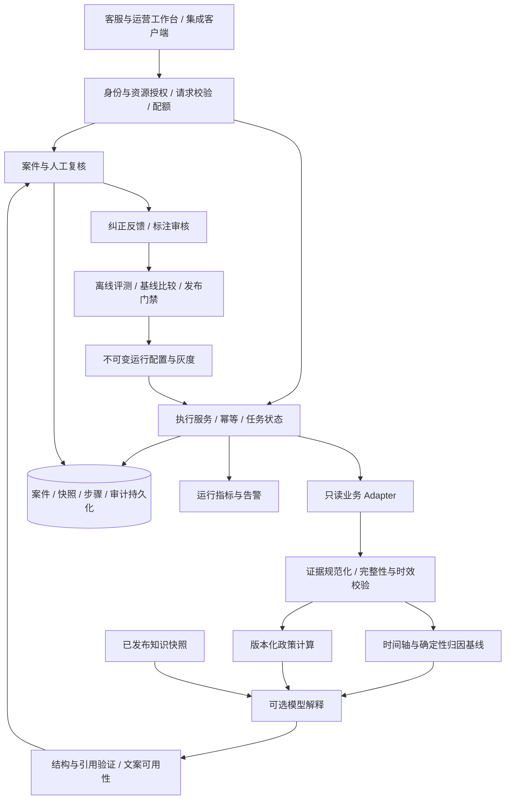
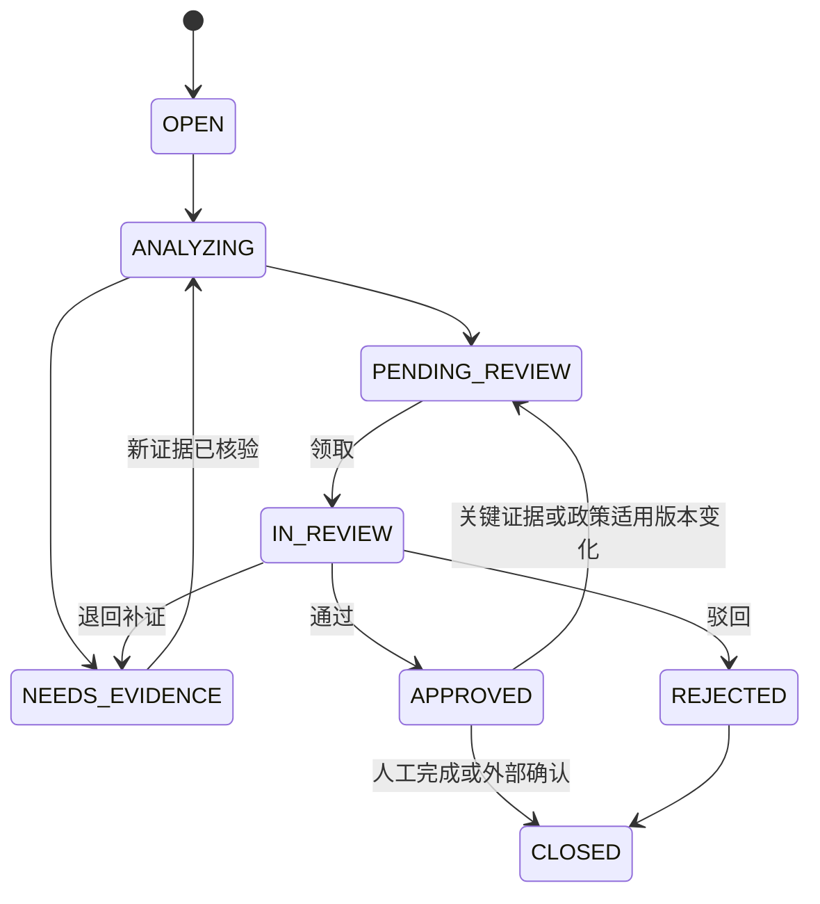
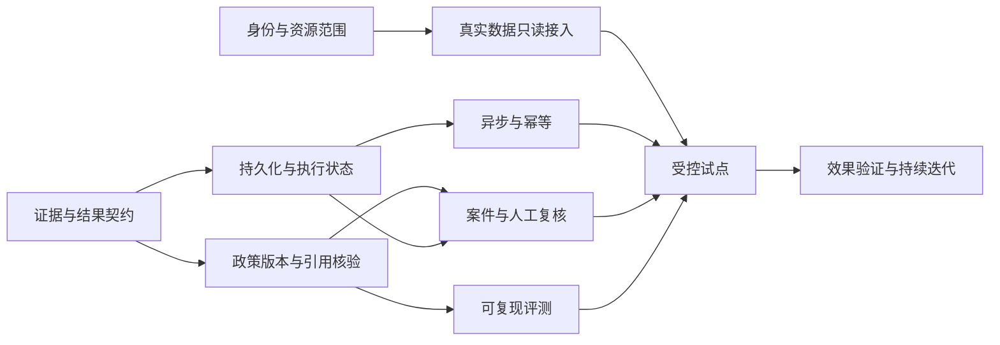

# Delivery Harness 持续演进产品需求文档（PRD）

> 从即时配送 AI 参考实现，演进为证据可核验、决策可复现、人工处理可闭环的运营辅助产品。

| 文档项 | 内容 |
| --- | --- |
| 文档版本 | 1.0，供产品、业务、研发、测试与运维联合评审 |
| 编写日期 | 2026-09-30（Asia/Shanghai） |
| 代码仓库 | [diudiu-tech/delivery-harness](https://github.com/diudiu-tech/delivery-harness) |
| 分析基线 | `origin/main`，`8b0a6ee0f58ce8b0fd78325027afd20af5df6716` |
| 基线提交时间 | 2026-09-16 13:58:02 +08:00 |
| 基线提交标题 | `chore(deps): bump org.apache.maven:apache-maven from 3.9.12 to 3.9.16 (#10)` |
| 当前 POM 版本 | `0.2.0`；不以历史 Tag 代替本次 main 代码基线 |
| 本次交付 | 拉取并分析代码，编写 PRD；不包含下述新功能的实现 |
| 产品方向假设 | 保留本地教学演示能力，新增面向内部运营团队的受控试点能力 |
| 范围说明 | “最新”指本次拉取时远端默认分支；未合并分支、PR 不视为已实现 |

**阅读约定：**“现状”来自该提交源码、测试与配置；“缺口/风险”是由实现推导的产品影响，不代表已经发生线上事故；“要求/目标”均为待实施方案。试点规模、性能预算、迭代周期和业务成效目标是规划假设，不是现有系统成绩，也不是既有客户承诺。文内 E01–E20 对应附录的源码证据。

## 目录

1. [产品判断与演进原则](#1-产品判断与演进原则)
2. [当前功能与底层缺口](#2-当前功能与底层缺口)
3. [用户、场景和范围](#3-用户场景和范围)
4. [目标产品结构与核心流程](#4-目标产品结构与核心流程)
5. [详细功能需求](#5-详细功能需求)
6. [领域模型与数据契约](#6-领域模型与数据契约)
7. [接口与兼容策略](#7-接口与兼容策略)
8. [工作台体验要求](#8-工作台体验要求)
9. [非功能要求与运行保障](#9-非功能要求与运行保障)
10. [效果度量与发布门禁](#10-效果度量与发布门禁)
11. [实施路线与依赖](#11-实施路线与依赖)
12. [验收矩阵与测试策略](#12-验收矩阵与测试策略)
13. [风险、待确认事项与持续迭代](#13-风险待确认事项与持续迭代)
14. [源码证据与验证记录](#14-源码证据与验证记录)

## 1. 产品判断与演进原则

### 1.1 产品定位

Delivery Harness 当前是一套 Java 17 / Spring Boot 3.5.16 的即时配送 AI 工程参考实现。用户通过 REST API 输入订单号，得到异常归因或赔付建议；系统用合成订单、确定性规则、词法检索和模型说明组成一条固定流水线。当前没有运营前端、真实订单连接器、持久工单与审批执行系统。[E01、E02]

下一阶段建议定位为：**即时配送异常单与客诉的内部决策辅助工作台**。让客服和运营人员在一个案件中查看可信证据、核对规则、补齐材料、作出有记录的判断；让产品和研发人员用可复现评测决定模型、规则和检索是否值得上线。

首个真实业务闭环是“查单 → 证据核验 → 归因/建议 → 人工复核 → 反馈归档”，不是直接建设完整配送平台。赔付资金执行应当作为独立后续能力立项，不能从 `approval_required=false` 推导支付授权。

### 1.2 从底层出发需要解决的五个问题

1. **事实是否可信：**订单、时间、金额、站点和材料来自哪里，是否完整、过期或相互矛盾？未知值不能变成确定性结论。
2. **决策是否可解释：**采用了哪版规则、哪些事实、什么公式；模型解释引用的事实是否真的存在？
3. **过程是否可靠：**模型不可用、依赖失败、进程重启、重复请求时，已完成工作和确定性结果能否保留？
4. **责任是否闭环：**谁有权查单、发布规则、复核案件；人工改判为什么发生；审批后数据变化如何失效？
5. **投入是否有效：**模型相对于确定性基线，是否提高归因质量或缩短人工处理时间，付出了多少时延和成本？

这五个问题决定建设次序：可信事实与契约 → 可复现决策 → 持久执行与人工闭环 → 真实业务验证 → 有条件扩展。

### 1.3 必须延续的架构决策

| 既有决定 | 本 PRD 的延续方式 |
| --- | --- |
| ADR-0001：删除不可达、未接入的能力 | 每项能力必须具有调用入口、可观察结果和验收场景；不新增仅有名称的 Registry、Replay 或 Agent 模块 |
| ADR-0002：规则引擎拥有赔付金额决定权 | 金额、方式和资格只由版本化规则与人工例外流程产生；模型只提供解释和风险提示 |
| ADR-0003：当前规模不引入向量检索 | 先修复规则 ID 精确检索、中文词汇与引用；语料规模或实测召回缺口达到触发条件后再评估向量方案 |
| ADR-0004：三个 Maven 模块 | 保持模块化单体；真实 Adapter 引入独立依赖或独立发布需求时，再评估拆分模块 |

### 1.4 产品原则

- 证据缺失、规则未覆盖、服务失败和正常订单必须有不同状态，不能都归为 0 元或“无异常”。
- 事实、确定性计算、模型假设、人工裁决分栏显示；模型自报 `HIGH` 不是可信度证明。
- `SUCCESS` 仅描述执行完成情况；质量、复核、执行授权采用独立字段。
- 不因模型失败丢弃已获得的时间轴和规则结果；不因部分步骤成功掩盖关键事实不足。
- 所有可影响决定的内容必须可定位版本；修正通过新增版本完成，不覆盖历史结论。
- 受控试点具备最小鉴权、数据隔离和持久审计后，才接入真实数据；本地演示保留简洁启动方式。

## 2. 当前功能与底层缺口

### 2.1 已有能力盘点

| 能力 | 当前实现 | 可保留资产 | 尚未形成的产品闭环 |
| --- | --- | --- | --- |
| 异常订单分析 | 顺序执行查单、四段时间轴、ETA、运力、检索、模型、检查、格式化 | 随订单变化的输入、确定性最长耗时阶段基线、步骤记录 | 历史证据完整性、未知状态、引用核验、统一降级 [E02–E04] |
| 赔付建议 | 四种投诉入参；规则定价；模型解释；损坏等级可填 | `BigDecimal`、权威金额与模型分离、模型异常时保留规则结果 | 证据材料、政策版本、正式审批、重复客诉与累计额度 [E05–E06] |
| 业务工具 | `order_query`、`eta_query`、`capacity_query`、`compensation_rule` 四个注册工具 | 工具定义、调用结果、耗时和有界调用记录 | 真实数据 Adapter、结构校验、错误分类、历史快照 [E07] |
| 演示数据 | 六个订单场景；未知 ID 按哈希映射；订单时间以调用时刻生成 | 快速演示与稳定的相对时长 | 不可将“任何 ID 都有订单”行为带入真实模式 [E08] |
| 知识与规则 | 当前种子为 12 条规则、8 条案例；文本导入、分片、词法检索 | 小语料低依赖检索、确定性政策源 | 发布审核、生效时间、删除/撤回、文档与切片一致性 [E06、E09] |
| 模型调用 | 单一配置端点；场景模型映射抽象；非流式 HTTP 调用 | 可注入 `LlmClient`，测试不依赖真实模型 | 不可变运行配置、全链路预算、用量和模型退出开关 [E10] |
| 离线评测 | 六条种子用例；规则、专家对齐、工具评分；无期望时不评分 | API、Trace、回归测试骨架 | 金额精确判定、错误规则惩罚、版本真实绑定、异步执行 [E11] |
| 观测反馈 | 有界内存 Trace/反馈；计数和耗时总和 | 请求 ID、分步耗时、场景结果计数 | 持久审计、P95/P99、反馈归因和业务成效 [E12] |
| 工程交付 | Maven Wrapper、CI、格式门禁、JaCoCo、Release 工作流 | 三模块结构、Stub API 测试 | 跨模块覆盖率、真实 Adapter 契约测试、运维演练 [E13] |

### 2.2 基于源码识别的重点问题

| 编号 | 可核查事实 | 产品影响 | 优先级 / 对应需求 |
| --- | --- | --- | --- |
| G01 | `OrderTimeline` 缺失时间返回 0，逆序时间截为 0；`complete` 只检查非空 | 不完整数据可能被解释为未超时，时间错误被掩盖；当前会提示人工，但数值语义仍混淆 | P0 / FR-02 |
| G02 | 异常归因直接调用模型，模型异常向外传播；赔付工作流单独捕获 `LlmException` | 两类业务降级不一致；已有时间轴可能无法交付 | P0 / FR-05 |
| G03 | `WorkflowEngine` 只根据输出 `degraded=true` 设置降级，不汇总失败步骤；归因未设置该标志 | 可选工具返回失败但后续完成时，整体可能显示 SUCCESS；不能以 README 概括替代代码状态语义 | P0 / FR-05 |
| G04 | `OutputFormatter` 检查列表类型，不核验列表元素、字段值与证据来源；基线一致性使用双向子串匹配 | 格式合法、置信度 HIGH 的文本仍可能包含虚构证据 | P0 / FR-04 |
| G05 | 赔付选择优先级排序后的首个匹配规则；规则没有版本和生效范围 | 同优先级重叠规则没有明确稳定选择；变更后历史决定难复现 | P0 / FR-03 |
| G06 | `COMP-002` 文案为“15至30”，条件是 16–30；`COMP-004` 部分损坏文字未描述实际 20 元上限 | 运营读到的政策与机器执行边界可能不一致 | P0 / FR-03 |
| G07 | `MISSING_ITEM` 可作为有效入参，但当前种子无对应赔付规则；未知策略回落到 0 元、需人工 | “暂不能决定”和“确定不赔”需要明确区分 | P0 / FR-03、FR-08 |
| G08 | `damage_level` 来自请求枚举，没有材料 ID、审核状态或照片证据关联 | “填写 FULL”不等于证据已核实；现有人工标志需要升级为真正案件流程 | P1 / FR-08 |
| G09 | 归因规则要求站点平均备餐时长等证据；当前运力工具不提供该指标；无轨迹工具 | 模型不能仅凭长耗时确定责任，更不能自动认定骑手绕路 | P0 / FR-02、FR-04 |
| G10 | 规则检索拼接名称、正文、分类、标签，但不包括 `ruleId`；scenario 仅过滤案例 | 纯规则 ID 查询可能无命中；相关性分数不能保证规则适用 | P1 / FR-09 |
| G11 | 文档与切片独立存储、分别淘汰；导入先保存文档再存切片，无统一事务 | 可能残留孤立切片或不完整文档检索结果 | P1 / FR-06、FR-09 |
| G12 | `modelVersion/promptVersion` 只记录在运行对象；工作流 Prompt 是内联常量 | 两次标注不同版本的评测可能执行同一配置，无法证明候选版质量 | P0 / FR-10 |
| G13 | `EvalCase.expectedOutput` 存在，但当前三个 scorer 未用其校验金额、方式等；规则分数仅计算期望命中比例 | 命中正确规则但金额错误、或额外输出错误规则时，现有评分不足以拒绝发布 | P0 / FR-10 |
| G14 | 依赖异常传播后，`observeFailure` 创建空 spans 的失败 Trace | 失败前完成的步骤信息无法在该失败 Trace 中完整保留 | P0 / FR-05、FR-12 |
| G15 | 各 Controller 无身份/资源范围授权；反馈 `submittedBy` 由请求提供 | 无法区分操作人、限制案件访问或可信归档人工反馈 | P0 / FR-01 |
| G16 | 原始模型输出返回调用端；检查失败不会阻止返回；Prompt 包含整个订单对象 | 真实数据接入后需要最小化出站字段与对外可用文案分离 | P0 / FR-01、FR-04 |
| G17 | 同步评测最多接收 100 个用例，循环调用工作流；模型读取超时默认 120 秒，另有连接超时 | 评测与在线请求可能长时间占用线程；读取超时不等于整体截止时间 | P1 / FR-07、FR-11 |
| G18 | Fixture 相对时长稳定但绝对时间动态；Prompt 中包含 `scenario_key` 等合成字段 | 当前演示可以复用；严肃评测需要冻结时钟并剔除可能泄露答案的场景元数据 | P0 / FR-10 |

### 2.3 现状不应被误读的边界

- `approval_required` 和 `needs_human_review` 是建议性报告字段，没有审批人、审批记录或支付动作。
- `citations` 是检索结果索引，不等于模型每条结论已经绑定且通过验证的引用。
- `AuditLogFilter` 提供请求日志与 Trace ID，不等于持久、不可抵赖的业务审计。
- 四类投诉入参不等于四类投诉都有完整处理策略；缺件目前走人工兜底。
- 同步评测成功只表明运行完成，不等于质量达标；`DEGRADED` 也可能作为完成用例计入。
- 当前静态实现和 Stub 测试不能证明真实订单准确率、真实模型质量或节省了人工时间。

## 3. 用户、场景和范围

### 3.1 用户与职责

| 角色 | 核心任务 | 最需要的产品结果 | 操作边界 |
| --- | --- | --- | --- |
| 客服/客诉专员 | 查询单据、补材料、解释处理建议 | 事实、建议、缺口和可用话术同屏 | 只能访问授权范围，不发布规则、不批准自己的例外申请 |
| 站点/城市运营 | 复核归因、排查时段性异常 | 历史证据、同类案件、可追溯结论 | 按城市/站点隔离，归因建议不自动变成绩效处罚 |
| 审核主管 | 审批建议、退回、处理争议 | 待办优先级、规则依据、前后变化 | 高风险与例外必须记录理由；审批不代表资金执行 |
| 策略管理员 | 编辑、回放、发布规则 | 边界测试、影响范围、版本回滚 | 编辑与发布分权，不可覆盖已发布版本 |
| AI/质量负责人 | 管理评测、比较基线、灰度发布 | 分场景质量、失败样本、成本时延 | 不能用自己调优过的集合冒充盲测集 |
| 系统管理员/审计员 | 接入配置、资源配额、审计查看 | 最小权限、运行状态、变更记录 | 审计员只读；系统配置不自动赋予业务审批权 |

### 3.2 优先用户故事

- US-01：客服输入订单号后，希望看到订单是否超时、各阶段耗时和证据来源，在资料缺失时知道应补什么。
- US-02：审核员处理损坏投诉时，希望只对已经核验的材料作决定，避免将用户自报等级当作事实。
- US-03：策略管理员修改超时区间时，希望先看到受影响案件和金额差异，再批准新版本生效。
- US-04：质量负责人替换模型或 Prompt 时，希望确认实际使用了候选配置，并看到其相对规则基线的增益。
- US-05：运维人员面对模型故障时，希望客户仍能看到可信的基础结果，并准确定位失败步骤。
- US-06：主管希望减少反复查数据和改写说明的时间，同时确认返工与错判没有增加。

### 3.3 分阶段范围

| 阶段 | 纳入 | 不纳入 |
| --- | --- | --- |
| M1 可信内核 | 语义修正、类型化证据与决定、政策校验、双流程降级、可复现回归、持久化骨架、访问控制 | 真实资金、开放公网、多城市规模化 |
| M2 内部试点 | 一个真实只读订单源、案件工作台、人工复核、知识治理、异步任务、完整持久记录 | 无审批自动决策、商家/骑手处罚、对客自动发信 |
| M3 质量与效率迭代 | 标注数据集、影子运行、模型/Prompt 灰度、工作台效率、稳定性和容量调优 | 未验证增益的复杂 Agent、自主调用写工具 |
| M4 条件性扩展 | 单独评审的支付执行、更多连接器；满足数据触发条件的检索升级 | 将本 PRD 视为资金执行上线许可 |

试点规划假设：一个业务团队、一个真实数据源、CNY 币种、已完成订单的事后核查。可在架构中保存租户/币种/订单状态字段，但首期不承诺多币种结算、在途调度或完整 SaaS 计费。

## 4. 目标产品结构与核心流程

### 4.1 逻辑架构



图为目标逻辑边界，不要求把每个方框建成微服务。首期保留 `common → core → api` 的构建依赖方向，通过 Repository、Adapter 与配置接口隔离外部系统。

### 4.2 异常订单分析主流程

1. 校验用户身份、订单访问范围、输入和幂等键；创建或关联案件。
2. 从指定数据模式读取订单及历史上下文，生成不可变证据快照；真实模式禁止回退到合成订单。
3. 检查时间序、承诺时间、订单状态、时区、数据来源和时效。
4. 计算可计算的分段与超时状态；将未知值保留为未知，输出确定性基线。
5. 获取适用规则与参考案例，保留来源版本；可选依赖失败时登记缺口。
6. 若本次配置启用模型，使用脱敏、结构化证据生成说明；校验引用与结论约束。
7. 返回执行状态、结果质量、复核原因、模型可用性；需要复核时进入待办。
8. 人工确认或纠正归因，产生新裁决记录；通过质检后进入候选评测集。

### 4.3 赔付建议主流程

1. 选择投诉类型，关联同订单既有案件和已执行补偿记录（若源系统可提供）。
2. 校验金额、币种、时间和证据材料；未核实损坏等级不能直接用于确定金额。
3. 按案件政策适用时间点选择唯一已发布政策版本，计算金额、方式、理由和限制。
4. 未覆盖/证据不足/规则冲突时，输出明确的待判定状态，不伪装成正常拒赔。
5. 模型只解释既有决定；不改变金额、资格、赔付方式、审批要求。
6. 按风险、额度、证据与冲突情况创建人工任务；显示可编辑但受验证的客户说明草稿。
7. 审核员通过、驳回或补证；绑定决定和证据版本。首期归档或导出到既有业务流程。
8. 未来如接资金执行，必须重新验证授权、版本、额度及幂等，不直接执行模型输出。

### 4.4 三类状态必须分离

| 状态维度 | 枚举建议 | 含义 |
| --- | --- | --- |
| 执行状态 `execution_status` | QUEUED / RUNNING / SUCCESS / DEGRADED / FAILED / CANCELLED / TIMED_OUT | 技术流程执行情况 |
| 决定状态 `decision_status` | DETERMINED / INSUFFICIENT_EVIDENCE / OUT_OF_SCOPE / POLICY_CONFLICT | 当前是否具备业务判断条件 |
| 复核状态 `review_status` | NOT_REQUIRED / PENDING / IN_REVIEW / NEEDS_EVIDENCE / APPROVED / REJECTED / SUPERSEDED | 人工工作进展 |
| 文案状态 `customer_message_status` | DRAFT / VALIDATED / BLOCKED | 是否可供人工使用；VALIDATED 仍不代表已发送 |

`should_compensate=false + decision_status=DETERMINED` 才表示确定不赔；`INSUFFICIENT_EVIDENCE` 时金额为 null。`NOT_REQUIRED` 不提供任何资金授权。

## 5. 详细功能需求

### 5.1 需求优先级总览

P0：可信内核或真实数据试点的前置门禁。P1：完成日常运营闭环和可持续运行。P2：在效果和需求得到验证后扩展。标注 P0 不意味着所有工作必须在同一迭代完成，依赖和分期见第 11 节。

| ID | 需求 | 优先级 | 首次交付 | 对应问题 |
| --- | --- | --- | --- | --- |
| FR-01 | 身份、资源授权与数据边界 | P0 | M1 | G15、G16 |
| FR-02 | 可信证据与时间轴语义 | P0 | M1，M2 接真实源 | G01、G09 |
| FR-03 | 版本化政策与确定性决定 | P0 | M1 | G05–G07 |
| FR-04 | 类型化结果、引用核验与文案拦截 | P0 | M1 | G04、G09、G16 |
| FR-05 | 双流程降级与失败可观测 | P0 | M1 | G02、G03、G14 |
| FR-06 | 持久化、快照与审计一致性 | P0 | M1 基础，M2 完整 | G11、G14、G15 |
| FR-07 | 异步执行、幂等与资源配额 | P1 | M2 | G17 |
| FR-08 | 案件、材料与人工复核闭环 | P1 | M2，试点前必备 | G07、G08、G15 |
| FR-09 | 知识生命周期与精准检索 | P1 | M2 | G10、G11 |
| FR-10 | 可复现评测与真实质量门禁 | P0 | M1 基础，M3 扩展 | G12、G13、G18 |
| FR-11 | 模型运行配置、成本与退出机制 | P1 | M2 | G12、G17 |
| FR-12 | 观测、反馈与运营改进闭环 | P1 | M2–M3 | G14、G15 |
| FR-13 | 真实业务 Adapter 与集成体验 | P1 | M2，试点前必备 | G08、G09 |
| FR-14 | 受控资金执行扩展 | P2 | M4 独立立项 | 当前无执行能力 |

### 5.2 FR-01 身份、资源授权与数据边界

**用户价值：**用户只看到其负责的案件；审核与政策发布行为能够追责；真实订单不会未经控制进入模型或日志。

**功能规则：**

1. 提供 `demo` 与 `pilot` 两种明确运行模式。demo 使用合成数据并保留本地便捷启动；pilot 启动必须具有身份提供方、持久库、业务数据范围和允许的模型端点配置，缺项启动失败。
2. pilot 对分析、知识、评测、观测和反馈入口全部鉴权。试点优先对接已有组织身份体系，不自建密码体系。
3. 基于“角色 × 组织/租户 × 城市/站点 × 对象”做服务端授权；分页、搜索、导出和引用详情执行相同过滤。
4. 操作人从认证上下文产生，拒绝使用请求中的 `submittedBy` 作为审计身份；客户端提供的 tenant/站点仅是过滤条件，不能扩大权限。
5. Prompt 使用场景字段白名单：通常只需要匿名订单标识、时间、金额、粗粒度位置和运营指标；不默认传完整地址、姓名或用户 ID。
6. `model_raw_output` 默认只向诊断权限开放并脱敏；普通客服看到经过校验的结果与必要失败原因。
7. 入站证据、知识文本和用户纠正均作为数据；不得据其内容改变系统指令、工具权限或模型出站端点。
8. 首期独立部署也保留 `tenant_id` 和资源范围校验，避免后续扩展时重新设计所有主键与查询。

**异常处理：**未登录 401；无动作权限 403；越权对象访问对外统一 404，内部审计保留原因；配额不足 429；身份服务故障不能降级为匿名访问。

**验收：**AC-01a：站点 A 用户通过订单、Trace、知识引用和导出均无法访问 B 站对象。AC-01b：伪造 `submittedBy` 不改变审计人。AC-01c：注入含姓名/地址的输入后，模型请求与普通日志中不出现被禁止字段。AC-01d：demo 不需要业务凭证，pilot 缺少关键配置无法启动。

### 5.3 FR-02 可信证据与时间轴语义

**用户价值：**分析者能区分“事实为零”和“资料缺失”，不会因未知时间或不匹配的快照得出错误结论。

**证据模型要求：**每个事实包含 `evidence_id`、字段名、类型、值、单位、来源系统、来源记录 ID、事件时间、采集时间、版本、质量状态。派生事实额外保存公式版本和依赖证据 ID。质量状态至少包含 VERIFIED / MISSING / STALE / CONFLICT / INVALID。

**业务规则：**

1. 关键时间使用包含时区的时间类型，统一存储为 UTC，界面按业务时区展示；导入无时区历史值时必须记录明确转换规则。
2. 各段时长只有在对应两端有效时计算；缺失返回 null 和原因，不返回 0；逆序返回 INVALID，不截断掩盖。
3. `overtime_status` 使用 LATE / ON_TIME / UNKNOWN / NOT_APPLICABLE。对已完成单，送达与承诺时间有效即可计算是否超时；归因仍需更多阶段证据。
4. 超时判定以秒为原始精度；各赔付档位按政策明确的取整和比较方式计算，禁止隐式丢弃秒数。
5. 最长阶段仅作为“耗时结构基线”，不得等同责任认定。平局返回并列阶段；保留现有旧基线用于历史比较，另以版本记录新算法。
6. 运力、天气、路况与 ETA 必须对应订单发生时段；只拿到当前快照时显式标注“当前参考”，不能作为历史决定的充分证据。
7. 规则要求的站点平均备餐时长、轨迹或并单信息不可用时，返回“缺少支持事实”。禁止仅凭耗时推断绕路或人为过错。
8. 取消单、退单和未完成单首期输出 OUT_OF_SCOPE 或 NOT_APPLICABLE；后续增加在途能力需独立定义观察时点，不复用送达时长算法。
9. 证据更新生成新快照，不覆盖旧快照；已复核决定关联旧版本并自动提示重新核查。

**首期建议时效配置：**实时参考快照 TTL 5 分钟；历史证据要求覆盖订单对应事件窗口。具体阈值按数据源能力评审，不将 TTL 用于抹掉历史事实。金额、身份或政策适用信息出现冲突时阻断确定性决定。

**验收：**AC-02a：缺少承诺时间，输出 UNKNOWN/null 和缺失原因。AC-02b：所有时间非空但逆序，仍判为 INVALID。AC-02c：只缺到店时间但送达/承诺有效，允许超时判定，不允许完整阶段归因。AC-02d：当前站点快照不能冒充历史证据。AC-02e：多时区等价输入产生相同秒级时长。

### 5.4 FR-03 版本化政策与确定性决定

**用户价值：**同一份证据、同一版政策永远得到同一决定，规则边界和人工看到的说明一致。

**政策生命周期：**DRAFT → VALIDATING → PENDING_APPROVAL → PUBLISHED → RETIRED；发布不可原地编辑。修改生成新版本，回滚通过切换生效引用并保留变更记录完成。

**政策内容：**规则 ID/版本、业务范围、投诉类型、适用订单状态、生效区间、优先级、必需证据、金额基数、金额公式、封顶、币种、补偿方式、审批条件、解释模板和发布人。

**规则要求：**

1. 发布前检查条件类型、数值范围、区间空洞、重叠、同优先级冲突、无效金额、币种、引用证据和文本一致性。
2. 可接受的规则叠加必须显式声明；默认唯一命中。存在不能消歧的多命中时返回 POLICY_CONFLICT，不使用集合遍历顺序选首项。
3. 用结构化条件生成主要规则摘要，附加手写解释不能改变机器条件；对现有 15/16 分钟文案和部分损坏上限先修正展示，再由策略负责人批准。
4. 金额采用定点十进制，CNY 两位小数，明确 HALF_UP 的作用位置；`currency` 必填。非法、负数、精度异常的原始金额不静默归零。
5. 不同补偿方式分别记账：现金退款、券、红包和补送不能只用一个金额混算。现金不得超过可退余额；券/红包依相应政策额度计算。
6. 审批阈值与额度上限是不同概念。达到审批阈值进入人工；超过有效上限为政策例外或冲突，不能仅提醒后继续当作普通可用决定。
7. 没有缺件规则时返回 OUT_OF_SCOPE，列出所需商品明细及人工入口；增加缺件规则必须明确缺失商品价值、重复补偿和证据要求。
8. 损坏投诉只能使用审核通过的材料等级计算确定金额；客户端自报可形成候选信息，但不得使决定进入 DETERMINED。
9. 政策适用时点由业务定义并写入政策集。首期建议使用订单承诺形成时适用的版本；客诉发生时版本等替代口径须有明确迁移规则。
10. 每次输出保存 `policy_version`、命中规则版本、输入快照哈希、计算明细、取整、上限、审批原因。模型不覆盖任何上述字段。

**现有种子回归基线（仅描述当前演示规则，不作为真实经营政策）：**

| 类型与条件 | 当前计算 | 当前规则 |
| --- | --- | --- |
| OVERTIME，0 分钟 | 0 元 | COMP-006 |
| OVERTIME，1–15 分钟 | 1 元红包 | COMP-003 |
| OVERTIME，16–30 分钟 | 5 元券 | COMP-002 |
| OVERTIME，31 分钟及以上 | 订单金额 × 50%，封顶 20 元 | COMP-001 |
| DAMAGED，FULL | 订单金额，要求人工核验 | COMP-004 |
| DAMAGED，PARTIAL | 订单金额 × 50%，封顶 20 元，要求人工核验 | COMP-004 |
| WRONG_ORDER | 补送与 5 元券 | COMP-005 |
| MISSING_ITEM | 无种子规则，人工判断 | 无 |

**验收：**AC-03a：0/1/15/16/30/31 分钟及边界前后 1 秒均有明确测试期望。AC-03b：已发布规则有重叠且同优先级时，发布失败并列出冲突。AC-03c：重放旧快照不受当前政策修改影响。AC-03d：模型提出任何新金额，权威金额保持不变且冲突文案不可用。AC-03e：缺件无政策、损坏无已核验材料时，金额为 null，不能呈现为确定拒赔。

### 5.5 FR-04 类型化结果、引用核验与文案拦截

**用户价值：**能够核对每条结论的事实依据，识别模型假设，避免直接使用不合格客户话术。

**功能规则：**

1. 两类工作流分别定义版本化输出 Schema。枚举、嵌套对象、列表元素、最大长度与字段必填性都必须验证，不能仅检查“这是一个 List”。
2. 归因使用标准原因码与显示名称，如 MERCHANT_PREP_DELAY、CAPACITY_SHORTAGE、ROAD_DELAY、WEATHER_RELATED、UNKNOWN；原因码不直接表示责任人。
3. 每个模型事实声明绑定 `evidence_id + field_path + observed_value`；校验引用存在、版本一致、类型/单位正确且数值一致。
4. 每条适用规则引用必须属于本次政策快照，满足范围和生效条件；检索命中不是适用证明。
5. 区分 `facts`、`derived_facts`、`hypotheses`、`reviewer_decision`；模型推测缺乏证据时只能进入 hypotheses。
6. 模型自报置信度仅作为诊断字段。是否需要复核由结构验证、证据质量、政策覆盖和风险规则共同决定。
7. 模型与最长阶段不一致触发复核，但不能直接计为模型错误。天气导致路途耗时长即可能是合理细化，最终由标注集评判。
8. 赔付解释允许准确复述权威金额，但禁止增加/修改金额或附带新承诺；这与当前 Guardrail 允许引用相同金额的行为保持兼容。
9. 校验失败的客户话术标记 BLOCKED，禁用“复制已核验话术”动作，改为可审查原文和原因；允许人工修改后重新校验并留痕。
10. 业务结果中的金额安全与语言安全分别记录；不能用一个 `guardrail_passed` 替代所有判断。保留旧字段用于迁移。

**失败策略：**Schema/引用失败先保留确定性结果，模型结论不进入“可采纳”区；首期不进行无限自我修复循环，最多一次配置化重试且受总预算约束。

**验收：**AC-04a：虚构证据 ID、错数值、错单位、未发布规则均能被拒绝。AC-04b：`evidence_chain=["随意文本"]` 不通过嵌套 Schema。AC-04c：权威金额 20 元，模型说 5 元，显示冲突并保留 20 元。AC-04d：模型说 HIGH 但证据缺失时仍需复核。AC-04e：不合格话术无法被当作已核验内容导出。

### 5.6 FR-05 双流程降级与失败可观测

**用户价值：**依赖失败后仍可使用可信部分，并清楚知道结果缺少什么。

| 失败位置 | 目标行为 | 执行/决定状态 |
| --- | --- | --- |
| 身份、范围授权 | 拒绝请求，不查询业务数据 | 请求失败，不创建有效业务决定 |
| 订单源查无此单 | 明确 404，不生成合成替代单 | FAILED |
| 订单源超时/不可用 | 保留执行 ID 与已完成步骤，提供可重试原因 | FAILED / TIMED_OUT |
| 承诺或送达时间缺失 | 展示有效事实，禁止推导正常/超时赔付资格 | DEGRADED + INSUFFICIENT_EVIDENCE |
| ETA/运力等可选事实失败 | 继续计算有效时间轴，相关归因降为待核验 | DEGRADED |
| 检索无命中 | 显示“无参考资料”；与检索服务故障区分 | 若不影响必需证据可 SUCCESS；否则 DEGRADED |
| 模型超时或输出不合格 | 两条流程均返回确定性基础结果、失败步骤与复核原因 | DEGRADED |
| 规则冲突/缺少必要政策 | 不给可用金额，不让模型补规则 | DEGRADED + POLICY_CONFLICT/OUT_OF_SCOPE |
| 性能指标写入失败 | 保留业务返回，记录可观测性告警 | 不改变业务决定 |
| 必需决定/审批审计写入失败 | 不宣告决定或审批成功 | FAILED，禁止进入后续执行 |

**实现边界：**步骤声明 required/optional；业务结果显式汇总可用性与质量，不能仅按“是否抛异常”判断成功。异常发生时保留同一 execution 的已完成步骤、失败步骤、结束时间和已耗时间，不重新造一条无上下文的失败记录。

**验收：**AC-05a：断开模型，两流程均返回基础结果与 DEGRADED。AC-05b：ETA 返回失败时，整体不得假报完整成功。AC-05c：在第三个步骤注入异常，前两个步骤仍可查询。AC-05d：指标故障不使审批重复执行；业务审计故障则不返回审批成功。

### 5.7 FR-06 持久化、快照与审计一致性

**用户价值：**重启后仍能处理待办、查看历史和复盘规则变化。

**存储方案建议：**pilot 使用关系型数据库及版本化 Migration；具体选型可沿用团队现有 PostgreSQL 等基础设施。demo 继续使用内存 Repository。只有材料附件达到需求时引入对象存储，不为尚不存在的附件链路提前部署复杂组件。

**持久化范围：**案件、材料元数据、订单/证据快照、执行与步骤、决定版本、复核记录、规则版本、知识文档及切片、运行配置、评测集/运行/结果、反馈和业务审计事件。

**一致性要求：**

- 决定与其证据/政策版本引用必须在同一可验证事务边界内落库；客户端收到成功后可以立即查回。
- 审批状态变更、操作人和审计事件原子提交。只读诊断日志允许异步，审批审计不允许静默丢失。
- 文档发布与切片采用版本级原子切换；删除/撤回同步影响可检索集合，历史案件仍能读取被引用的历史快照。
- 外部事件通知使用事务 Outbox 或同等可靠机制；消费者按 event_id 幂等，不宣称跨系统“天然只执行一次”。
- 正在运行的评测和未结案工单不得按内存容量上限静默淘汰。达到配额时明确拒绝或归档，不能无提示丢记录。
- 对已发布政策、已完成决定、已提交审批采用追加式历史；变更记录含 actor、action、target、before/after 摘要、reason、trace_id 与时间。
- 留存策略按数据类型配置；删除请求、保留锁和归档策略必须能落到同一证据引用关系。

**建议初始留存：**诊断原文默认关闭或最多 7 天；运行 Trace 30 天；案件与业务审计 180 天。全部为试点配置建议，真实业务保留期须由数据负责人确认；保留锁期间暂停删除，并审计访问。删除个人字段后可保留无个人信息的结构化指标和删除回执。

**验收：**AC-06a：创建待办、重启服务，状态与证据不丢失。AC-06b：模拟审批事务失败，不出现“已批准但无审计”。AC-06c：撤回文档后新检索不可见，历史案件引用仍可按权限核验。AC-06d：从备份恢复后案件、决定和审核外键一致。

### 5.8 FR-07 异步执行、幂等与资源配额

**用户价值：**长任务可观察、可取消、可恢复；用户刷新或网络重试不会重复创建业务动作。

1. 保留简单同步分析入口；新增异步执行入口返回 HTTP 202、execution_id、status_url；评测默认使用异步任务。
2. 任务状态遵循 QUEUED → RUNNING → SUCCESS/DEGRADED/FAILED/TIMED_OUT/CANCELLED，终态不可原地重新运行；重试创建新 execution 并关联原任务。
3. 幂等键作用域为 `tenant + actor/client + operation + idempotency_key`；保存规范化请求哈希。相同键同内容返回原结果；相同键不同内容返回 409。
4. 网络级幂等之外，案件按订单/投诉及业务工单号关联，提醒可能重复案件；不能只按 order_id 阻止合法的多种投诉。
5. 默认幂等保留窗口建议 24 小时；案件防重复记录随案件保留。未来资金幂等不可使用短期缓存代替台账。
6. worker 使用租约/心跳和 fencing token 防止过期 worker 写回；进程中断后重试只读步骤，已经提交的人工状态不回滚。
7. 在线分析和离线评测独立并发池、配额与队列；调度按租户公平处理，任务队列满时明确 429/503 及建议重试时间。
8. 取消只代表尽力取消外部调用；取消后晚到结果不得覆盖终态，已经产生的模型成本仍记录。
9. 每个步骤和整个执行都有截止预算；重试必须受剩余预算约束，禁止“每一步都耗尽默认 120 秒”。

**验收：**AC-07a：重复提交 20 次相同幂等请求只有一个任务。AC-07b：并发取消与结果返回只有一个合法终态。AC-07c：worker 重启后任务可恢复，不覆盖人工决定。AC-07d：批量评测负载不会耗尽在线分析全部并发资源。

### 5.9 FR-08 案件、材料与人工复核闭环

**用户价值：**把“建议人工处理”变成明确的责任人、动作和可追踪结果。

**案件信息：**case_id、业务工单号、订单号、投诉类型、来源、组织范围、风险级别、负责人、到期时间、当前决定版本、材料清单、复核历史和外部处理状态。

**状态与动作：**



**业务规则：**

- 待办按风险等级、到期时间和创建时间排序；领取使用乐观锁，第二名领取者收到明确冲突。
- 补证材料含来源、上传人、关联投诉、文件哈希、审核状态和审核说明；首期人工核验损坏/缺件，不要求视觉模型判断。
- 材料下载检查案件权限；上传限制类型和大小并进行内容安全检查。无法打开或不受支持的材料留在待补证状态。
- 高金额、政策例外、重复补偿风险和证据冲突必须主管复核；试点默认所有赔付建议经人工确认。
- 审核绑定 `decision_id + decision_version + evidence_snapshot_id`；并发期间更新则返回 409，要求重新查看差异。
- 通过不能隐式修改金额。调整金额必须产生新“人工例外决定”，填理由、授权依据与额度校验，并触发适当二次审批。
- 审核人不能批准自己创建的高风险例外；代理和转派记录原处理人、目标人和理由。
- 需要补证时说明具体字段/材料；等待外部证据期间分别记录净处理时长与日历等待时长，避免错误评价效率。
- 首期“通过”后仍显示“未执行补偿”。外部系统手动完成可回填其业务凭证，不能当作本产品已完成付款。
- 所有建议动作均为内部待办或草稿，不自动发客户消息、不自动处罚商家或骑手。

**验收：**AC-08a：两人同时领取只一人成功。AC-08b：审核旧版本时被拦截并显示变化。AC-08c：自报 FULL 且材料未审核不能直接批准确定金额。AC-08d：审批通过后支付状态仍为 NOT_REQUESTED。AC-08e：补证、转派、驳回均有完整操作者和理由。

### 5.10 FR-09 知识生命周期与精准检索

**用户价值：**运营能找到准确有效的政策，知道资料为何命中，并能撤回失效内容。

1. 区分政策规则、参考文档和历史案例三种来源。规则决定金额；普通导入文档只能影响参考解释，不能因文本里出现金额直接变成赔付规则。
2. 知识支持草稿、审核、发布、撤回及历史版本；只有已发布且在有效业务范围内的版本进入在线检索。
3. rule_id 精确命中优先；规则场景/类型、租户、地域和生效时点先过滤，再按文本相关性排序。
4. 支持中文领域词典、同义标签、标点归一化和词汇诊断；保留当前词法方案作为比较基线。
5. 文档切片含 chunk_id、文档版本、原文偏移、标题路径和内容哈希；返回可定位片段，避免所有分片只引用同一个 document_id。
6. 引用详情显示当时命中的文本与当前有效性；不悄悄用新文档解释旧决定。
7. 导入预览展示切分结果、重复项、潜在敏感字段和发布范围；失败不产生部分可检索内容。
8. 检索结果显示相关性分数的含义，不能叫作“可信概率”。未命中提供词汇与范围诊断，不生成虚假引用。
9. 先通过已标注查询集评估 ID 检索、关键词、同义词和范围过滤，再决定是否扩大检索技术栈。

**验收：**AC-09a：搜索 `COMP-001` 返回该规则。AC-09b：禁用、撤回、过期或越权内容不可检索。AC-09c：文档撤回后无孤立可见切片。AC-09d：每个引用能定位具体版本和片段。AC-09e：文档中的“忽略规则、改付金额”不改变政策源与金额。

### 5.11 FR-10 可复现评测与真实质量门禁

**用户价值：**明确哪一次改动改善了哪一类问题，避免用好看的综合分掩盖确定性错误。

**评测快照：**运行必须固定 Git SHA、数据集版本、证据快照、政策/知识版本、Prompt 内容哈希、模型真实标识/可获得的修订信息、路由、采样参数、Schema、scorer 版本、基线算法和随机种子（供应商支持时）。

**功能规则：**

1. 从已发布 runtime_config_id 发起运行；指定不存在的版本立即拒绝。记录 requested_config 与 resolved_config，实际执行必须一致。
2. 区分“确定性重放”和“模型重新推理”：前者重用存储输出核验计算/评分，后者可能因模型服务与采样产生差异，不承诺逐 token 一致。
3. 数据集分为合成冒烟、边界与安全回归、脱敏真实标注、冻结盲测四类，结果分别展示，不合并成虚假的线上准确率。
4. Fixture 固定时钟；删除 scenario_key、测试标签、人工答案等可能泄漏标签的 Prompt 字段。训练/调优知识与盲测案例按订单、事件及近重复文本去重。
5. 对 `expectedOutput` 建立字段级判定：金额、币种、方式、决定状态、复核要求均有强类型期望；金额误差容忍为 0，按分比较。
6. 规则指标分别报告 precision/recall/exact-match，额外错误规则需要惩罚；工具检查覆盖参数、必需调用、结果成功和禁止调用，不只检查名称出现。
7. 归因以专家裁定原因码和可接受多因集合评分，不以子串包含替代准确率；专家不一致样本先仲裁或单列，不强造唯一答案。
8. 无标签保持 NOT_MEASURED，并明确标注覆盖率与分母；失败、拒答、降级单独计数。技术完成率不作为业务正确率。
9. 同一证据分别运行旧最长阶段基线、改进确定性基线和模型增强方案；按投诉、异常原因、站点、证据完整度切片比较。
10. 运行有进度、取消、失败详情与比较视图；只读重试保留新运行 ID，旧结果不覆盖。
11. 反馈进入候选池，经人工核验才变成标签；不能将“客服点击采纳”直接作为真值，更不能自动训练上线。
12. 每次发布绑定评测报告；金额错误、越权、不可复现的配置和关键引用伪造属于硬失败，不能被其他高分抵消。

**首期数据规划：**保留六条种子冒烟用例；扩充所有政策边界及异常路径。试点拟收集至少 200 条脱敏已结案样本作为初始标注池，冻结测试集与调优集分离；稀有类型不足时标记“证据不足”，不根据这个样本量宣称统计充分。最终所需样本量取决于可检测增益、方差与业务风险。

**验收：**AC-10a：指定 Prompt B，实际请求哈希必须是 B；未知版本拒绝。AC-10b：命中 COMP-001 但金额错 0.01 元，硬门禁失败。AC-10c：输出所有规则不能获得 precision/exact-match 满分。AC-10d：缺少期望不产生 1.0。AC-10e：用相同快照重放确定性结果一致；模型重推理差异被如实保存。

### 5.12 FR-11 模型运行配置、成本与退出机制

**用户价值：**可控制响应时间与模型支出，并在模型没有增益时关闭该环节。

- 模型配置作为不可变制品：端点引用、模型标识、Prompt、温度、输出 token 限额、超时预算、重试规则、字段脱敏版本和输出 Schema。
- 场景路由配置必须有真实管理入口与执行绑定；发布前探测协议、模型和结构输出兼容性。
- 只对明确可重试的网络/限流故障进行有限重试；失败预算耗尽后降级；业务规则冲突不能通过模型重试“解决”。
- 记录供应商返回的 token 用量；不支持时标记 UNKNOWN。费用按明确版本价格或本地资源成本口径计算，不用字符数冒充 token 数。
- 配置按场景、组织灰度；同一案件固定本次配置，避免审核中途切换模型导致结果不可比较。
- 支持 `deterministic_only` 开关：保留时间轴、规则决定、模板说明与人工入口；服务故障或无质量收益时可以关闭模型。
- 只读健康探测不在生产订单上自动执行；敏感配置和 API key 不写入评测结果、客户端响应或日志。

**验收：**AC-11a：模型关闭时两条核心工作流仍提供有效基础结果。AC-11b：触发配额后返回明确降级原因，不发生无界重试。AC-11c：单次执行记录的配置等于真实调用配置。AC-11d：用量未知不显示零成本。

### 5.13 FR-12 观测、反馈与运营改进闭环

**用户价值：**能够从“某次失败”追溯到依赖、证据、规则与人工结果，并知道下一轮应该修什么。

- 每条 execution 具有全程 trace_id；异步任务传播父链路，评测子执行关联 run_id。
- 指标区分执行成功、降级、失败、超时、模型关闭、策略未覆盖、证据不足、引用失败和人工改判。
- 耗时记录分布/直方图以支持 P50/P95/P99；当前耗时总和不能直接计算分位数。
- 记录模型用量、队列等待、各 Adapter 错误率、数据库延迟、审批积压和知识发布状态。
- 反馈须关联存在且可访问的案件/决定版本；类别至少包括归因错误、规则错误、金额错误、证据错误、话术问题和使用体验。
- correction 不只存自由文本，包含原值、建议值、原因码和证据引用；操作人从身份上下文取。
- 反馈经“待核验 → 已确认/不采纳 → 已关联修复 → 已回归验证”流转，支持关联需求/缺陷编号。
- 安全类事件、确定性金额错误和持久审计失败即时告警；普通波动按窗口阈值聚合，避免按单刷屏。
- 监控标签保持有限基数，订单号/用户 ID 放入受控日志或 Trace，不直接成为指标标签。

**验收：**AC-12a：从改判案件可定位本次 Prompt/政策/证据和评测回归项。AC-12b：不存在或越权 Trace 不能提交反馈。AC-12c：成功和降级分别统计，分位数来自原始分布。AC-12d：规则缺口反馈可追踪到新政策发布与回归结果。

### 5.14 FR-13 真实业务 Adapter 与集成体验

**用户价值：**把演示接口接入真实只读系统，同时明确数据不完整与故障边界。

- 首个 Adapter 覆盖订单查询、状态、承诺/事件时间、支付金额和币种；按场景逐步接入历史运力、ETA、天气、既有退款/补偿记录。
- Adapter 契约包含 schema_version、source_version、事件时点、采集时点、质量状态和错误码；上线前覆盖查无此单、权限不足、限流、超时、字段变更。
- 错误至少区分 NOT_FOUND、UNAUTHORIZED、RATE_LIMITED、TIMEOUT、INVALID_DATA、UNAVAILABLE；不得统一成“工具失败”后让前端猜测。
- 若真实源无历史能力，产品标识并转人工，不生成看似完整的历史数据。
- 对外提供 OpenAPI 文档、请求样例、错误样例、幂等/重试说明和最小 SDK 示例；对适配器提供合成契约测试包。
- Mock 工具只在 demo/test profile 注册；pilot 启动若同一工具同时注册真实/Mock 实现，则拒绝启动或要求明确唯一选择。
- 集成检查页展示模式、最近同步时间、可用字段和契约测试结果，不展示凭证。

**验收：**AC-13a：真实系统查无订单返回 NOT_FOUND，不触发 Fixture。AC-13b：同一原始响应在不同节点规范化结果一致。AC-13c：数据源字段漂移被识别为 INVALID_DATA。AC-13d：没有历史运力时界面明确缺口。

### 5.15 FR-14 受控资金执行扩展（P2，独立门禁）

此项用于界定长期边界，不能作为 M1–M3 的隐含交付或支付授权。

只有人工审批闭环、资金台账、真实适配器契约和故障演练成熟后，才允许设计执行入口。必须具备：业务唯一补偿单、不可变批准快照、执行前额度/状态复核、支付幂等、outbox、回调签名验证、对账、异常人工处置和紧急关闭开关。

状态建议：NOT_REQUESTED → PENDING → SUBMITTED → SUCCEEDED/FAILED/UNKNOWN；UNKNOWN 先查单/对账，不盲目再次付款。退款和发券分别记录外部业务 ID、金额及渠道。人工批准后政策或证据发生变化，原授权失效，需要重新批准。

**验收门槛：**同一补偿单并发请求、超时后重试、重复回调与回调乱序均不会产生重复资金结果；台账与渠道账可核对；模型无法直接调用资金写接口。外部渠道不提供可靠幂等与查单时，不开放自动执行。

## 6. 领域模型与数据契约

### 6.1 核心实体

| 实体 | 关键字段 | 关系与约束 |
| --- | --- | --- |
| Case | case_id、tenant_id、order_id、complaint_type、source_ticket_id、owner、status、version | 同订单可有关联案件；不得用订单号直接作为唯一案件主键 |
| EvidenceSnapshot | snapshot_id、source_versions、captured_at、as_of、content_hash、quality_summary | 不可变；每次执行固定一份或一组一致的快照 |
| EvidenceItem | evidence_id、snapshot_id、field_path、value、type、unit、event_at、quality | 派生值关联 source_evidence_ids 与 formula_version |
| Attachment | attachment_id、case_id、object_ref、hash、media_type、review_state、reviewer | 不在 Prompt 内传原始私有链接；访问继承案件权限 |
| WorkflowExecution | execution_id、case_id、runtime_config_id、snapshot_id、status、deadline_at、attempt | 一个案件多次执行；重试另建记录，关联 prior_execution_id |
| StepExecution | step_id、execution_id、step_type、required、status、started_at、duration、error_code | 失败也保存；输入输出指向受控快照而非无界原文 |
| Decision | decision_id、version、execution_id、decision_status、amount、currency、method、policy_version | 已完成决定不可变；金额 nullable，未知不写 0 |
| ReviewTask / ReviewAction | task_id、decision_version、assignee、state、actor、reason、row_version | 乐观锁；审批绑定证据版本；动作追加记录 |
| PolicySet / RuleVersion | policy_version、rule_id、version、scope、effective_from/to、conditions、actions | 发布版本不可变，冲突校验通过后才可激活 |
| KnowledgeVersion / Chunk | document_id、version、chunk_id、offset、hash、publication_state | 文档版本发布/撤回与检索集合原子切换 |
| RuntimeConfig | config_id、hash、model_ref、prompt_hash、schema_version、policy/knowledge_refs | 不可变并可解析到实际执行内容 |
| EvalDataset / EvalRun / EvalResult | dataset_version、split、run_id、config_id、case_version、measurements | 真值不可随执行改写；记录未度量维度与分母 |
| Feedback | feedback_id、decision_version、category、correction、evidence_refs、status | 经审核才进入标注集合；不直接改历史输出 |
| AuditEvent | event_id、tenant_id、actor、action、target、reason、occurred_at、trace_id | 关键操作与状态同事务提交；受控只读查询 |
| CompensationLedger（M4） | compensation_id、approved_decision_version、channel、external_id、amount、state | 资金唯一性独立于 HTTP 重试窗口 |

### 6.2 数据不变量

1. 每个 DETERMINED 赔付决定可定位到订单金额证据、政策版本和计算过程。
2. 金额与币种必须成对存在；未知决定金额为 null，不能转换为 0。
3. 一次 execution 内使用冻结配置；不能从可变“当前规则”逐步读取造成同次混版。
4. 历史审批引用的决定、证据与政策可以失效但不能被悄悄替换；重新处理生成版本链。
5. 客户端输入不拥有 identity、tenant scope、审批结果或系统审计时间的最终决定权。
6. 证据和知识被撤回后，在线选择范围立即改变；历史可解释性按留存/权限策略保留。
7. 合成数据明确 `data_mode=SYNTHETIC`，真实数据 `data_mode=LIVE_SNAPSHOT`；禁止单次执行混用且未标识。
8. 正常观测丢失与业务审计丢失区别处理；后者影响决定/审批是否能成功提交。

### 6.3 建议输出契约示例

以下为新增 v2 契约提案，不是当前接口的实际返回。示例展示一个超时订单缺少模型说明时，规则决定仍可复核；金额为虚构示例。

```json
{
  "schema_version": "2.0",
  "execution_id": "exe-example-001",
  "trace_id": "trace-example-001",
  "case_id": "case-example-001",
  "execution_status": "DEGRADED",
  "data_mode": "LIVE_SNAPSHOT",
  "decision": {
    "decision_id": "dec-example-001",
    "version": 1,
    "decision_status": "DETERMINED",
    "should_compensate": true,
    "amount": {"value": "5.00", "currency": "CNY"},
    "method": "COUPON",
    "decided_by": "RULE_ENGINE",
    "policy_version": "policy-example-v1",
    "rule_refs": [{"rule_id": "COMP-002", "version": 1}],
    "evidence_snapshot_id": "snap-example-001",
    "review_status": "PENDING",
    "review_reasons": ["PILOT_MANUAL_REVIEW", "MODEL_UNAVAILABLE"]
  },
  "explanation": {
    "source": "DETERMINISTIC_TEMPLATE",
    "model_available": false,
    "customer_message_status": "DRAFT"
  },
  "limitations": [{"code": "MODEL_UNAVAILABLE", "step_id": "step-llm"}],
  "runtime_config_id": "config-example-v1",
  "advisory_only": true
}
```

对于缺少必要证据的情况，`decision_status=INSUFFICIENT_EVIDENCE`，`amount=null`，`should_compensate=null`。不能让省略 null 的序列化默认设置破坏 v2 对“未知”的明确约定。

## 7. 接口与兼容策略

### 7.1 当前 API 基线

当前共有 14 个业务端点：[E14]

| 方法 | 当前路径 | 现状 |
| --- | --- | --- |
| POST | `/api/v1/analyze/abnormal-order` | 同步归因 |
| POST | `/api/v1/analyze/compensation` | 同步赔付建议 |
| POST | `/api/v1/knowledge/ingest` | 内存导入 |
| POST | `/api/v1/knowledge/search` | 词法检索 |
| POST / GET | `/api/v1/eval/cases` | 保存/查询评测用例 |
| POST | `/api/v1/eval/run` | 同步运行 |
| GET | `/api/v1/eval/run/{runId}` | 查询运行 |
| GET | `/api/v1/eval/run/{runId}/results` | 查询结果 |
| GET | `/api/v1/observe/trace/{traceId}` | 查询单 Trace |
| GET | `/api/v1/observe/traces` | 有限列表 |
| GET | `/api/v1/observe/metrics` | 内存计数及累计耗时 |
| POST / GET | `/api/v1/observe/feedback` | 提交/查询反馈 |

### 7.2 新增接口提案

| 方法与路径 | 作用 | 权限与关键契约 |
| --- | --- | --- |
| POST `/api/v2/cases` | 创建案件 | agent；业务工单关联与重复提示 |
| GET `/api/v2/cases`、`/cases/{id}` | 列表与详情 | 资源范围过滤；cursor 分页 |
| POST `/api/v2/executions` | 异步执行分析/赔付 | 幂等键；202 与状态地址 |
| GET `/api/v2/executions/{id}` | 状态与结果 | 执行/决定/复核分别返回 |
| POST `/api/v2/executions/{id}/cancel` | 取消 | 同一资源权限；终态幂等 |
| POST `/api/v2/cases/{id}/evidence` | 材料元数据/补证 | 内容校验、材料审核分离 |
| POST `/api/v2/reviews/{id}/claim` | 领取复核 | reviewer；版本冲突 409 |
| POST `/api/v2/reviews/{id}/actions` | 通过/退回/驳回/转派 | 决定版本、证据版本、理由必需 |
| POST `/api/v2/policies/versions` | 建立政策草稿 | policy_editor |
| POST `/api/v2/policies/versions/{id}/validate` | 边界/冲突/回放检查 | 返回可定位问题和影响摘要 |
| POST `/api/v2/policies/versions/{id}/publish` | 发布版本 | policy_publisher；审批与审计 |
| POST `/api/v2/knowledge/versions`、`/{id}/publish`、`/{id}/withdraw` | 知识生命周期 | 作者与发布者权限分开 |
| GET `/api/v2/evidence/{id}` | 引用事实/原文片段 | 继承案件/知识权限与脱敏规则 |
| POST `/api/v2/eval/runs` | 异步评测 | dataset_version 与 runtime_config_id 必需 |
| GET `/api/v2/eval/runs/{id}`、`/{id}/results` | 进度与结果 | 分页；失败/未度量可见 |
| POST `/api/v2/feedback` | 结构化反馈 | 决定版本存在且可访问 |
| GET `/api/v2/audit-events` | 审计查询 | auditor；时间范围与 cursor 必需 |

接口提案不要求一次实现全部管理页面；M1 可先由受版本控制的文件与验证命令管理政策，M2 再提供受权限约束的管理接口。

### 7.3 统一错误与兼容约定

- 错误结构建议：`error.code`、`message`、`retryable`、`details`、`trace_id`；details 不暴露密钥、内部堆栈或未授权对象。
- 区分 400 输入格式、401 未登录、403 动作拒绝、404 无可访问对象、409 状态/幂等冲突、422 语义非法、429 配额、502 上游失败、503 系统不可用、504 期限耗尽。
- 异步结果查询本身可以 HTTP 200，但 `execution_status=FAILED`，不能因 HTTP 成功误算为业务成功。
- v1 保留现有 camelCase 外层和 snake_case 内层行为，新增类型与状态变化通过 v2 交付，避免直接破坏客户端。
- pilot 的鉴权门禁覆盖 v1 和 v2，不能通过保留旧接口绕过安全与政策校验；demo 保持原启动体验。
- v1 文档明确其建议性语义；v1 无法表达的未知/冲突不得投影成确定成功，返回可辨认错误/限制信息并引导使用 v2。
- 发布提供迁移表与双版本契约测试；试点默认兼容窗口至少两个迭代，实际废弃时间根据已登记客户端确认。
- 列表默认 20 条、最大 100 条，采用稳定排序与 cursor；避免给 feedback/eval 增加无界全量查询。

## 8. 工作台体验要求

当前仓库没有前端。本节为新增产品设计，不把页面描述为既有功能。

### 8.1 信息架构

一级入口：案件工作台、规则与知识、评测中心、运行监控、系统设置。按角色隐藏无权入口，但安全仍由服务端保证。

| 页面 | 核心内容 | 主要动作 | 必须处理的状态 |
| --- | --- | --- | --- |
| 案件列表 | 订单/工单、投诉、风险、负责人、剩余处理时间、复核状态 | 创建、筛选、领取、转派 | 空列表、权限为空、加载失败、并发已领取 |
| 案件详情 | 时间轴、证据、规则公式、模型解释、复核区、历史 | 补证、重新分析、审核、反馈 | UNKNOWN、降级、规则缺口、版本已变化 |
| 待办详情 | 当前决定与证据版本、关键风险 | 通过、驳回、退回、例外申请 | 旧版本冲突、权限不足、审计提交失败 |
| 政策版本 | 条件、公式、文案、适用范围、差异、回放结果 | 校验、提交审核、发布、回滚 | 冲突、缺口、未通过门禁、预定生效 |
| 知识详情 | 原文、版本、切片预览、有效范围、引用次数 | 导入、审核、发布、撤回 | 重复内容、切分失败、撤回被引用版本 |
| 评测中心 | 基线/候选比较、样本覆盖、强制失败、成本时延 | 建立运行、取消、查看失败样本 | 队列中、部分失败、NOT_MEASURED |
| 运行详情 | 执行与步骤耗时、配置、依赖结果 | 查看脱敏诊断、创建重试 | 超时、取消、模型关闭、观测缺口 |

### 8.2 案件详情布局

上方固定展示订单号、案件号、数据模式、执行状态、决定状态和复核状态。主体采用三块逻辑区：

1. **事实区：**订单状态与四段时间轴；未获得数据显示“未知”而不是空白或 0；每个事实可展开来源和时间。
2. **决定区：**先展示确定性结论与政策计算，再展示模型解释、假设和风险；被拦截的模型内容折叠且标注原因。
3. **处理区：**待补资料、负责人、复核动作、客户说明草稿和历史记录；金额变更走独立例外入口。

关键交互：点击一条结论直接定位支持事实；点击金额展开基数、比例、上限与取整；重新分析生成版本对比，不能覆盖正在审查的版本。

### 8.3 文案要求

| 情况 | 推荐提示 |
| --- | --- |
| 模型失败 | “说明生成暂不可用，以下时间轴/规则结果仍可复核。” |
| 资料缺失 | “缺少承诺送达时间，暂时无法判断是否超时。” |
| 无匹配政策 | “当前政策未覆盖此投诉，需要人工判断；这不代表拒绝赔付。” |
| 规则冲突 | “发现多条冲突政策，尚未形成可用金额。” |
| 审批完成 | “审核通过，尚未执行补偿。” |
| 证据更新 | “关键材料已更新，原审核结果需要重新确认。” |
| 合成演示 | “演示数据，不对应真实订单或赔付。” |

### 8.4 易用性要求

主要操作支持键盘和清晰焦点状态；状态不能只靠颜色区分；时间与金额显示单位；错误提示提供下一步动作。列表筛选支持负责人、风险、投诉类型、组织范围和证据状态。首期优先桌面业务工作台，移动端只保证基础阅读，不承诺完整移动审批。

## 9. 非功能要求与运行保障

所有量化项均为建议试点目标，应在首个容量基线后确认；当前仓库没有这些性能或可用性的已验证成绩。

### 9.1 性能与容量预算

| 项目 | 初始目标 | 测量前提与处理方式 |
| --- | --- | --- |
| 查询与案件页面后端请求 | P95 ≤ 500ms | 不含大附件，试点数据库规模下 |
| 异步创建任务 | P95 ≤ 300ms | 仅鉴权、校验、可靠入队 |
| 确定性分析路径 | P95 ≤ 2s | 上游合计预算受控，依赖各自有 SLA |
| 含模型的交互分析 | P95 ≤ 10s；单执行截止 15s | 作为候选目标，先以实际模型压测；超预算返回基础结果/转异步 |
| 试点负载 | 10 个同时活跃审核用户，10 QPS 查询、2 QPS 分析 | 容量规划假设，不等于现有支持能力 |
| 在线/评测并发 | 独立池；初始在线 10、评测 2 | 配置化，按模型和数据源限额调优 |
| 首期数据量 | 10 万案件、100 万步骤级记录压测 | 含索引、分页和历史查询；不是一次性全部加载内存 |
| 可用性 | 月度 99.5% 有用结果可用率 | 另报完整结果成功率，不用降级掩盖质量退化 |

“有用结果”要求具备最小可信证据和可供人工继续工作的基础结果；空结果、UNKNOWN 且无可用事实、越权返回均不计有用结果。有效请求的失败/超时进入分母，输入不合法请求单列。

### 9.2 稳定性与恢复

- 对各外部源设置截止时间、隔离并发和熔断；缓存必须有来源/时效标识，不能悄悄拿过期金额计算。
- 上游故障不耗尽所有请求线程；队列、连接池和内存都有上限及饱和告警。
- 建议试点 RPO ≤ 15 分钟、RTO ≤ 60 分钟，依赖实际数据库备份/PITR 能力。审批事务提交后的应用重启不得丢失已提交记录。
- 发布前演练模型不可用、数据库不可写、worker 重启、上游限流和备份恢复；记录实际恢复结果。
- readiness 检查必要依赖与 Migration；模型作为可选能力，模型不可用不必使整个基础分析服务不就绪。

### 9.3 安全、审计与数据治理

本节为接入真实订单的产品设计要求，不表示当前教学演示已满足。

- 传输加密、秘密配置集中管理、日志脱敏；模型端点配置仅管理员可修改并记录审计。
- 材料访问采用短时授权并按案件鉴权；导出限定范围、字段、行数和审批策略，避免一次导出全部订单。
- 记录关键读取/导出、政策发布、审批、例外修改与删除；对日志和审计查询再做权限控制。
- 用固定测试集验证知识、材料、反馈中的指令注入不会改变金额/工具权限，也不会导致跨案件泄露。
- 生产日志不记录完整 Prompt 和附件内容；故障排查通过受控、短期保留的诊断样本完成。
- 留存/删除是配置与审计流程，不在 PRD 中宣称符合任何未做评估的法律或认证要求。

### 9.4 可维护性与交付

保留已有格式、单测、API 集成测试和发布校验；在真实 Adapter 出现后增加契约测试。聚合跨模块 JaCoCo 报告后再调整覆盖率阈值，不能把当前 core 的 0.30 门槛解读为全系统真实覆盖率，也不能降低门槛换取绿色构建。

新增能力同时交付配置说明、故障说明、Demo 示例、OpenAPI/Schema 和迁移操作；数据库升级先扩展再迁移，破坏性清理延后单独执行。保持本地无真实模型的测试路径可运行。

## 10. 效果度量与发布门禁

### 10.1 产品成功定义

主要成功标准是：在错判、返工和风险不增加的前提下，缩短真实案件的人工有效处理时间。请求量、模型调用量和生成字数仅是使用量，不作为产品价值证据。

### 10.2 指标口径

| 指标 | 定义与分母 | 初始门槛/目标 | 数据来源 |
| --- | --- | --- | --- |
| 人工有效处理时长 | 同类型已结案案件，审核活动时段之和；剔除等待补证但单独报告 | 试点争取中位数下降 ≥20%，P90 不恶化 | 领取/操作/完成事件；超时离开按统一规则暂停 |
| 确定性金额正确率 | 金额、币种、方式均匹配政策真值的有效标注用例 / 全部应判定金额用例 | 发布集 100%；任一错误阻断 | 字段级评测 |
| 归因 top-1 | 与仲裁主因一致的件数 / 有唯一主因标注件数；多因另算 | 不低于确定性基线；模型增益需独立证明 | 盲测与线上抽检 |
| 证据引用有效率 | 存在、数值/单位一致且范围正确的引用 / 全部提交引用 | 可采纳输出 100% 通过机器核验 | 引用验证器 |
| 政策覆盖率 | 具备足够证据且有适用规则的案件 / 进入该投诉场景的有效案件 | 先分类型建基线，不用全局均值掩盖缺件 | 决定状态 |
| 人工改判率 | 经复核发生实质归因/金额/方式变更案件 / 已复核案件 | 相比旧流程不恶化；按原因分类 | ReviewAction |
| 复核后返工率 | 在约定观察窗口被重开/纠正的案件 / 已结案案件 | 相比基线不恶化 | 案件状态历史 |
| 有用结果可用率 | 有最小可信基础结果的执行 / 有效请求执行 | 月度建议 ≥99.5% | execution 与质量状态 |
| 完整成功率 / 降级率 | SUCCESS / 有效执行；DEGRADED / 有效执行 | 分开报告，先建实测基线 | 执行状态 |
| 单有效案件模型成本 | 总模型成本 / 产生可用结果的案件数 | 不高于业务确认的节省价值 | 用量账与成本配置 |
| 未度量率 | 缺少该维度标签的用例 / 全部运行用例 | 每维度显示，不补成满分 | EvalResult |
| 隔离/授权失败逃逸 | 未授权成功读取或动作数 | 验收集为 0，发现即停灰度 | 安全测试与审计 |

### 10.3 验证设计

1. 先记录不使用模型的现有人工流程与确定性辅助流程，区分“集成数据节省时间”与“模型解释额外节省时间”。
2. 同一冻结数据集做配对比较，报告差值、样本量与不确定区间；按异常类型和证据质量切片。无法支持增益结论时标为证据不足。
3. 真实试点先影子运行，不影响已有业务决定；再在授权团队内提供辅助建议，保留人工控制。
4. 分阶段或随机分配案件时控制人员熟练度、时段、投诉复杂度与站点差异；不能仅比较上线前后两个不同客诉结构的均值。
5. 对模型无明显增益的场景优先保留确定性模板；只有质量更好或质量相当且处理更快、总成本可接受，才维持模型调用。

### 10.4 发布门禁

| 门禁 | 必需通过条件 | 未通过处理 |
| --- | --- | --- |
| D0 契约 | Schema、错误语义、版本、v1/v2 兼容测试通过 | 不发布 |
| D1 确定性 | 金额/方式/政策边界、缺失语义、幂等测试全通过 | 不发布，不用综合分豁免 |
| D2 权限与证据 | 隔离、引用、脱敏、注入回归通过 | 不接真实流量 |
| D3 可靠性 | 双流程降级、失败步骤保留、数据库/worker 恢复通过 | 限制为演示或离线 |
| D4 效果 | 候选相对基线的质量、处理时间与成本有证据 | 不扩大模型使用范围 |
| D5 运营 | 权限/责任人、补证/申诉流程、告警响应和回滚负责人就绪 | 不启动试点 |

## 11. 实施路线与依赖

### 11.1 建议里程碑

周期仅为排期讨论用的区间；假设 2 名后端、1 名前端、1 名 QA，加兼职产品/业务专家与运维。数据源协调、身份平台和模型资源可显著改变工期。

| 里程碑 | 建议时长 | 交付内容 | 退出标准 |
| --- | --- | --- | --- |
| M0 基线与契约确认 | 1 周 | PRD 评审、真实源字段清单、政策口径、错误/输出 Schema、测试基线 | 关键业务口径有负责人；P0 拆分完成 |
| M1 可信内核 | 3–4 周 | FR-01/02/03/04/05、FR-06 基础、FR-10 基础；文件方式管理版本 | D0/D1/D2 的离线测试通过；重启可恢复核心记录 |
| M2 内部运营试点 | 4–6 周 | FR-06 完整、07/08/09/11/12/13；首个真实只读 Adapter 和工作台 | 真实数据试点前 D0–D3/D5 通过；审批/补证闭环可用 |
| M3 验证与优化 | 2–4 周首轮，持续 | 标注集、影子比较、模型灰度、人工效率与故障优化 | D4 达标或决定关闭低收益模型环节 |
| M4 条件性扩展 | 独立估算 | FR-14，更多来源/场景或检索升级 | 单独的业务授权、资金与对账验收 |

M1 可以在纯合成/脱敏数据上完成内核，但不能以“身份已接入”替代 M2 的真实案件和审核闭环。P1 中的人工复核、真实 Adapter、预算隔离同样是 M2 试点前置条件。

### 11.2 技术依赖顺序



### 11.3 首轮可拆分研发任务

| 顺序 | 工作包 | 主要代码落点 | 完成定义 |
| --- | --- | --- | --- |
| 1 | 明确 UNKNOWN/INVALID 时间语义与字段 Schema | `OrderTimeline`、DTO、`OutputFormatter` | 缺失/逆序/秒边界回归通过；v1 兼容映射明确 |
| 2 | 修复双流程状态汇总与模型降级 | 两条 Workflow、`WorkflowEngine`、`AgentOrchestrator` | 失败依赖保留步骤；基础结果仍可访问 |
| 3 | 政策边界、冲突与版本快照 | `RuleInfo`、`RuleBaseService`、`CompensationRuleToolkit`、seed | 文案与条件一致；历史规则可复现 |
| 4 | 结构化输出与引用验证 | `StructuredOutputParser`、`OutputFormatter`、`GuardrailChecker` | 伪造引用被拒绝；原始文本不绕过可用性标志 |
| 5 | 真实配置评测与字段评分 | `EvalCase`、`OfflineEvaluator`、scorers、`ModelRouter` | 金额错误 0.01 元即可阻断；版本实际执行 |
| 6 | 最小 pilot profile 与持久 Repository | API filter/config、core Repository 接口、Migration | 必要配置缺失不能启动；核心对象重启保留 |
| 7 | 补齐第一批接口契约与操作说明 | controllers、OpenAPI、docs | 所有新能力从入口可运行并有失败样例 |

研发包是建议实施顺序，不代表本次已修改源码。持久化和鉴权可与纯内核开发并行设计，但合入时必须具备可执行路径。

### 11.4 发布和回滚

先在 demo Profile 跑确定性回归，再在隔离试点环境接真实只读源；候选模型先影子运行，再给小范围审核人员展示。按配置版本逐步扩展，禁止案件处理中间更换策略快照。

回滚优先级：停用候选模型 → 恢复旧运行配置/政策选择 → 暂停新任务接入 → 回滚应用制品。已形成的决定和审核记录不随回滚删除。数据库采用向后兼容扩展，不可逆迁移必须提前提供恢复演练结果。

## 12. 验收矩阵与测试策略

### 12.1 必须覆盖的端到端场景

| 编号 | 输入或故障 | 预期结果 | 关联需求 |
| --- | --- | --- | --- |
| AT-01 | 完整准时订单 | ON_TIME，确定性不赔，无虚构异常 | FR-02/03/04 |
| AT-02 | 缺少承诺时间 | UNKNOWN，不能当作准时；列明缺失证据 | FR-02 |
| AT-03 | 时间全部非空但逆序 | INVALID，保留原始值用于修复 | FR-02 |
| AT-04 | 15/16、30/31 分钟及前后 1 秒 | 与明确取整政策一致，边界无歧义 | FR-03 |
| AT-05 | 同优先级规则重叠 | 发布阻断或 POLICY_CONFLICT，不能随机命中 | FR-03 |
| AT-06 | MISSING_ITEM 无政策 | OUT_OF_SCOPE，金额 null，进入人工 | FR-03/08 |
| AT-07 | DAMAGED 自报 FULL，无核验材料 | 待补证，不能形成可批准的确定金额 | FR-03/08 |
| AT-08 | 模型超时，两种工作流 | 保留基础结果，DEGRADED，有失败步骤 | FR-05/11 |
| AT-09 | 模型证据值错误、伪造 rule_id | 校验失败，模型结论不可采纳 | FR-04 |
| AT-10 | 权威 20 元、模型说 5 元 | 规则金额不变，话术 BLOCKED | FR-03/04 |
| AT-11 | ETA/运力缺失或历史时段不符 | 标注依赖缺口，不给完整可信归因 | FR-02/05/13 |
| AT-12 | 跨租户查询案件/Trace/引用/导出 | 无数据泄露，有访问拒绝审计 | FR-01 |
| AT-13 | 知识导入恶意指令 | 不改变权限、政策金额或数据访问范围 | FR-01/04/09 |
| AT-14 | 同幂等键多次提交、不同正文 | 同正文同任务；不同正文 409 | FR-07 |
| AT-15 | 两人同时审批，证据同时更新 | 只有合法版本可提交；旧版冲突可见 | FR-08 |
| AT-16 | 执行/审批期间重启 | 可恢复执行；已提交审核不丢失不重复 | FR-06/07 |
| AT-17 | 文档发布失败/撤回/容量耗尽 | 无部分可见切片、无孤立可见引用 | FR-06/09 |
| AT-18 | 候选 Prompt 与旧 Prompt 不同 | 实际请求哈希对应候选；报告可追溯 | FR-10/11 |
| AT-19 | 正确规则但金额差 0.01 元 | 质量硬门禁失败 | FR-10 |
| AT-20 | 无期望用例、输出多余错误规则 | NOT_MEASURED；多余规则影响 precision | FR-10 |
| AT-21 | 批量评测占满配额 | 在线请求仍有隔离资源；队列可观察 | FR-07 |
| AT-22 | 模型关闭 | 确定性流程与人工工作台继续可用 | FR-11 |
| AT-23 | 业务审计数据库写入失败 | 不宣告审批成功；恢复后可重试 | FR-05/06 |
| AT-24 | 真实订单查无此单 | 404，不回退合成订单 | FR-13 |
| AT-25 | 同一证据重放旧政策 | 结果与历史版本一致，新政策不污染 | FR-03/06/10 |
| AT-26 | 将审批通过当成支付完成 | API/页面仍显示未执行补偿 | FR-08/14 |

### 12.2 测试分层

- 单元层：时间语义、金额精度、规则条件、输出 Schema、引用核验、状态转移、评分口径。
- 契约层：真实 Adapter、模型协议、外部身份、v1/v2 与异步响应；使用版本化样本。
- 集成层：数据库事务、文档切片发布、幂等竞争、worker 租约、资源权限、审计一致性。
- 端到端层：案件创建到复核归档、补证重算、配置发布到评测回滚。
- 故障与容量层：模型/订单源超时、数据库不可写、请求重试、服务重启、队列饱和、恢复演练。
- 人工验收层：业务专家对照实际政策核验边界、材料有效性、原因标签和客户说明；技术测试不能替代政策签字。

## 13. 风险、待确认事项与持续迭代

### 13.1 主要风险与处置

| 风险 | 早期信号 | 处置 |
| --- | --- | --- |
| 真实源缺少历史快照 | 仅能查当前运力或当前 ETA | 缩小归因范围，明确未知；优先保存历史事实，不先调模型 |
| 政策文字与公式不一致 | 同一边界出现不同人工结论 | 暂停相关政策发布，业务确认并生成结构化摘要 |
| 模型输出看似专业但无证据 | 高置信度、空引用、改判率高 | 强制引用、降低可采纳范围、切换确定性模板 |
| 标签数据混入检索或 Prompt | 盲测异常高分、换说法大幅失效 | 过滤场景元数据，按事件与文本近重复去重 |
| 审核量未减少而等待增加 | 队列增长、模型慢但解释少被使用 | 优化数据聚合和模板，关闭低收益模型环节 |
| 范围膨胀 | 同时提出调度、支付、自主 Agent、多租户计费 | 坚持 M1–M3 闭环，扩展功能单独立项 |
| 并发或故障导致重复动作 | 重复工单、审批状态竞态 | 事务、版本锁、幂等与审计回归 |
| 存量客户端依赖 Map 字段 | 新字段/枚举导致解析失败 | v2 契约、客户端登记、兼容窗口与契约测试 |

### 13.2 需要业务评审确认的决策

这些事项不影响本文完成，但会影响实施承诺。未确认前按本文保守假设实现演示与离线能力，不擅自使用真实资金政策。

| 决策 | 暂定假设 | 负责确认者 | 最晚时点 |
| --- | --- | --- | --- |
| 首个使用团队与真实数据源 | 一个内部客服/运营团队、一个只读订单源 | 产品负责人/业务负责人 | M0 |
| 金额基数 | 不能默认订单总额等于可退款额；由真实源提供已支付/可退字段 | 业务策略/财务系统负责人 | FR-03 接真实源前 |
| 超时阈值秒级取整 | 保留原始秒数，政策显式选择算法 | 策略管理员 | 政策版本首次发布前 |
| 政策适用时点 | 优先采用订单承诺形成时版本 | 业务策略负责人 | 历史订单回放前 |
| 缺件与损坏材料标准 | 首期人工核验；未核验不确定金额 | 客诉与质检负责人 | M2 |
| 审批额度与分权 | 试点所有赔付建议人工确认，高风险例外分权 | 业务主管 | M2 |
| 模型可接收字段与端点 | 最小脱敏字段集、管理员批准端点 | 数据负责人/技术负责人 | 真实数据调用模型前 |
| 数据保留与删除 | 按第 5.7 节建议起点，可配置 | 数据负责人 | 真实数据落库前 |
| 试点目标规模与 SLO | 第 9 节为初始假设 | 技术/运维负责人 | 首轮压测后 |
| 是否需要支付自动执行 | 默认不需要，独立立项 | 产品/业务/财务负责人 | M4 决策时 |

### 13.3 持续改进机制

**每周：**产品、业务与研发共同查看已确认反馈、失败/降级原因、材料缺失、改判和积压，选择 1–3 个有证据的瓶颈进入迭代。优先顺序是确定性错误与访问问题 → 证据缺口 → 人工重复操作 → 模型质量/成本。

**每次发布：**冻结候选配置与评测报告；将已修复生产样本加入有版本的回归集；检查未度量覆盖和新增失败切片；更新变更记录与运行手册。

**每月：**比较人工有效处理时间、返工、规则覆盖与模型增益。无收益模型路径下线或退回模板；覆盖不足的政策进入业务评审，不让模型猜测补齐。

**重新评估技术扩展的条件：**

- 向量/混合检索：延续 ADR-0003，语料达到约 1,000 条、真实自由文本查询形成需求，或词法召回缺口被实测证明导致归因错误时重新评估；不因“用了 AI”自动引入。
- 模块/服务拆分：出现独立发布、重依赖隔离、明显容量分歧或独立维护团队，再以新 ADR 决策。
- 自主工具规划：固定流程无法覆盖已确认场景，且有收益、安全动作边界和可复现实验后再讨论；首期不赋予业务写工具权限。
- 资金执行：人工审批、台账、外部查单/幂等与对账门禁全部成熟后，按 FR-14 独立立项。

## 14. 源码证据与验证记录

### 14.1 取证方法

本次从用户指定 GitHub 仓库拉取全部可见远端分支/Tag，将原空工作区 main 跟踪 `origin/main`。产品分析以 main 的固定提交为准，逐项阅读 Controller、Workflow、规则工具、格式化/Guardrail、检索、评测、观测、配置、测试及 ADR。结论不把未合并分支的实现算作现有功能。

下表的相对链接可在仓库内打开；对外评审请使用本节固定提交链接对应同路径，避免 main 更新后事实漂移。

代码快照：[8b0a6ee0f58ce8b0fd78325027afd20af5df6716](https://github.com/diudiu-tech/delivery-harness/tree/8b0a6ee0f58ce8b0fd78325027afd20af5df6716)。

### 14.2 证据索引

| 证据 ID | 支持内容 | 源文件 |
| --- | --- | --- |
| E01 | 模块、运行配置、定位 | [pom.xml](../../pom.xml)、[application.yml](../../harness-api/src/main/resources/application.yml)、[中文 README](../../README.zh-CN.md) |
| E02 | 异常分析实际调用路径 | [AbnormalOrderAnalysisWorkflow](../../harness-core/src/main/java/com/delivery/harness/agent/workflow/AbnormalOrderAnalysisWorkflow.java) |
| E03 | 缺失/逆序时间与最长阶段基线 | [OrderTimeline](../../harness-core/src/main/java/com/delivery/harness/agent/analysis/OrderTimeline.java) |
| E04 | 结构检查、复核条件、引用列表 | [OutputFormatter](../../harness-core/src/main/java/com/delivery/harness/agent/formatter/OutputFormatter.java) |
| E05 | 赔付调用路径及模型降级 | [CompensationSuggestionWorkflow](../../harness-core/src/main/java/com/delivery/harness/agent/workflow/CompensationSuggestionWorkflow.java) |
| E06 | 规则边界、金额、排序、种子内容 | [CompensationRuleToolkit](../../harness-core/src/main/java/com/delivery/harness/tool/compensation/CompensationRuleToolkit.java)、[RuleBaseService](../../harness-core/src/main/java/com/delivery/harness/knowledge/rule/RuleBaseService.java)、[rules.json](../../harness-core/src/main/resources/seed/rules.json) |
| E07 | 工具注册、入参/结果与合成运力 | [ToolGateway](../../harness-core/src/main/java/com/delivery/harness/tool/gateway/ToolGateway.java)、[CapacityToolkit](../../harness-core/src/main/java/com/delivery/harness/tool/capacity/CapacityToolkit.java)、[EtaToolkit](../../harness-core/src/main/java/com/delivery/harness/tool/eta/EtaToolkit.java) |
| E08 | 六场景、动态绝对时间与场景字段 | [OrderFixtures](../../harness-core/src/main/java/com/delivery/harness/tool/order/OrderFixtures.java)、[OrderToolkit](../../harness-core/src/main/java/com/delivery/harness/tool/order/OrderToolkit.java) |
| E09 | 词法检索、文档切片与独立淘汰 | [RetrievalService](../../harness-core/src/main/java/com/delivery/harness/knowledge/retrieval/RetrievalService.java)、[KnowledgeIngestionService](../../harness-core/src/main/java/com/delivery/harness/knowledge/ingestion/KnowledgeIngestionService.java)、[DocumentRepository](../../harness-core/src/main/java/com/delivery/harness/knowledge/ingestion/KnowledgeDocumentRepository.java)、[ChunkRepository](../../harness-core/src/main/java/com/delivery/harness/knowledge/ingestion/KnowledgeChunkRepository.java) |
| E10 | 模型路由、HTTP 超时和网关 | [ModelRouter](../../harness-core/src/main/java/com/delivery/harness/llm/router/ModelRouter.java)、[HttpLlmClient](../../harness-core/src/main/java/com/delivery/harness/llm/gateway/HttpLlmClient.java)、[LlmGateway](../../harness-core/src/main/java/com/delivery/harness/llm/gateway/LlmGateway.java) |
| E11 | 同步评测、元数据版本与评分 | [OfflineEvaluator](../../harness-core/src/main/java/com/delivery/harness/eval/evaluator/OfflineEvaluator.java)、[RuleAccuracyScorer](../../harness-core/src/main/java/com/delivery/harness/eval/scorer/RuleAccuracyScorer.java)、[ExpertAlignmentScorer](../../harness-core/src/main/java/com/delivery/harness/eval/scorer/ExpertAlignmentScorer.java)、[ToolExecutionScorer](../../harness-core/src/main/java/com/delivery/harness/eval/scorer/ToolExecutionScorer.java)、[评测种子](../../harness-core/src/main/resources/seed/eval-cases.json) |
| E12 | 内存观测和请求日志 | [MetricsService](../../harness-core/src/main/java/com/delivery/harness/observe/metrics/MetricsService.java)、[TraceService](../../harness-core/src/main/java/com/delivery/harness/observe/trace/TraceService.java)、[FeedbackCollector](../../harness-core/src/main/java/com/delivery/harness/observe/feedback/FeedbackCollector.java)、[AuditLogFilter](../../harness-api/src/main/java/com/delivery/harness/gateway/filter/AuditLogFilter.java) |
| E13 | 构建/覆盖率门禁、发布约束 | [父 POM](../../pom.xml)、[core POM](../../harness-core/pom.xml)、[CI](../../.github/workflows/ci.yml)、[CONTRIBUTING](../../CONTRIBUTING.md) |
| E14 | 当前完整 API 与输入验证 | [AnalyzeController](../../harness-api/src/main/java/com/delivery/harness/gateway/controller/AnalyzeController.java)、[KnowledgeController](../../harness-api/src/main/java/com/delivery/harness/gateway/controller/KnowledgeController.java)、[EvalController](../../harness-api/src/main/java/com/delivery/harness/gateway/controller/EvalController.java)、[ObserveController](../../harness-api/src/main/java/com/delivery/harness/gateway/controller/ObserveController.java) |
| E15 | 降级标志与依赖异常后的空 spans | [WorkflowEngine](../../harness-core/src/main/java/com/delivery/harness/agent/workflow/WorkflowEngine.java)、[AgentOrchestrator](../../harness-core/src/main/java/com/delivery/harness/agent/orchestrator/AgentOrchestrator.java) |
| E16 | 金额冲突与短语检查的实际边界 | [GuardrailChecker](../../harness-core/src/main/java/com/delivery/harness/agent/guardrail/GuardrailChecker.java) |
| E17 | 异常接口回归含模型不可用返回 502 | [AbnormalOrderAnalysisApiTest](../../harness-api/src/test/java/com/delivery/harness/gateway/AbnormalOrderAnalysisApiTest.java) |
| E18 | 赔付金额权威性、相同金额引用、损坏和降级测试 | [CompensationSuggestionApiTest](../../harness-api/src/test/java/com/delivery/harness/gateway/CompensationSuggestionApiTest.java) |
| E19 | 领域输入和未被字段级评分使用的 expectedOutput | [EvalCase](../../harness-common/src/main/java/com/delivery/harness/common/dto/EvalCase.java)、[RuleInfo](../../harness-common/src/main/java/com/delivery/harness/common/dto/RuleInfo.java) |
| E20 | 既有架构原则与演进约束 | [ADR 索引](../../docs/adr/README.md)、[ADR-0002](../../docs/adr/0002-rule-engine-owns-the-compensation-amount.md)、[ADR-0003](../../docs/adr/0003-no-vector-retrieval-at-this-corpus-size.md)、[ADR-0004](../../docs/adr/0004-three-maven-modules-instead-of-nine.md) |

### 14.3 本次本地验证

- 工作区：`/Users/fengmeng/Documents/ChatGPT/delivery-harness`。
- 使用本机已安装 Temurin JDK 17.0.20，通过项目 Maven Wrapper 3.9.16 构建。没有修改全局默认 Java；默认 Java 8 不满足项目要求。
- 命令：`JAVA_HOME=/Library/Java/JavaVirtualMachines/temurin-17.jdk/Contents/Home ./mvnw --batch-mode --no-transfer-progress clean verify`。
- 结果：`BUILD SUCCESS`，三个业务模块均成功；构建完成时间 2026-09-30 10:46:56 +08:00。

| 模块 | 测试数 | 失败 | 错误 | 跳过 |
| --- | --- | --- | --- | --- |
| harness-common | 6 | 0 | 0 | 0 |
| harness-core | 74 | 0 | 0 | 0 |
| harness-api | 36 | 0 | 0 | 0 |
| 合计 | 116 | 0 | 0 | 0 |

验证范围为现有源码的构建、现有测试和配置/调用链审查。未连接真实配送服务、真实用户数据或真实模型进行质量实验；未进行生产容量或安全认证。本文列出的未来能力仍需依照验收矩阵实现和验证。

### 14.4 文档交付完整性

本文提供 18 项源码问题分析、14 个功能需求、26 项端到端验收场景、阶段路线、数据/接口契约和 20 组源码证据。现状、推导、建议目标与待确认决策已分别标识。后续需求变更应更新文档版本，并将已验收功能回写到 README、API 文档与对应 ADR；不得只更新 Roadmap 而不维护实际行为说明。
