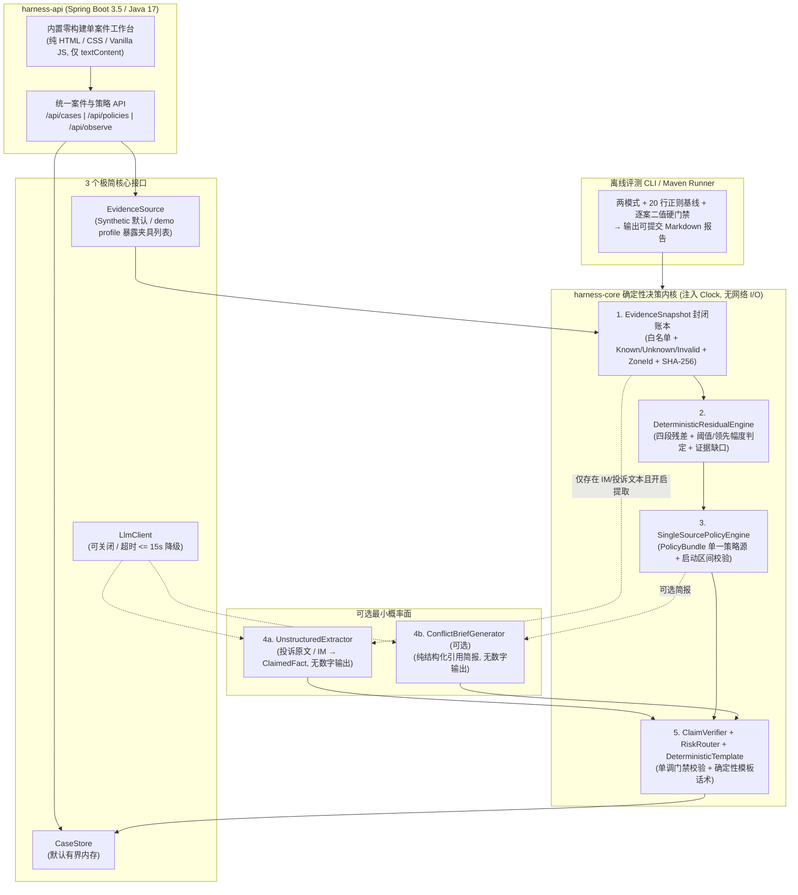
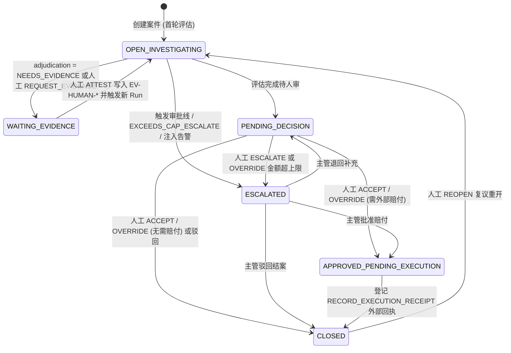

# Delivery Harness v0.3+ 产品与架构实施蓝图（Rev 2 · 开源工程标杆定稿）

> 状态：方案定稿（Rev 2），已完整吸收独立架构审阅的全部 8 项 P0 修正与 P1 瘦身裁剪。
> 基线：`main` (`8b0a6ee`，Maven `0.2.0`，Java 17，Spring Boot 3.5.16)。
> 范围：本文件作为 `PR0`–`PR7` 渐进重构的唯一设计与验收契约，落地代码按 PR 切片分步提交。

## 0. 已锁定产品与工程边界

| 决策项 | 最终结论 |
| --- | --- |
| **产品路线** | **开源 AI Harness 工程参考标杆**：零模型可开箱运行确定性内核；接入真实模型后可通过防泄漏基准检验其相对确定性规则与轻量正则基线的真实增益。 |
| **LLM 职责边界** | 结构化归因全面下沉至确定性残差引擎；新增合成的“投诉原文 / 客骑 IM”非结构化证据源，LLM 仅负责非结构化信号提取与可选冲突简报，且严格服从**单调门禁（只升不降）**。 |
| **API 演进策略** | `0.x` 阶段直接重构为统一案件与决策 API，不保留 `/api/v1/analyze/*` 兼容层，按 [ADR-0001](adr/0001-delete-unreachable-code-before-adding-features.md) 清理失去消费方的旧组件。 |
| **Java 基线** | 保持 **Java 17**（与 `.java-version` 及 `.github/workflows/ci.yml` 一致），通过三值 `sealed interface` + `fold(...)` 访问器实现编译期穷举。 |
| **交付与演示形态** | 1 个内置于 `harness-api` 的零构建单案件工作台（纯 HTML/CSS/Vanilla JS，零 Node/npm）；消融评测通过 CLI/Maven 输出可提交的 Markdown 报告；策略影子试算推迟至 `v0.3.1`；默认零外部依赖内存运行。 |

---

## 1. 现状继承与架构决策演进

### 1.1 继承 `0.2.0` 的 4 条核心哲学

- [ADR-0001](adr/0001-delete-unreachable-code-before-adding-features.md)：先删不可达代码再加特性；任何文档宣称的能力都必须在请求路径上可达。
- [ADR-0002](adr/0002-rule-engine-owns-the-compensation-amount.md)：赔付金额 100% 归规则引擎，绝不由采样 Token 决定。
- [ADR-0003](adr/0003-no-vector-retrieval-at-this-corpus-size.md)：小规模策略库不做向量检索。
- [ADR-0004](adr/0004-three-maven-modules-instead-of-nine.md)：维持 3 个 Maven 模块（`harness-common` / `harness-core` / `harness-api`），不为尚不存在的外部依赖预建模块和抽象层。

### 1.2 计划随实现 PR 落地的 3 份新 ADR（不提前空写）

遵循仓库惯例，每份 ADR 随其对应实现 PR 一同提交，并附可执行的 `Verification` 段：

1. **ADR-0005 · 最小概率面与 LLM 单调门禁**（**显式标注 `Amends / Partially Supersedes ADR-0002`**）：
   - 取代 ADR-0002 中“由模型生成客户话术与解释”的既有结论，同时将结构化字段归因从 LLM 下沉到确定性残差引擎。
   - **不可违反条款（单调门禁）**：未确认的 LLM 抽取信号只能把案件推向人工复核、暴露冲突或发起补证，**严禁减少赔付、自动免责、自动定责或满足政策 `requiredEvidence`**；LLM 输出中**禁止出现数字**。
2. **ADR-0006 · 三值证据账本与确定性快照**（随 `PR1`/`PR3` 落地）：
   - 用 `EvidenceValue<T>`（`Known | Unknown | Invalid`）表达缺失与脏数据；`Stale` 降为 `Known` 的元数据；所有业务输入经白名单过滤、规范化序列化（含 `ZoneId`）与注入 `Clock` 后固化为不可变 `EvidenceSnapshot`（带 SHA-256）。
3. **ADR-0007 · 单一策略源 `PolicyBundle`**（随 `PR2` 落地）：
   - 赔付公式、区间边界、审批线、升级上限、归因阈值、路由矩阵、分钟取整语义及自动生成的策略说明全部收口至单一版本化 `PolicyBundle`，删除分散在 `application.yml` 与 Java 常量中的策略参数。
   - 注：影子试算只是“纯函数内核 + 不可变快照”带来的自然产物，不单列为架构公理。

### 1.3 显式清理清单（按 ADR-0001 在 `PR0` 单独删除）

结构化归因确定化、策略由 `PolicyBundle` 直接裁决后，以下旧组件失去真实消费方，在 `PR0` 中通过纯删除 diff 清理，并同步更新 [ADR-0003](adr/0003-no-vector-retrieval-at-this-corpus-size.md) 状态说明（标注因策略直判与归因确定化，词法检索已随无消费方退出默认主链路）：

- `harness-core` 中的 `knowledge.ingestion`、`knowledge.retrieval.RetrievalService`、`knowledge.casemgmt.CaseBaseService`、`seed/cases.json`；
- `harness-api` 中的 `/api/v1/knowledge/*`、`/api/v1/observe/feedback` 与 `FeedbackCollector`（由结构化 `HumanDecision` 取代）；
- `OrderFixtures` 中对陌生 `order_id` 的静默哈希伪造订单逻辑，以及进入订单对象的 `extraInfo.scenario_key` 泄漏字段。

---

## 2. 总体架构与极简接口边界

遵循 ADR-0004“不为想象中的扩展预建抽象”，`v0.3.0` 仅定义 **3 个核心 SPI 接口**（而非 9 个 Port/Repo），待首个带重依赖的真实外部 Adapter 出现时再拆分模块与契约测试套件：

1. `EvidenceSource`：按 `(orderId, asOf)` 采集订单、ETA、历史时点运力与非结构化会话记录，显式区分 `NOT_FOUND` 与有效数据。
2. `CaseStore`：有界内存存储（默认零外部依赖），管理 `Case`、`EvidenceSnapshot`、`AssessmentRun` 与 `HumanDecision`。
3. `LlmClient`：沿用现有 OpenAI 兼容抽象，在无模型环境下支持完全关闭，或以严格超时预算（`<= 15s`）运行并优雅降级。

同时在 `harness-core` 测试中引入 **ArchUnit**，先锁定 3 条高价值边界规则：
- 生产代码（`com.delivery.harness..`）不得依赖评测真值标签或夹具标签类；
- 纯决策内核包不得依赖 Spring Web / HTTP 客户端 / 外部 IO；
- Controller 层不得绕过编排服务直接调用底层夹具或规则实现。

---

## 3. 核心机制与 P0 修正细则

### 3.1 确定性残差引擎：数学语义与真实夹具复算（解决 P0-1）

#### 1) 对 `0.2.0` 现有 6 个夹具的真实公式复算

直接套用现有 `EtaToolkit`（大圆距离 × `1.35` ÷ `4.0 m/s` + `180s`，暴雨系数 `1.6`）与 `CapacityToolkit` 数值复算，结果如下：

| 现有夹具 | 实际总时 / 超时 | 派单实际 / 站点均值 / Δ | 备餐实际 | 路途实际 | 晴天 ETA | 天气 ETA | 天气解释 | 剥离天气后路途残差 | 关键事实 |
| --- | --- | --- | --- | --- | --- | --- | --- | --- | --- |
| `MERCHANT_SLOW` | 58 / +18 | 3 / 3 / 0 | 28 | 20 | 8 | 8 | 0 | **+12** | 备餐与路途均有显著正值 |
| `CAPACITY_SHORT` | 58 / +18 | 22 / 17(S002) / **+5** | 6 | 22 | 8 | 8 | 0 | **+14** | 若用已拥堵的站点均值 17 作基线，派单残差仅 +5，小于路途 +14 |
| `WEATHER_DELAY` | 65 / +25 | 4 / 9 / -5 | 8 | 44 | 13 | 19 | **+6** | **+25** | 天气仅解释 6 min，剥离天气后仍有 25 min 未解释路途残差 |
| `RIDER_DETOUR` | 54 / +14 | 3 / 3 / 0 | 7 | 38 | 6 | 6 | 0 | **+32** | 路途残差明显占优，但缺 GPS 轨迹不可自动定责骑手 |
| `SEVERE_MERCHANT_SLOW` | 75 / +35 | 4 / 17 / -13 | 45 | 20 | 7 | 7 | 0 | **+13** | 备餐绝对与超额均占优 |
| `ON_TIME` | 37 / 0 | 3 / 3 / 0 | 9 | 18 | 6 | 6 | 0 | +12 | 未超时门控直接判 `NO_OVERTIME_ANOMALY` |

#### 2) 严格的残差与主因判定语义

1. **基线来源明确化（纳入 `PolicyBundle` 与历史快照）**：
   - `DISPATCH_WAIT`：对比**正常态站点派单基准**（例如 `normal_dispatch_baseline_minutes`），而不是拿“已经爆单时的实时站点均值 17min”做减法；同时保留站点历史时点 `capacity_ratio` 与 `avg_dispatch_wait(asOf)` 作为运力紧张佐证。
   - `TO_SHOP`：对比合理到店基准（`to_shop_baseline_minutes`）。
   - `MERCHANT_PREP`：对比商家/站点正常出餐基准（`normal_merchant_prep_baseline_minutes`，补齐 `CapacityToolkit` 缺失该字段的缺陷）。
   - `ON_ROAD`：对比 `eta_clear` 与 `eta_weather` 两个反事实值，显式拆分 `weather_explained_minutes = max(0, eta_weather - eta_clear)` 与 `unexplained_road_excess_minutes = max(0, actual_on_road - eta_weather)`。
2. **负残差与超额贡献**：
   - 原始差值 `delta = actual - baseline` 原样存入证据账本（保留负残差，如提前到店抵消了部分延误）；
   - 用于主因排序的正超额贡献定义为 `excess = max(0, delta)`，并显式注明 `sum(excess_legs)` **不必然等于** `overtime_minutes`（因承诺时长包含缓冲余量且各段存在正负抵消）。
3. **主因判定规则（全部参数收敛于 `PolicyBundle`）**：
   - 未超时（`overtime_minutes == 0` 且时间戳均 `Known`）→ `NO_OVERTIME_ANOMALY`；
   - 超时后，仅当某候选因子的 `excess >= minExcessThreshold` **且** 与第二大候选因子的差值 `top1 - top2 >= dominanceMargin` 时，才输出单一候选主因；
   - 若多个因子均超阈值且差距小于 `dominanceMargin` → 输出 `MULTI_FACTOR`（列出全部超阈值因子）；
   - 若无因子达标或关键段为 `Unknown / Invalid` → 输出 `UNDETERMINED` 并附具体 `evidenceGaps`。
4. **中性命名与拒绝自动定责（P1 裁剪）**：
   - 砍掉自动 `liabilityAllocation` 字段，责任归属仅作为人工决定字段；
   - 路途未解释超额统一命名为中性的 `UNEXPLAINED_ROAD_EXCESS`（而非 `SUSPECTED_RIDER_DETOUR`），证据缺口明确提示“缺少骑手 GPS 轨迹与并单记录”。
5. **接受夹具标签翻转**：
   - 使用上述真实公式运行现有夹具时，例如 `WEATHER_DELAY` 因存在 `weather_explained = +6` 与 `unexplained_road_excess = +25`，引擎如实输出 `MULTI_FACTOR`（天气 + 未解释路途超额）或 `UNEXPLAINED_ROAD_EXCESS`，**严禁倒改现有夹具数字去硬凑旧标签**；需要验证单一天气场景时，作为带说明的新契约夹具独立建档。

---

### 3.2 三值证据账本与确定性快照（解决 P0-4、P0-6）

1. **Java 17 编译期穷举三值类型**：
   - `public sealed interface EvidenceValue<T> permits Known, Unknown, Invalid`；
   - `Known<T>(T value, String source, Instant observedAt, Instant asOf, boolean stale)`（`Stale` 为元数据，是否允许某字段接受 `stale=true` 由 `PolicyBundle` 按字段声明）；
   - `Unknown<T>(String reasonCode, String detail)`（缺失值绝不转为 `0`）；
   - `Invalid<T>(String rawValue, String violation)`（如 `acceptTime < createTime` 倒序时间、负金额）；
   - 提供统一穷举方法：`<R> R fold(Function<Known<T>, R> onKnown, Function<Unknown<T>, R> onUnknown, Function<Invalid<T>, R> onInvalid)`，保证 Java 17 编译期全分支覆盖。
2. **确定性可重放前提**：
   - 全链路注入 `java.time.Clock`；夹具时间基于冻结基准时钟（如 `2026-09-01T12:00:00+08:00`）而非 `LocalDateTime.now()`，确保同一 `orderId` 每次生成完全一致的快照哈希。
   - `EvidenceSnapshot` 携带显式 `ZoneId`（修复原 `OrderInfo` 仅使用无时区 `LocalDateTime` 的缺陷）。
   - SHA-256 哈希前执行规范化序列化（JSON 键按字典序排序、`BigDecimal.toPlainString()`、时间统一格式化为带偏移量 ISO-8601）。
   - `EvidenceSource` 查询站点运力时强制传入订单事件 `asOf` 时间戳。

---

### 3.3 LLM 非结构化抽取的“单调门禁”与信任边界（解决 P0-2、P0-3、P1）

1. **信号 ≠ 事实**：
   - 账本将 LLM 抽取结果记录为独立的 `ClaimedFact(signalType, speakerRole, sourceEvidenceId, startOffset, endOffset, quote, extractor="LLM", promptHash)`。
   - `speakerRole`（`CUSTOMER | RIDER | MERCHANT | SYSTEM`）**强制从 IM 原始消息元数据读取**，绝不采信模型填写的角色。
2. **不可违反的单调门禁（只升不降）**：
   - 未经人工确认的 `ClaimedFact` 仅允许产生三类效果：① 将案件路由升级为人工复核；② 在前端展示“非结构化冲突/备选线索”；③ 生成明确的人工核实/补证提示。
   - **严格禁止**：未确认的 LLM 信号绝不能降低赔付金额、绝不能免除骑手/商家责任、绝不能自动定责、绝不能满足政策 `requiredEvidence`（例如模型从聊天里抽到“全洒了”，绝不等同于经核验的 `DAMAGE_LEVEL=FULL`）。
   - **改变裁决结果的唯一合法途径**：① 确定性结构化佐证（如订单系统真实的地址变更事件或坐标偏移）；② 人工通过 `ATTEST` 动作核实后写入带操作者记录的 `EV-HUMAN-*` 证据，再触发新一次确定性 `AssessmentRun`。
3. **核验器加固（`ClaimVerifier`）**：
   - 对原文与 `quote` 做 NFKC 及全半角归一；
   - `quote` 必须严格落在所引用的单条 `EV-IM-*` 内（通过 `startOffset/endOffset` 精确对齐，禁止跨消息拼接），且满足最小字符长度；
   - 每类信号配置否定词窗口检测（如 `quote` 前后窗口命中“没有/并未/不是/并未同意”则判定校验失败并告警）；
   - 快照文本进入 LLM 前先经提示词注入特征扫描（如“忽略以上指令/输出某某枚举”），命中即标记该条文本为 `UNTRUSTED_TEXT`，**跳过模型抽取并整案强制转人工**；
   - **LLM 输出禁止出现数字**：抽取结果仅允许枚举 + 原文偏移；可选的冲突简报仅输出 `[{statement, evidenceIds[]}]` 且由核验器拒绝任何含数字/金额字符的简报文本——所有数字一律由前端或确定性模板从证据账本渲染。
4. **砍掉 LLM 槽位话术草稿（P1 裁剪）**：
   - 槽位锁不住槽位之外的自由文本写出“已为您退款”，因此全面改用**确定性模板库**，按 `(adjudicationStatus, hasExecutionReceipt)` 渲染客户说明草稿；无 `RECORD_EXECUTION_RECEIPT` 凭证前永不渲染完成态措辞。
5. **不夹带隐性新政策（解决 P0-3）**：
   - 现有 `rules.json` 不存在“用户改址免赔/免责”政策，也不存在 `NOT_DELIVERED` 投诉类型。
   - 本次契约夹具严格遵循 `PolicyBundle` 已声明的 4 类投诉（`OVERTIME | WRONG_ORDER | DAMAGED | MISSING_ITEM`）：
     - `ORD-IM-ADDR-01`（`OVERTIME`）：晴天路途长，IM 中用户明确提出改送对面 B 座；确定性赔付仍按 `OVERTIME` 规则计算，**不会因 IM 信号自动减赔或免责**，但抽取信号触发 `HUMAN_REVIEW_REQUIRED` 与冲突提示，交由人工决定是否采纳或 `ATTEST`。
     - `ORD-IM-SWAP-01`（`DAMAGED`）：无核验损坏等级、仅 IM 中提及换菜与洒漏；政策返回 `NEEDS_EVIDENCE`（不给金额），LLM 抽取信号提示核实照片与换菜沟通，不能绕过 `requiredEvidence`。
     - `ORD-IM-NEG-01`（对抗反例，替换原 `NOT_DELIVERED` 夹具）：IM 中用户明确说“**我没有改地址**，骑手自己走错了”以及提示词注入变体，专门验证否定词检测与注入拦截。
     - `ORD-OUT-OF-SCOPE-01`（或明确声明 `MISSING_ITEM`）：验证 `NO_APPLICABLE_POLICY` 与 `INELIGIBLE` 的严格分离。

---

### 3.4 真正的单一策略源 `PolicyBundle`（解决 P0-5）

将原先散落在 `rules.json`、`application.yml` 和 Java 代码中的全部策略参数收口为单一版本化 JSON 文件（如 `policy-v1.0.0.json`），**同步删除 `harness.compensation.approval-threshold` 和 `harness.guardrail.max-compensation-amount` 配置项**：

- **不做动态表达式语言**（拒绝 SpEL / MVEL / JS）：使用强类型 JSON Schema + 固定 `amountType` 枚举（`FIXED | PERCENT_CAPPED | DAMAGE_LEVEL | MANUAL`）由 Java 代码确定性解释。
- **Bundle 必含 6 大块**：
  1. `metadata`：`policyVersion`、`effectiveFrom`、`effectiveTo`、`evaluationClockField`（如 `DELIVERED_AT`）、`minuteRoundingMode`（显式声明 `FLOOR_TRUNCATE` / `CEIL` / `ROUND_HALF_UP`，消除 `15分59秒` 歧义）。
  2. `stalenessPolicy`：按字段声明是否允许 `stale=true` 及最大容忍时效。
  3. `attributionThresholds`：`minExcessMinutes`、`dominanceMarginMinutes`、`normalDispatchBaselineMinutes`、`normalPrepBaselineMinutes`、`toShopBaselineMinutes`、`strainedCapacityRatio`。
  4. `compensationRules[]`：按 `complaintType` 分组，声明 `requiredEvidence[]`、闭区间 `[minOvertimeMinutes, maxOvertimeMinutes]`、`amountType` 与公式参数、`approvalRequired`。
  5. `limits`：`approvalThreshold`（原 `10.00`）、`escalationCap`（原 `50.00`，显式定义为 `ESCALATE_NO_ACTIONABLE_AMOUNT`：超限返回 `EXCEEDS_CAP_ESCALATE`，不展示可采纳金额）。
  6. `routingMatrix`：确定性风险路由矩阵（输入：核验是否通过、证据完备度、裁决状态、是否存在未确认冲突信号、是否触发审批线 → 输出路由动作）。
- **启动期强校验**：加载 `PolicyBundle` 时，针对同一 `complaintType` 的一维超时区间执行严格连续性校验——存在区间重叠或空洞直接拒绝启动（Fail-Fast）；每条规则的中文说明文案由其结构化定义自动渲染，彻底消除 F04 文案/代码漂移。

---

### 3.5 收敛后的状态模型与案件生命周期（解决 P0-7）

砍掉 576 种组合的四维正交状态，收敛为 **Run 上 2 个派生值 + Case 上 1 个状态机**：

1. **`AssessmentRun` 上的 2 个派生值（不可变快照结果）**：
   - `runHealth`：`OK` | `DEGRADED`（如 LLM 超时/关闭或可选工具失败，带具体 `degradedReasons[]`） | `FAILED`（核心订单缺失或不可用）。
   - `adjudication`：`ELIGIBLE`（附确定金额与方式） | `INELIGIBLE`（如准时送达明确不赔） | `NEEDS_EVIDENCE`（附 `missingEvidence[]`，金额为 `null`） | `EXCEEDS_CAP_ESCALATE`（超上限升级，无直接可采纳金额） | `NO_APPLICABLE_POLICY` | `OUT_OF_SCOPE`。
2. **`Case` 上的单一状态机（不放入 `AssessmentRun`）**：

- **防过期决定**：`POST /api/cases/{caseId}/decisions` 强制携带 `runId` 与 `expectedCaseVersion`；若案件已存在更新的 `AssessmentRun`，返回 **`HTTP 409 Conflict`**。
- **完整动作闭环**：支持 `ACCEPT`、`OVERRIDE`（含结构化 `overrideReasonCode`、`finalRemedy`、`finalLiability`，且 `finalRemedy` 仍过 `PolicyBundle` 上限校验，超限强制转 `ESCALATED`）、`REQUEST_EVIDENCE`、`ATTEST`（写入 `EV-HUMAN-*` 证据并自动重跑确定性评估）、`ESCALATE`、`RECORD_EXECUTION_RECEIPT`（写入外部凭证，使模板渲染“已执行”分支真实可达）、`CLOSE`、`REOPEN`。
- **身份诚实声明**：在无鉴权开源参考版中，`operatorId` 由调用方提供，将在 README 与响应元数据中显式标注为 `unauthenticated_operator_id`，不伪装成真实权限审计。

---

### 3.6 诚实评测与 CLI 消融报告（解决 P0-8 与 P1）

- **契约与回归夹具命名**：内置 12 组合成夹具明确称为 **Contract & Regression Fixtures**，绝不在 12 单上宣称“准确率”或报 P95 延迟。
- **两模式 + 20 行正则诚实基线**：
  - 对比三组：`DETERMINISTIC_ONLY`（纯结构化） vs **`REGEX_BASELINE`（约 20 行关键词/正则文本基线）** vs `DETERMINISTIC_PLUS_EXTRACT`（LLM 非结构化提取）。
  - **显式退场条款（延续 ADR-0003 “bring the number” 精神）**：若真实模型在改写/否定/多说话人样本上未能稳定胜过 20 行正则基线，报告直接输出“当前模型未证明相对正则基线的净增益，不建议在提取链路启用 LLM”。
  - 可选 `CONFLICT_BRIEF` 仅执行安全硬门禁检查，报告中明确注明“简报对审核人提速的价值无法离线度量，不计入收益”。
- **逐案二值硬门禁（整体一票否决，非“通过率”）**：
  1. `NEEDS_EVIDENCE` / `EXCEEDS_CAP_ESCALATE` / `NO_APPLICABLE_POLICY` 状态绝不输出可采纳金额；
  2. 无 `RECORD_EXECUTION_RECEIPT` 前话术绝不出现“已退款/已发券/已处理完成”；
  3. 零虚构 `EV-*` 引用与越界偏移；
  4. LLM 输出零数字；
  5. 未确认 LLM 信号导致赔付或定责改变的次数 **必须为 0**（免责/减赔假阳性一票否决）；
  6. 未知 `orderId` 返回 `NOT_FOUND`，绝不伪造订单。
- **防泄漏与独立判分**：
  - 真值标签独立存于 `eval` 模块测试资源的 `labels.json`，ArchUnit 禁止生产代码引用；
  - 评测判分器独立校验原文偏移与门禁，**不复用生产 `ClaimVerifier`**（避免自己验自己）；
  - 使用 `StubLlmClient` 运行的输出强制标注 **`PIPELINE_SMOKE_ONLY（非模型质量）`**，严禁与真实 Ollama/外部模型结果混排在同一张对比表中。
- **交付形态**：通过 Maven / CLI（如 `./mvnw test -Dtest=AblationReportRunner` 或独立 CLI 入口）生成可直接贴进 PR 的 Markdown 报告，**不暴露消融 HTTP 接口与前端 Tab**。

---

## 4. 统一 API 契约与极简工作台（`v0.3.0`）

### 4.1 精简后的 REST API（业务接口与调试接口严格隔离）

| 分组 | 方法与路径 | 说明与安全约束 |
| --- | --- | --- |
| **案件生命周期** | `POST /api/cases` | 创建案件并同步执行确定性评估（支持 `Idempotency-Key` 防重复建案，或限制同 `orderId + complaintType` 仅一个未结案）；若启用 LLM，施加严格超时预算 `<= 15s`，超时优雅记 `DEGRADED` 返回确定性结果。**业务接口不暴露 `mode` 与 `policyVersion` 覆盖参数**，防止调用方挑宽政策。 |
| | `GET /api/cases` / `GET /api/cases/{caseId}` | 查询案件列表与完整聚合视图（含 `EvidenceSnapshot`、历次 `AssessmentRun`、`HumanDecision`、模板草稿及原始 JSON Trace 链接）。 |
| | `POST /api/cases/{caseId}/attestations` | 人工 `ATTEST` 补证（写入 `EV-HUMAN-*`），自动追加新 `AssessmentRun`。 |
| | `POST /api/cases/{caseId}/decisions` | 提交人工决定（`ACCEPT / OVERRIDE / REQUEST_EVIDENCE / ESCALATE / RECORD_EXECUTION_RECEIPT / CLOSE / REOPEN`），强制校验 `runId` 与 `expectedCaseVersion`，过期返回 `409`。 |
| **策略只读** | `GET /api/policies/active` / `GET /api/policies/{version}` | 查看单一策略源定义及同源自动渲染文案。 |
| **可观测** | `GET /api/observe/traces/{traceId}` / `GET /api/observe/metrics` | 原始 JSON Trace 与有界内存指标（含降级率、核验拦截计数）。 |
| **演示夹具（仅 `demo` profile）** | `GET /api/demo/fixtures` | 仅在 `demo` profile 激活时注册，列出 12 组契约/对抗夹具供工作台快选。 |

### 4.2 内置零构建单案件工作台（1 个主视图）

托管于 `harness-api/src/main/resources/static/`（纯 HTML5 + CSS + 原生 ES Module JS，无构建工具）：

- 仅保留 **1 个高信息密度单案件工作台**（砍掉原 4-Tab 里的消融 Tab、独立 Trace Tab 与空壳影子试算 Tab）：
  - **顶栏**：夹具快选（`demo` profile 下可见）+ 案件状态与 `runHealth` / `adjudication` 徽章 + 原始 Trace JSON 链接。
  - **左栏（封闭证据账本）**：四段实际 vs 基准残差可视化条（缺失/脏数据显式标注）+ 客骑 IM 原始消息列表（标注 `speakerRole` 元数据与 `EV-IM-xx` 编号）。
  - **右栏（确定性裁决与人工闭环）**：候选原因与证据缺口卡、单一策略源命中规则卡（点击 `EV-*` 高亮左侧证据）、未确认 LLM 信号冲突提示区、确定性模板客户草稿（明示未发送）、以及完整的人工操作条（`ATTEST` 补证 / 采纳 / 改判 / 升级 / 登记回执 / 结案 / 重开）。
- **安全硬约束**：IM 原文与任何 LLM 输出文本**一律使用 `textContent` 渲染**，引文高亮通过计算偏移量拆分 DOM 文本节点创建 ``，**严禁使用 `innerHTML`**；配套服务端静态页冒烟测试与 XSS 回归用例。

---

## 5. 按 ADR-0001 拆分的渐进 PR 实施路线

杜绝大爆炸重写。每个 PR 必须独立可审阅、`./tools/check-format.sh` 与 `./mvnw clean verify` 全绿、JaCoCo core 覆盖率棘轮只升不降：

| PR | 主题 | 核心变更 | 验证与退出标准 |
| --- | --- | --- | --- |
| **PR0** | **纯删除清理**（ADR-0001 风格） | 删除无消费方的 `knowledge` 检索/导入、`cases.json`、`FeedbackCollector`、`/api/v1/knowledge`、`/feedback`、陌生 ID 哈希伪造、`scenario_key` 泄漏；更新 ADR-0003 状态。 | 纯删除（加必要调用清理与测试调整）diff 易审；`clean verify` 全绿。 |
| **PR1** | **Java 17 三值类型与确定性时间轴**（修 F02） | 引入 `EvidenceValue<T>`（`Known/Unknown/Invalid` + `fold`）、`Clock` 注入、`ZoneId`；重构 `OrderTimeline` 不再将缺时间或倒序截断为 0。 | 缺送达时间、缺承诺时间、倒序时间戳全量单测覆盖；JaCoCo 不降。 |
| **PR2** | **单一策略源 `PolicyBundle`**（修 F03/F04 + 落 ADR-0007） | 统一赔付规则、归因阈值、审批线、升级上限、取整语义、路由矩阵至 `policy-v1.0.0.json`；删除旧配置项；加启动期区间重叠/空洞校验与同源文案渲染。 | 重叠/空洞策略启动失败测试；`NEEDS_EVIDENCE` / `EXCEEDS_CAP_ESCALATE` / `NO_APPLICABLE_POLICY` / `INELIGIBLE` 全分支验证。 |
| **PR3** | **封闭证据账本、白名单与标签隔离**（修 F09 + 落 ADR-0006） | 实现 `EvidenceSource`、规范化序列化 + SHA-256 `EvidenceSnapshot`、`asOf` 运力查询、冻结时钟 12 组契约夹具、独立 `labels.json` 与 ArchUnit 隔离规则。 | 同一订单两次快照哈希完全一致；ArchUnit 拦截生产代码读取真值标签。 |
| **PR4** | **确定性残差引擎替换 LLM 归因**（修 F07） | 实现 `DeterministicResidualEngine`（`excess`、`dominanceMargin`、`MULTI_FACTOR`、`UNDETERMINED`、`UNEXPLAINED_ROAD_EXCESS`、证据缺口）；用真实公式复算全部夹具并诚实建档。 | 零模型环境下完整产出确定性诊断 + 赔付裁决 + 确定性模板话术。 |
| **PR5** | **统一案件聚合、状态机与 REST API**（修 F05/F06/F12） | 实现 `CaseStore`、`Case / AssessmentRun / HumanDecision`、状态迁移表（含 `ATTEST` / `RECORD_EXECUTION_RECEIPT` / `REOPEN`）、`runId` 过期 `409`、`Idempotency-Key` 与全新 `/api/cases` API，移除 v1 `/analyze/*`。 | 完整案件生命周期 API 集成测试；无回执前绝不渲染完成态话术；`OVERRIDE` 超上限强制 `ESCALATED`。 |
| **PR6** | **最小概率面提取器、单调门禁与 CLI 消融报告**（修 F01/F10 + 落 ADR-0005） | 实现 `UnstructuredExtractor`（<=15s 预算与降级）、`ClaimVerifier`（NFKC/单条偏移/否定窗口/注入拦截/禁数字）、20 行正则基线、独立判分器与 CLI Markdown 消融报告。 | 否定句、骑手自利陈述、提示词注入、LLM 含数字、LLM 宕机 5 类对抗测试 100% 拦截；Stub 报告明确标注 `PIPELINE_SMOKE_ONLY`。 |
| **PR7** | **零构建单案件工作台与文档收口** | 交付 `static/` 单案件工作台（仅 `textContent`）、服务端静态页冒烟测试、更新中英文 `README.md` 与 `CHANGELOG.md`。 | `java -jar harness-api.jar` 打开 `127.0.0.1:8080` 无模型完成全流程演示；CI 全绿。 |

### 后续版本规划（`v0.3.1` / `v0.4.0`，不塞入 `v0.3.0`）

- **`v0.3.1` · 策略影子试算（带合成人口生成器）**：引入带固定种子的合成人口生成器（明确标注为合成分布），基于冻结的已核验信号集合支持 `asOf` 策略回放、标记 `NOT_REPLAYABLE` 样本，并与人工最终决定并排对比后开放影子试算面板。
- **`v0.4.0` · 可选 H2 文件持久化 Profile（并在 CI 中实际执行）与外部 Adapter 接入指南**：仅在真实接入场景出现时按 ADR-0004 拆分 `harness-adapters` 与契约测试套件；按需评估 `promote-to-eval` 与扩展 IM 改写/否定/注入语料生成器。
