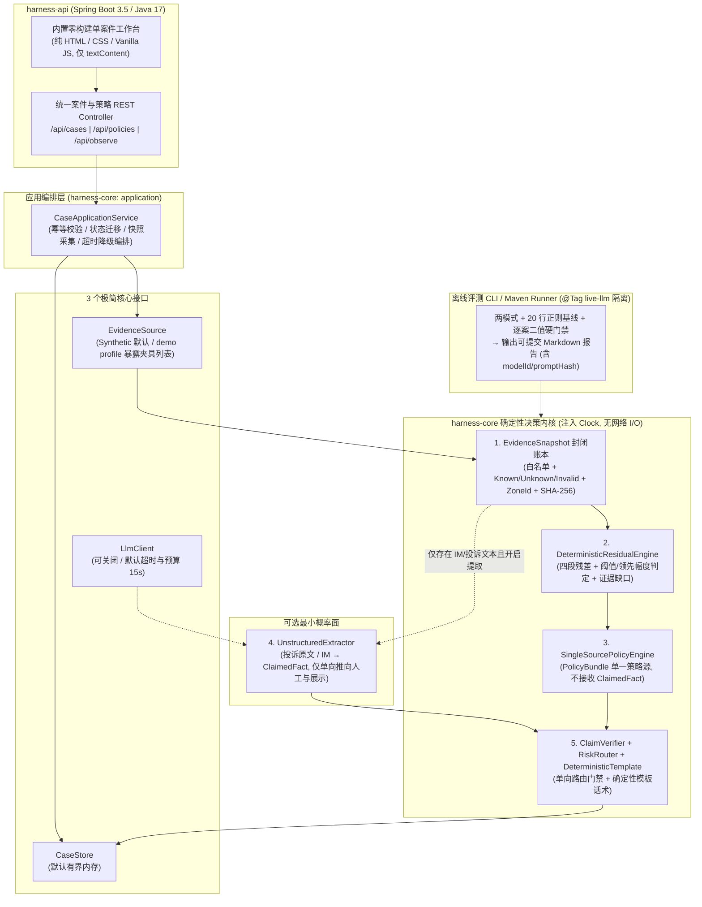

# Delivery Harness v0.3+ 产品与架构实施蓝图（Rev 2.1 · 开源工程标杆定稿）

> 状态：方案定稿（Rev 2.1），已通过独立架构复核（`GO_WITH_MINOR_NOTES`）并闭环 N1 及全部细粒度修正。
> 基线：`main` (`8b0a6ee`，Maven `0.2.0`，Java 17，Spring Boot 3.5.16)。
> 范围：本文件作为 `PR0`–`PR7` 渐进重构的唯一设计与验收契约，落地代码按 PR 切片分步提交。

## 0. 已锁定产品与工程边界

| 决策项 | 最终结论 |
| --- | --- |
| **产品路线** | **开源 AI Harness 工程参考标杆**：零模型可开箱运行确定性内核；接入真实模型后可通过防泄漏基准检验其相对确定性规则与 20 行正则基线的真实增益。 |
| **LLM 职责边界** | 结构化归因全面下沉至确定性残差引擎；新增合成的“投诉原文 / 客骑 IM”非结构化证据源，LLM 仅负责非结构化信号提取；**裁决结果在两个方向上均与 LLM 无关，LLM 仅单向影响路由（推向人工）与展示**。 |
| **API 演进策略** | `0.x` 阶段直接重构为统一案件与决策 API，不保留 `/api/v1/analyze/*` 兼容层；按 [ADR-0001](adr/0001-delete-unreachable-code-before-adding-features.md) 仅在旧组件真正失去消费方时统一删除。 |
| **Java 基线** | 保持 **Java 17**（与 `.java-version` 及 `.github/workflows/ci.yml` 一致），通过三值 `sealed interface` + `fold(...)` 访问器实现编译期穷举。 |
| **交付与演示形态** | 1 个内置于 `harness-api` 的零构建单案件工作台（纯 HTML/CSS/Vanilla JS，零 Node/npm）；消融评测通过 CLI/Maven 输出可提交的 Markdown 报告；冲突简报与策略影子试算均推迟至 `v0.3.1`；默认零外部依赖内存运行。 |

---

## 1. 现状继承与架构决策演进

### 1.1 继承 `0.2.0` 的 4 条核心哲学

- [ADR-0001](adr/0001-delete-unreachable-code-before-adding-features.md)：先删不可达代码再加特性；任何文档宣称的能力都必须在请求路径上可达；删除已有请求路径上的代码属于行为变更，不可冒充纯删除。
- [ADR-0002](adr/0002-rule-engine-owns-the-compensation-amount.md)：赔付金额 100% 归规则引擎，绝不由采样 Token 决定。
- [ADR-0003](adr/0003-no-vector-retrieval-at-this-corpus-size.md)：小规模策略库不做向量检索。
- [ADR-0004](adr/0004-three-maven-modules-instead-of-nine.md)：维持 3 个 Maven 模块（`harness-common` / `harness-core` / `harness-api`），不为尚不存在的外部依赖预建模块和抽象层。

### 1.2 计划随实现 PR 落地的 3 份新 ADR（不提前空写）

遵循仓库惯例，每份 ADR 随其对应实现 PR 一同提交，并附可执行的 `Verification` 段：

1. **ADR-0011 · 最小概率面与 LLM 单向路由门禁**（**显式标注 `Amends / Partially Supersedes ADR-0002`**，随 `PR6` 落地）：
   - 取代 ADR-0002 中“由模型生成客户话术与解释”的既有结论，同时将结构化字段归因从 LLM 下沉到确定性残差引擎。
   - **不可违反条款（结构性隔离 + 单向路由）**：**裁决结果（是否赔付、金额、方式、免责）在两个方向上均与 LLM 无关，LLM 仅单向影响路由（推向人工）与展示**。结构上由 `PolicyEngine` 方法签名不接收 `ClaimedFact` 与 ArchUnit 规则（禁止 `policy` 包依赖 `extraction` 包）双重保证；LLM 自由文本输出字段（`statement`）禁止出现数字。
2. **ADR-0012 · 三值证据账本与确定性快照**（随 `PR3` 落地）：
   - 用 `EvidenceValue<T>`（`Known | Unknown | Invalid`）表达缺失与脏数据；`Known<T>` 仅存 `observedAt` 与 `asOf`，过期判定由策略动态计算；所有业务输入经白名单过滤、规范化序列化（含 `ZoneId`）与注入 `Clock` 后固化为不可变 `EvidenceSnapshot`（带 SHA-256）。
3. **ADR-0013 · 单一策略源 `PolicyBundle`**（随 `PR2` 落地）：
   - 赔付公式、区间边界、审批线、升级上限、归因阈值与正常态基线、路由矩阵、分钟取整语义、字段过期容忍度及自动生成的策略说明全部收口至单一版本化 `PolicyBundle`，删除分散在 `application.yml` 与 Java 常量中的策略参数。
   - 注：影子试算只是“纯函数内核 + 不可变快照”带来的自然产物，不单列为架构公理。

### 1.3 清理时机与 `PR0` / `PR5` 边界（遵守 ADR-0001）

当前 `main` 上两条 v1 工作流均在请求路径上调用 `RetrievalService`、读取 `cases.json` 并输出 `citations`，`KnowledgeSeedLoader` 同时装载 `rules.json` 与 `cases.json`：

- **`PR0`（去伪行为修正，非纯删除）**：仅移除 `OrderFixtures` 注入订单的 `extraInfo.scenario_key` 泄漏字段，并取消对陌生 `order_id` 的静默哈希伪造（改为显式返回 `NOT_FOUND`）；`RuleBaseService` 保留至 `PR2`，`RetrievalService` / `cases.json` / `FeedbackCollector` 保留至 `PR5`，确保 v1 其余行为与测试完全可追溯。
- **`PR5`（随移除 v1 `/analyze/*` 一并清理）**：此时 `knowledge.ingestion`、`knowledge.retrieval.RetrievalService`、`knowledge.casemgmt.CaseBaseService`、`seed/cases.json`、`/api/v1/knowledge/*`、`/api/v1/observe/feedback` 与 `FeedbackCollector` 真正失去消费方，统一删除并更新 [ADR-0003](adr/0003-no-vector-retrieval-at-this-corpus-size.md) 状态说明。

---

## 2. 总体架构与极简接口边界

遵循 ADR-0004“不为想象中的扩展预建抽象”，`v0.3.0` 仅定义 **3 个核心 SPI 接口**（待首个带重依赖的真实外部 Adapter 出现时再拆模块与契约测试套件）：

1. `EvidenceSource`：按 `(orderId, asOf)` 采集订单、ETA、历史时点运力与非结构化会话记录，显式区分 `NOT_FOUND` 与有效数据。
2. `CaseStore`：有界内存存储（默认零外部依赖），管理 `Case`、`EvidenceSnapshot`、`AssessmentRun` 与 `HumanDecision`。
3. `LlmClient`：沿用现有 OpenAI 兼容抽象，在无模型环境下支持完全关闭；开启时默认 HTTP 超时（`HARNESS_LLM_TIMEOUT_SECONDS`）与硬预算对齐为 **`15s`**，超时优雅降级。

在 `harness-core` 测试中引入 **ArchUnit**，锁定 4 条架构守卫规则：
- 生产代码（`com.delivery.harness..`）不得依赖评测真值标签或夹具标签类；
- `policy` 包不得依赖 `extraction` 包（结构性保证裁决与 LLM 无关）；
- 纯决策内核包不得依赖 Spring Web / HTTP 客户端 / 外部 IO；
- Controller 层必须经过 `CaseApplicationService` 编排，不得直接调用 `EvidenceSource`、`CaseStore` 或底层规则实现。

---

## 3. 核心机制与全部 P0 闭环设计

### 3.1 确定性残差引擎：数学语义、反调参约束与真实夹具复算（P0-1）

#### 1) 对 `0.2.0` 现有 6 个夹具的真实公式复算（按旧 `EtaToolkit` / `CapacityToolkit` 口径）

| 现有夹具 | 实际总时 / 超时 | 派单实际 / 旧站点均值 / Δ | 备餐实际 | 路途实际 | 晴天 ETA | 天气 ETA | 天气解释 | 剥离天气后路途残差 | 关键事实 |
| --- | --- | --- | --- | --- | --- | --- | --- | --- | --- |
| `MERCHANT_SLOW` | 58 / +18 | 3 / 3 / 0 | 28 | 20 | 8 | 8 | 0 | **+12** | 合成 ETA 系统性偏低，路途出现 +12 |
| `CAPACITY_SHORT` | 58 / +18 | 22 / 17(S002) / **+5** | 6 | 22 | 8 | 8 | 0 | **+14** | 若用旧站点拥堵均值 17 作基线，派单残差小于路途 |
| `WEATHER_DELAY` | 65 / +25 | 4 / 9 / -5 | 8 | 44 | 13 | 19 | **+6** | **+25** | 天气仅解释 6 min，剥离天气后仍有 25 min 未解释残差 |
| `RIDER_DETOUR` | 54 / +14 | 3 / 3 / 0 | 7 | 38 | 6 | 6 | 0 | **+32** | 路途残差显著占优，但缺 GPS 轨迹不可自动定责骑手 |
| `SEVERE_MERCHANT_SLOW` | 75 / +35 | 4 / 17 / -13 | 45 | 20 | 7 | 7 | 0 | **+13** | 备餐绝对与超额均占优 |
| `ON_TIME` | 37 / 0 | 3 / 3 / 0 | 9 | 18 | 6 | 6 | 0 | **+12** | 未超时门控直接判 `NO_OVERTIME_ANOMALY` |

> 说明：上表派单 Δ 列的基线是按旧 `CapacityToolkit.avg_dispatch_wait_minutes` 复算的结果；同时 `ON_TIME` 与 `MERCHANT_SLOW` 均出现 `+12` 路途残差，说明合成球面 ETA 模型系统性偏低。

#### 2) 严格残差与主因排名语义

1. **参与排名的候选因子全集（固定 5 项）**：
   - `DISPATCH_WAIT_EXCESS`：`actual_dispatch_wait - normal_dispatch_baseline`（正常态 SLA 基线，而非拥堵实时均值；并附历史 `asOf` 的 `capacity_ratio` 佐证）；
   - `TO_SHOP_EXCESS`：`actual_to_shop - to_shop_baseline`；
   - `MERCHANT_PREP_EXCESS`：`actual_merchant_prep - normal_merchant_prep_baseline`；
   - `WEATHER_EXPLAINED`：`max(0, eta_weather - eta_clear)`（显式参与候选排名，避免天气因素被隐式忽略）；
   - `UNEXPLAINED_ROAD_EXCESS`：`actual_on_road - eta_weather`（中性命名，永不使用 `SUSPECTED_RIDER_DETOUR`）。
2. **负残差与主因判定**：
   - 原始差值 `delta = actual - baseline` 原样存入证据账本；排序用正超额 `excess = max(0, delta)`，显式说明 `sum(excess)` 不必然等于 `overtime_minutes`；
   - 未超时（`overtime_minutes == 0` 且相关时间均为 `Known`）→ `NO_OVERTIME_ANOMALY`；
   - 超时后，仅当 `top1.excess >= minExcessMinutes` 且 `top1.excess - top2.excess >= dominanceMarginMinutes` 时输出单一候选主因；多因子均超阈值且领先不足 → `MULTI_FACTOR`；无因子达标或关键段缺失/脏数据 → `UNDETERMINED` 并列出 `evidenceGaps`。
3. **反调参硬纪律**：
   - `attributionThresholds` 与各段正常态基线在 **`PR2` 一次性定稿并写明设定理由**，**`PR4` 实施引擎时禁止回头修改基线、阈值或夹具数字去凑标签**；
   - 未来任何阈值调整必须独立提 PR，并附调整前后全部契约夹具的输出对照表。
4. **砍掉自动定责**：不输出自动 `liabilityAllocation`，责任判定归人工决定字段。

---

### 3.2 三值证据账本与确定性快照（P0-4、P0-6）

1. **Java 17 编译期穷举三值类型（`PR1` 提前定义 `EvidenceType` 枚举）**：
   - `public sealed interface EvidenceValue<T> permits Known, Unknown, Invalid`；
   - `Known<T>(T value, String source, Instant observedAt, Instant asOf)` — **不保存 `boolean stale`**！过期判定由 `PolicyEngine` 结合 `stalenessPolicy` 动态计算，确保策略改动不会破坏既有快照内容与 SHA-256；
   - `Unknown<T>(String reasonCode, String detail)`（缺失值绝不转为 `0`）；
   - `Invalid<T>(String rawValue, String violation)`（如倒序时间戳、负金额）；
   - 统一穷举方法：`<R> R fold(Function<Known<T>, R> onKnown, Function<Unknown<T>, R> onUnknown, Function<Invalid<T>, R> onInvalid)`。
2. **确定性可重放前提**：
   - 全链路注入 `java.time.Clock`；夹具时间基于冻结基准时钟（`2026-09-01T12:00:00+08:00`）而非 `now()`；
   - `EvidenceSnapshot` 携带显式 `ZoneId`；
   - SHA-256 前执行规范化序列化（JSON 键字典序排序、`BigDecimal.toPlainString()`、时间统一格式化为带偏移 ISO-8601）；
   - `EvidenceSource` 查询运力时强制携带事件时刻 `asOf`。

---

### 3.3 LLM 单向路由门禁与信任边界（P0-2、P0-3、P1）

1. **结构性隔离（比运行期计数更硬）**：
   - 账本记录抽取结果为 `ClaimedFact(signalType, speakerRole, sourceEvidenceId, startOffset, endOffset, quote, extractor="LLM", promptHash)`，`speakerRole` 强制取自 IM 消息元数据；
   - **`PolicyEngine` 签名不接收 `ClaimedFact`**，配合 ArchUnit 规则禁止 `policy` 包依赖 `extraction` 包——从编译与架构层保证**裁决结果在两个方向上均与 LLM 无关**；
   - LLM 信号仅影响 `RiskRouter`（单向推向人工复核）与工作台冲突提示展示，绝不改变赔付金额、绝不免责/定责、绝不满足 `requiredEvidence`。
2. **`ClaimVerifier` 加固**：
   - NFKC + 全半角归一；`quote` 通过 `(startOffset, endOffset)` 精确落在所引用的单条 `EV-IM-*` 内（禁跨条拼接）且满足最小长度；
   - 每类信号配置否定词窗口检测（如“没有/并未/不是”）；
   - 提示词注入特征扫描作为纵深防御，命中即标记该文本为 `UNTRUSTED_TEXT`、跳过模型抽取并整案强制转人工（注：测试覆盖已知对抗样本，不宣称对未知注入泛化 100% 拦截）；
   - **禁数字限定范围**：仅针对自由文本字段（如后续扩展的 `statement`），不误伤偏移量、`EV-IM-02` 等结构字段及原文 `quote` 中的门牌号；
   - **冲突简报推迟至 `v0.3.1`**：因 `v0.3.0` 无法离线度量简报对审核人提速的真实价值，按 ADR-0002 精神暂缓引入。
3. **确定性客户草稿模板**：
   - 砍掉 LLM 槽位草稿，改用确定性模板库按 `(adjudicationStatus, hasExecutionReceipt)` 渲染；无 `RECORD_EXECUTION_RECEIPT` 凭证前永不输出“已退款/已发券”完成态文案。
4. **不夹带隐性新政策与 `ATTEST` 闭环**：
   - 仅支持 `PolicyBundle` 显式声明的 4 类投诉（`OVERTIME | WRONG_ORDER | DAMAGED | MISSING_ITEM`）；
   - `ATTEST` 的证据类型收口为封闭枚举 `AttestableEvidenceType`，**仅包含被某条策略 `requiredEvidence` 消费的类型**（`v0.3.0` 为 `DAMAGE_LEVEL`），防止对无政策消费的“用户改址”形成 `ATTEST → 新 Run` 死循环；人工确认的用户改址等非策略消费事实记入 `OVERRIDE` 原因码与备注。

---

### 3.4 真正的单一策略源 `PolicyBundle`（P0-5）

将原先分散在 `rules.json`、`application.yml` 与 Java 常量中的全部策略参数收口至单一文件 `policy-v1.0.0.json`，**同步删除 `harness.compensation.approval-threshold` 与 `harness.guardrail.max-compensation-amount`**：

- **无动态表达式语言**：强类型 JSON Schema + 固定 `amountType` 枚举（`FIXED | PERCENT_CAPPED | DAMAGE_LEVEL | MANUAL`）。
- **单份 Bundle 生效窗语义**：`v0.3.0` 仅装载 1 份 `PolicyBundle`，不写多版本选择器（遵循 ADR-0001）；快照适用时刻落在 `[effectiveFrom, effectiveTo]` 之外直接判 `NO_APPLICABLE_POLICY`。
- **边界显式区分**：
  - `order.status != DELIVERED` → **`OUT_OF_SCOPE`**；
  - `order.status == DELIVERED` 且无匹配规则（如 `MISSING_ITEM`）或不在策略生效窗内 → **`NO_APPLICABLE_POLICY`**。
- **启动期强校验**：
  - 同 `complaintType` 一维超时区间严禁重叠与空洞（Fail-Fast）；
  - **`routingMatrix` 完备性校验**（启动检查输入维度覆盖，未映射组合一律默认保守转人工）；
  - 同源自动渲染规则说明文案。

---

### 3.5 收敛状态模型与完整迁移表（P0-7）

#### 1) `AssessmentRun` 上 2 个派生值（不含 `caseStatus`）
- `runHealth`：`OK` | `DEGRADED`（含 `degradedReasons[]`） | `FAILED`（核心订单数据不可用）
- `adjudication`：`ELIGIBLE` | `INELIGIBLE` | `NEEDS_EVIDENCE`（含 `missingEvidence[]`，金额 `null`） | `EXCEEDS_CAP_ESCALATE`（超上限升级，无直接可采纳金额） | `NO_APPLICABLE_POLICY` | `OUT_OF_SCOPE`

#### 2) `Case` 单一状态机（补全所有合法入口、出口与瞬态推进）

| 当前状态 | 触发事件 / 动作 | 目标状态 | 约束与说明 |
| --- | --- | --- | --- |
| `(新建)` | 首次 `AssessmentRun` 完成 | `WAITING_EVIDENCE` / `ESCALATED` / `PENDING_DECISION` | `FAILED` / `EXCEEDS_CAP_ESCALATE` / 审批线 / 注入告警 → `ESCALATED`；`NEEDS_EVIDENCE` → `WAITING_EVIDENCE`；其余（含 `ELIGIBLE` / `INELIGIBLE` / `OUT_OF_SCOPE` / `NO_APPLICABLE_POLICY`）→ `PENDING_DECISION` |
| `PENDING_DECISION` / `ESCALATED` | 人工 `REQUEST_EVIDENCE` | `WAITING_EVIDENCE` | 人工主动要求补证 |
| `WAITING_EVIDENCE` / `PENDING_DECISION` / `ESCALATED` | 人工 `ATTEST(AttestableEvidenceType)` | 立即触发新 `AssessmentRun` 并按上表重算目标状态 | 写入 `EV-HUMAN-*` 证据，支持边审边补证 |
| `WAITING_EVIDENCE` | 人工 `ESCALATE` / `CLOSE` | `ESCALATED` / `CLOSED` | 超时未补证出口，防止案件永久卡住 |
| `PENDING_DECISION` | 人工 `ACCEPT` / `OVERRIDE`（金额 <= 审批线且 <= 上限） | `APPROVED_PENDING_EXECUTION`（需赔付）或 `CLOSED`（0 元/驳回） | `OVERRIDE` 金额超审批线或超上限时强制转 `ESCALATED` |
| `PENDING_DECISION` | 人工 `ESCALATE` | `ESCALATED` | 转主管处理 |
| `ESCALATED` | 主管 `RETURN_TO_REVIEW` | `PENDING_DECISION` | 退回经办补充 |
| `ESCALATED` | 主管 `APPROVE` | `APPROVED_PENDING_EXECUTION` | **批准超过 `escalationCap` 的金额必须填写非空 `exceptionReason`** |
| `ESCALATED` | 主管 `REJECT_CLOSE` | `CLOSED` | 主管驳回结案 |
| `APPROVED_PENDING_EXECUTION` | `RECORD_EXECUTION_RECEIPT` | `CLOSED` | 写入外部回执后结案，并解锁模板“已执行”文案分支 |
| `CLOSED` | 人工 `REOPEN` | 立即触发新 `AssessmentRun`（默认重新采集快照）并进入对应非终态 | 防止案件停留在瞬态 `OPEN_INVESTIGATING` |

- **防过期决定**：`POST /api/cases/{caseId}/decisions` 强制携带 `runId` 与 `expectedCaseVersion`；若存在更新的 `AssessmentRun` 或版本不匹配，返回 **`HTTP 409 Conflict`**。
- **确定性建案幂等（二选一收口为明确契约）**：`POST /api/cases` 支持可选 `Idempotency-Key`（同键重放返回原案件）；同时对同一 `(orderId, complaintType)` **最多允许 1 个非 `CLOSED` 案件**，重复创建返回 **`HTTP 409 Conflict`**（响应体携带已有 `caseId`）。
- **无鉴权身份诚实声明**：README 与响应元数据显式标注 `operatorId` 为 `unauthenticated_operator_id`。

---

### 3.6 12 组契约与回归夹具全表（替代“准确率数据集”）

| # | 订单 ID | 投诉类型 | 场景构造 | 核心契约验证点 |
| --- | --- | --- | --- | --- |
| 1 | `ORD-MERCHANT-01` | `OVERTIME` | 原 `MERCHANT_SLOW`（冻结时钟） | 备餐超额 + 规则 `COMP-002`（5 元券） |
| 2 | `ORD-CAPACITY-01` | `OVERTIME` | 原 `CAPACITY_SHORT`（含正常态 SLA 基线） | 派单超额 + 历史 `asOf` 运力比 0.95 |
| 3 | `ORD-WEATHER-01` | `OVERTIME` | 原 `WEATHER_DELAY`（暴雨，不改数字） | 验证 `WEATHER_EXPLAINED` 与 `UNEXPLAINED_ROAD_EXCESS` 并存时的诚实判定 |
| 4 | `ORD-ROAD-01` | `OVERTIME` | 原 `RIDER_DETOUR`（晴天路途长） | 输出中性 `UNEXPLAINED_ROAD_EXCESS` + 缺 GPS 证据缺口，不自动定责 |
| 5 | `ORD-SEVERE-01` | `OVERTIME` | 原 `SEVERE_MERCHANT_SLOW`（35min / 64 元） | `COMP-001` 50% 封顶 20 元 + 触发审批线 `ESCALATED` |
| 6 | `ORD-ONTIME-01` | `OVERTIME` | 原 `ON_TIME`（准时送达） | `INELIGIBLE`（0 元明确不赔）+ `NO_OVERTIME_ANOMALY` |
| 7 | `ORD-IM-ADDR-01` | `OVERTIME` | 晴天路途长 + IM 中用户提出改送 B 座 | LLM 提取 `CUSTOMER_CHANGED_ADDRESS` 仅触发冲突提示与人工复核，**不改变赔付** |
| 8 | `ORD-IM-DAMAGE-01` | `DAMAGED` | 无核验损坏等级 + IM 中提及换菜与洒漏 | 返回 `NEEDS_EVIDENCE`（无金额），LLM 不可满足 `requiredEvidence`；人工 `ATTEST(DAMAGE_LEVEL)` 后出档 |
| 9 | `ORD-IM-NEG-INJ-01` | `OVERTIME` | IM 含“我没有改地址”否定句 + 提示词注入文本 | 验证否定词拦截与 `UNTRUSTED_TEXT` 跳过模型直转人工 |
| 10 | `ORD-MISSING-TS-01` | `OVERTIME` | 缺少 `deliveryTime` | `Unknown` 向下传播 → `NEEDS_EVIDENCE`，绝不出确定金额或判正常单 |
| 11 | `ORD-CORRUPT-TS-01` | `OVERTIME` | `acceptTime < createTime` 倒序 | `Invalid` 向上冒泡 → 拒判正常，转人工 |
| 12 | `ORD-OVERCAP-OOS-01` | `DAMAGED` / `MISSING_ITEM` / 非 `DELIVERED` | 64 元全损（超 50 元升级上限）；另含未送达态与 `MISSING_ITEM` 契约 | 精确分离 `EXCEEDS_CAP_ESCALATE`、`OUT_OF_SCOPE` 与 `NO_APPLICABLE_POLICY` |

> 陌生订单 ID（如 `ORD-DOES-NOT-EXIST`）在非夹具命中时统一返回 `NOT_FOUND`，绝不静默哈希伪造。

---

### 3.7 诚实评测与 CLI 消融报告（P0-8）

- **手写文本评测小语料（解决 v0.3 语料缺口）**：在 `PR6` 交付一份位于 `harness-core/src/test/resources/eval/` 的手写文本语料（覆盖每类信号的改写、否定、不同 `speakerRole`、提示词注入），按模板族严格切分为 `dev` 与 `holdout`；**纪律：先冻结 `labels.json` 与 `holdout`，再由未看过 `holdout` 的独立规则编写 20 行正则基线**。
- **明确消融指标**：因单向路由门禁保证所有模式裁决结果一致，消融报告度量且仅度量 **信号级 Precision / Recall、冲突检出召回、以及免责/减赔类假阳性数（一票否决）**；不报 12 夹具“准确率”与 P95。
- **两模式 + 正则基线 + 退场条款**：对比 `DETERMINISTIC_ONLY` vs `REGEX_BASELINE` vs `DETERMINISTIC_PLUS_EXTRACT`；若真实模型在 `holdout` 上未稳定胜过 20 行正则基线，报告直接输出“未证明相对正则的净增益，不建议启用 LLM 提取”。
- **独立判分与 CI 隔离**：
  - 评测判分器独立实现偏移与门禁校验，**不复用生产 `ClaimVerifier`**；
  - 真值标签放 `harness-core/src/test/resources/eval/labels.json`，ArchUnit 禁止生产代码依赖；
  - 真实模型运行器标 `@Tag("live-llm")`，默认 `./mvnw clean verify` 不执行，确保离线 CI 100% 稳定；
  - Stub 运行报告强制标 **`PIPELINE_SMOKE_ONLY（非模型质量）`**，严禁与真实模型结果混排；报告必须打印 `modelId` 与 `promptHash`。

---

## 4. 精简 API 与单案件工作台

- **业务 REST API**：`POST /api/cases`（`Idempotency-Key` + 同单单未结案 `409`、同步确定性 + LLM `<= 15s` 预算降级、无 SSE、不暴露 `mode/policyVersion`）、`GET /api/cases`、`GET /api/cases/{caseId}`、`POST /api/cases/{caseId}/attestations`、`POST /api/cases/{caseId}/decisions`（强制 `runId` + `expectedCaseVersion`）、`GET /api/policies/active`、`GET /api/observe/traces/{traceId}`、`GET /api/observe/metrics`。
- **演示夹具 API**：`GET /api/demo/fixtures` 仅在 `demo` profile 激活时注册；快速启动命令显式写为 `java -jar harness-api/target/harness-api.jar --spring.profiles.active=demo`。
- **内置零构建单案件工作台**：1 个主视图托管于 `harness-api/src/main/resources/static/`；IM 原文与任何外部文本严格使用 `textContent` 与偏移切分 DOM `` 渲染，**严禁 `innerHTML`**；配套服务端静态页冒烟测试与 XSS 回归测试。

---

## 5. `PR0`–`PR7` 渐进实施路线（每步绿灯可发布）

| PR | 性质与主题 | 核心变更 | 退出门槛 |
| --- | --- | --- | --- |
| **PR0** | **行为修正：去伪防泄漏** | 移除 `OrderFixtures` 的 `extraInfo.scenario_key`；陌生 `order_id` 改为返回 `NOT_FOUND`（停止哈希伪造）；保留 `RuleBaseService` 与 `RetrievalService` 不破坏现有 v1 链路。 | 行为变更透明记录；`./tools/check-format.sh` 与 `./mvnw clean verify` 全绿；JaCoCo 不降。 |
| **PR1** | **三值类型、证据枚举与时间轴**（F02） | 新增 `EvidenceValue<T>`（`Known(value,source,observedAt,asOf) / Unknown / Invalid` + `fold`）、`EvidenceType`、`Clock`、`ZoneId`；重构 `OrderTimeline` 不再静默归零。 | 缺时间、倒序时间全单测通过。 |
| **PR2** | **单一策略源 `PolicyBundle`**（F03/F04 + ADR-0013） | 落地 `policy-v1.0.0.json`（含锁定后的归因阈值与正常态基线、审批线、升级上限、取整语义、完备 `routingMatrix`、过期容忍度）；删旧配置项；加启动期校验与同源文案生成。 | 重叠/空洞/缺路由矩阵拒绝启动；`OUT_OF_SCOPE`/`NO_APPLICABLE_POLICY`/`NEEDS_EVIDENCE`/`EXCEEDS_CAP_ESCALATE` 全测。 |
| **PR3** | **封闭证据账本与隔离**（F09 + ADR-0012） | 落地 `EvidenceSource`、规范化序列化 + SHA-256 `EvidenceSnapshot`、`asOf` 运力、冻结时钟 12 契约夹具、独立 `labels.json` 与 4 条 ArchUnit 规则。 | 同单双跑哈希一致；ArchUnit 拦截越层与标签依赖。 |
| **PR4** | **确定性残差引擎替换归因**（F07） | 落地 `DeterministicResidualEngine`（5 候选因子全集、`dominanceMargin`、`MULTI_FACTOR`/`UNDETERMINED`、`UNEXPLAINED_ROAD_EXCESS`、证据缺口）；不得修改 `PR2` 锁定阈值与夹具数字；落地确定性客户模板库。 | 零模型完整产出确定性诊断、赔付裁决与确定性模板草稿。 |
| **PR5** | **统一案件状态机、新 API 与旧链路清理**（F05/F06/F12 + 更新 ADR-0003） | 落地 `CaseStore`、`CaseApplicationService`、完整状态机（含 `REQUEST_EVIDENCE`/`ATTEST`/`RECORD_EXECUTION_RECEIPT`/`REOPEN`、`409` 防过期、`Idempotency-Key`）；上线 `/api/cases`；**移除 v1 `/analyze/*` 与此时真正无消费方的 `knowledge`/检索/`cases.json`/`FeedbackCollector`**，更新 ADR-0003。 | 完整生命周期集成测试通过；无回执永不渲染已退款文案；`OVERRIDE` 超限强制 `ESCALATED`。 |
| **PR6** | **最小概率面提取器、单向门禁与 CLI 消融**（F01/F10 + ADR-0011） | 落地 `UnstructuredExtractor`（15s 超时与降级）、`ClaimVerifier`（NFKC/单条偏移/否定窗口/注入扫描/自由文本禁数字）、手写 `dev/holdout` 小语料、冻结后编写的 20 行正则基线、独立判分器与 `@Tag("live-llm")` CLI Markdown 报告；对齐 `HARNESS_LLM_TIMEOUT_SECONDS=15`。 | 否定、自利陈述、已知注入、自由文本含数字、LLM 宕机全拦截；离线 CI 不触发真实模型。 |
| **PR7** | **零构建单案件工作台与文档收口** | 交付 `static/` 单案件工作台（仅 `textContent`）、静态页与 XSS 回归测试；更新中英文 `README.md` 与 `CHANGELOG.md`（启动命令含 `--spring.profiles.active=demo`）。 | `java -jar ... --spring.profiles.active=demo` 无模型跑通全流程；CI 全绿。 |

> 后续版本：`v0.3.1` 补带固定种子的合成人口生成器与策略影子试算（冻结已核验信号、`NOT_REPLAYABLE` 标记、`asOf` 开关、与人工决定并排对比），并视需求评估可选冲突简报；`v0.4.0` 补可选 H2 文件持久化 Profile（纳入 CI 执行）与外部 Adapter 接入指南。
